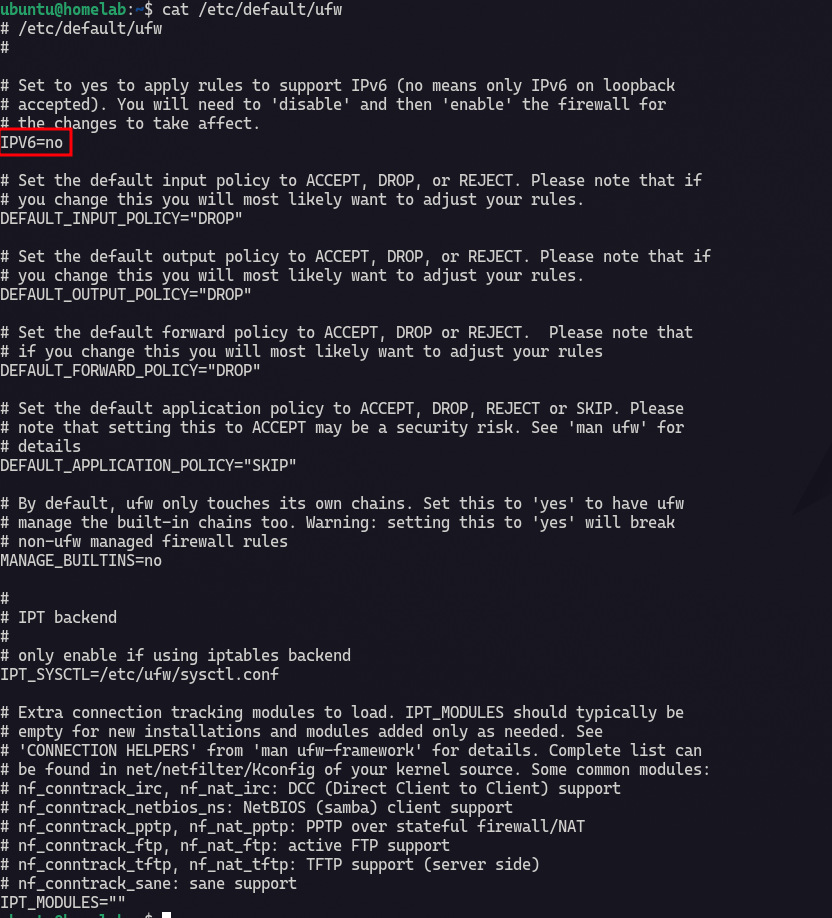
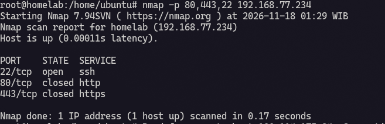

# Build a Homelab with Linux and Docker on a Single Laptop

On this homelab, I will use VM for demo. Please set a VM on VirtualBox, Qemu or others plaform by yourself. For resources :

| Resources | Specs |
| ----- | ----- |
| CPU | 4 core |
| RAM | 6 GB |
| Storage | 100 GB |

## Firewall rules set up using `ufw`

On our first step is setting up firewal, I will leverage `ufw` or Uncomplicated Firewall, it is interface of `iptables` designed to use easily rather than using a long and complicated command on `iptables`. This tool does not require a complicated learning curve as `ufw` is designed to easily to use on production server - source [Digital Ocean](https://www.digitalocean.com/community/tutorials/how-to-set-up-a-firewall-with-ufw-on-ubuntu#introduction).    

### Disable IPv6 

Disable IPv6 in `/etc/default/ufw` then change `IPV6=yes` becomes `IPV6=no`.



```bash
sudo ufw enable
```

{/* truncate */}

activate default rules :

```bash
sudo ufw default deny incoming
sudo ufw default deny outgoing
```

:::caution
Remeber our default firewal deny all incoming and outgoing connection so we should keep in mind that set outgoing port using `ufw allow in/out port`, for example :

```bash
sudo ufw allow in 80/tcp
sudo ufw allow in 443/tcp
sudo ufw allow out 80/tcp
sudo ufw allow out 443/tcp
```

Make sure you just open required ports.

:::

### Open Required Ports

These are some ports that commonly open, if you have your preference you can change by your need :

| Service | Ports | Action | Description |
| ----- | ----- | ----- | ----- |
| SSH | 22 | Allow In | Allow ssh connection from any outside network |
| HTTP | 80 | Allow In & out | Allow bidirectional connection to response & request  |
| HTTPS | 443 | Allow In & out | Allow bidirectional connection to response & request |
| DNS | 53 | Allow Out | Allow DNS query |
| NTP Sync | 123/udp | Allow Out | Allow NTP Synconization |

This is command in `ufw`, giving user easier to laverage `iptables` tools. `ufw` is frontend of `iptables`.

```bash
sudo ufw allow OpenSSH
sudo ufw allow in 80/tcp
sudo ufw allow in 443/tcp
sudo ufw allow out 80/tcp
sudo ufw allow out 443/tcp
sudo ufw allow 123/udp
sudo ufw allow 53
```

### Test using `nmap`

To make sure, We can easily test our ports server using `nmap` tools, like this :

```bash
nmap -p 80,443,22 192.168.77.234
```

