## What is Vault ?

## Installation

For installation on this docs, I refer to the official documentation of [vault](https://developer.hashicorp.com/vault/install).

First thing first, We should download HashiCorp's public signing key and print the downloaded content to standard output. After that, converting the text-formatted key into a binary keyring and saving the converted key to `/usr/share/keyrings/hashicorp-archive-keyring.gpg`.

```bash
wget -O - https://apt.releases.hashicorp.com/gpg | sudo gpg --dearmor -o /usr/share/keyrings/hashicorp-archive-keyring.gpg
```

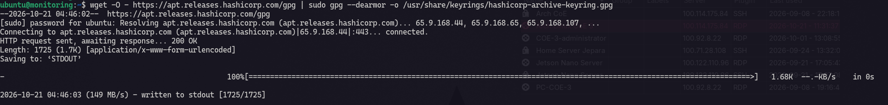

Then, add hashicorp repository into source list.

```bash
echo "deb [arch=$(dpkg --print-architecture) signed-by=/usr/share/keyrings/hashicorp-archive-keyring.gpg] https://apt.releases.hashicorp.com $(grep -oP '(?<=UBUNTU_CODENAME=).*' /etc/os-release || lsb_release -cs) main" | sudo tee /etc/apt/sources.list.d/hashicorp.list
```

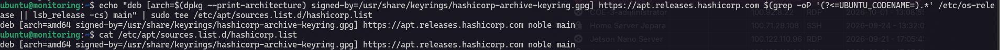

Now let's update package info and install vault.

```bash
sudo apt update && sudo apt install vault
```

**Verifi Vault Installation*** 

```bash
vault --version
```

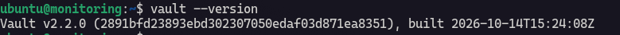

**Start Vault Dev Server**

```bash
vault server -dev -dev-root-token-id="root"
```

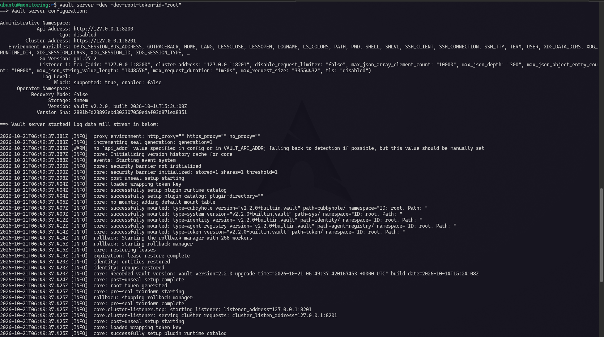

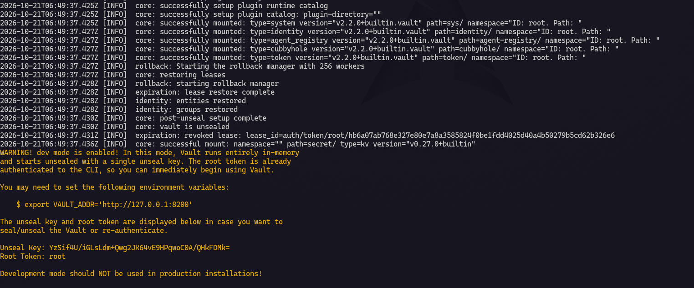

Do not open in browser, you need to export these two environment variable

```
export VAULT_ADDR='http://127.0.0.1:8200'
export VAULT_TOKEN='root'
```

Then hit this command :

```bash
vault status
```

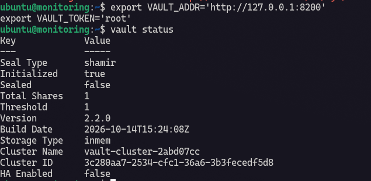

Login Vault UI and paste root token from terminal.

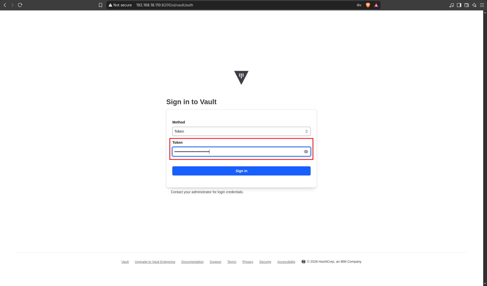

This is Vault dashboard

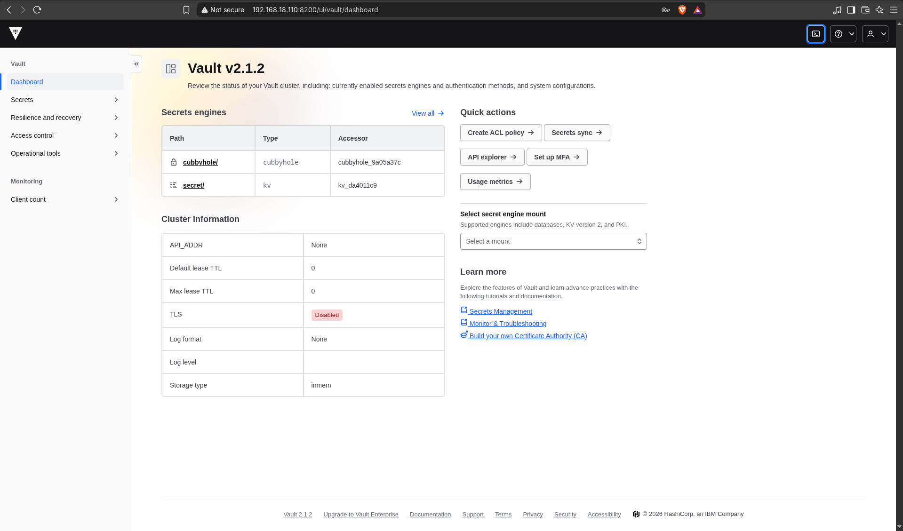

## Configure Vault Database Secrets Engine

**Enable the Database Secrets Engine**

```bash
vault secrets enable database
```

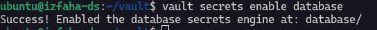

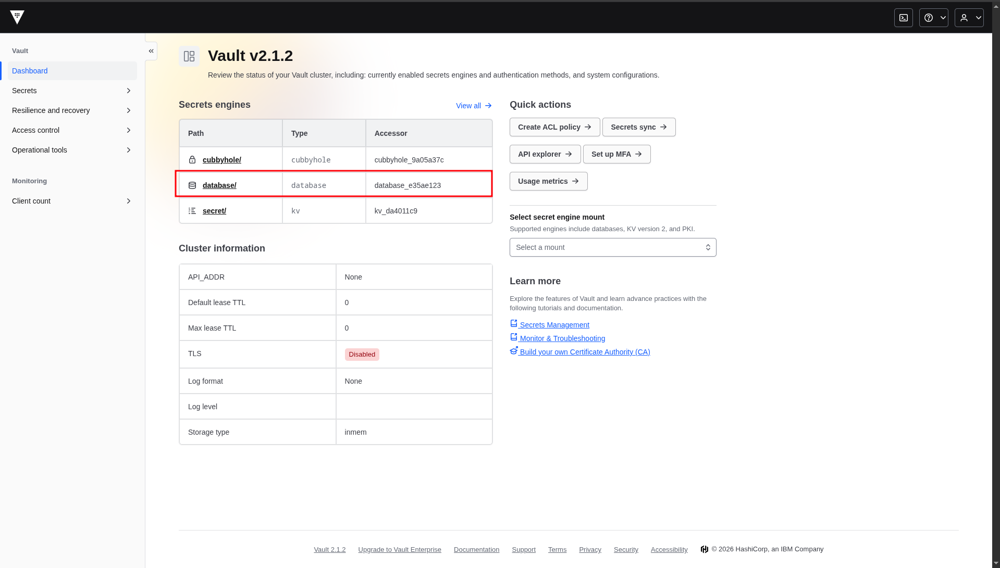

**Configure the Database Connection**

```bash
vault write database/config/mariadb \
  plugin_name=mysql-database-plugin \
  connection_url="{{username}}:{{password}}@tcp(192.168.18.110:3306)/" \
  allowed_roles="*" \
  username="root" \
  password="root"
```

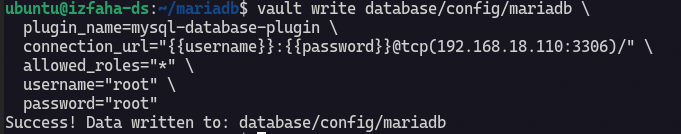

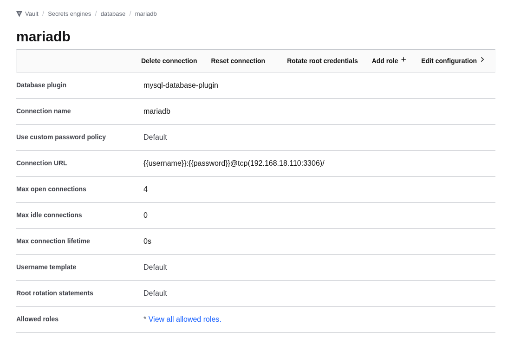

**Create an Admin Role**

```bash
vault write database/roles/db-admin \
  db_name=mariadb \
  creation_statements="CREATE USER '{{name}}'@'%' IDENTIFIED BY '{{password}}';" \
  creation_statements="GRANT ALL PRIVILEGES ON *.* TO '{{name}}'@'%';" \
  revocation_statements="DROP USER '{{name}}'@'%';" \
  default_ttl="1h" \
  max_ttl="1h"
```

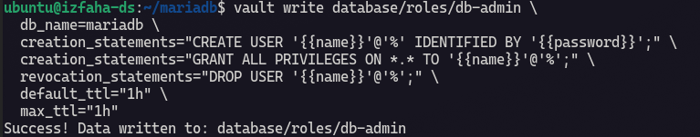

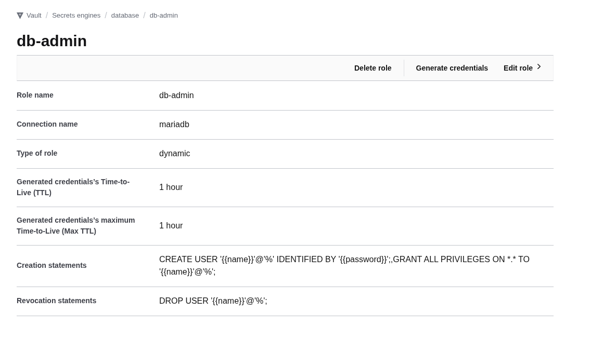

**Create a Read-Only Role**

```bash
vault write database/roles/db-read-only \
  db_name=mariadb \
  creation_statements="CREATE USER '{{name}}'@'%' IDENTIFIED BY '{{password}}';" \
  creation_statements="GRANT SELECT ON *.* TO '{{name}}'@'%';" \
  revocation_statements="DROP USER '{{name}}'@'%';" \
  default_ttl="1h" \
  max_ttl="1h"
```

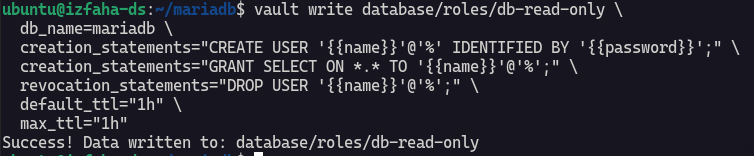

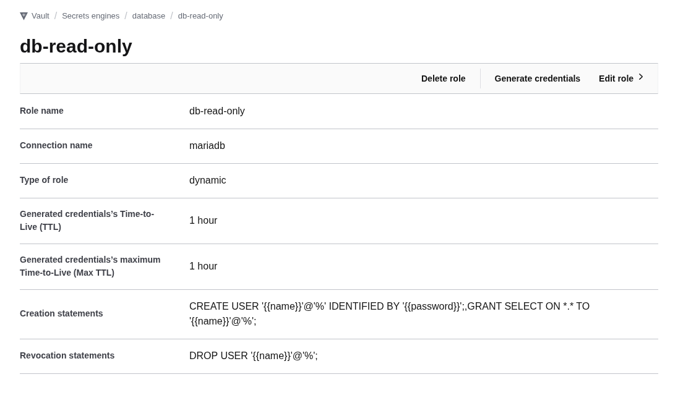

**Generate Dynamic Credentials**

Admin credentials:

```bash
vault read database/creds/db-admin
```

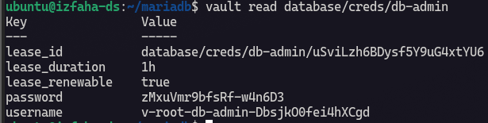

Read-only credentials:

```bash
vault read database/creds/db-read-only
```

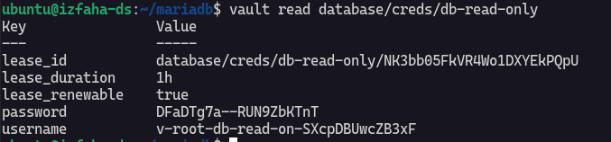

**Verify the Credentials**

```bash
mariadb -h 192.168.18.110 \
  -u v-root-db-read-on-SXcpDBUwcZB3xF \
  -p DFaDTg7a--RUN9ZbKTnT \
  -e "SHOW DATABASES;"
```

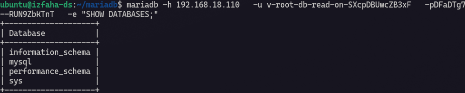

**Lease Management & Manual Revocation**

List Active Leases :

```bash
vault list sys/leases/lookup/database/creds/db-read-only
```

Revoke a Specific Lease Early :

```bash
vault lease revoke database/creds/db-read-only/<lease_id>
```

Revoke All Leases for a Role :

```bash
vault lease revoke -prefix database/creds/db-read-only/
```