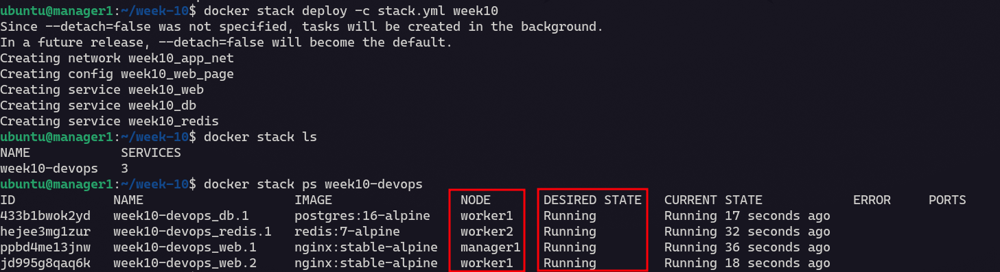
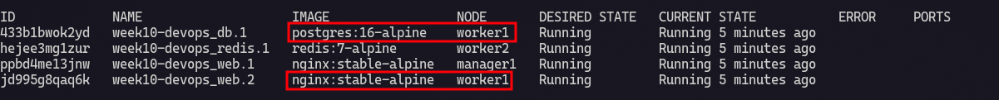
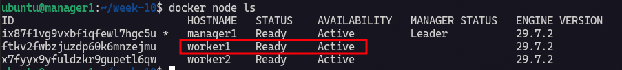
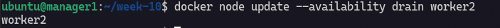
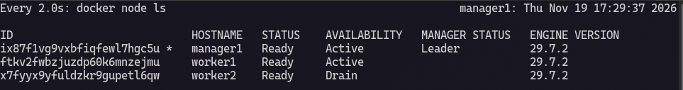
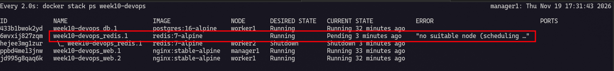
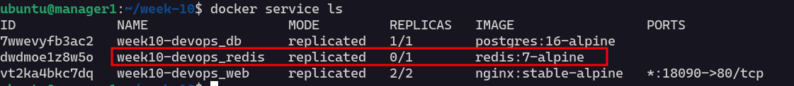

# Network dan Rescheduling Docker Swarm


Pada lab ini, saya membuat stack baru bernama `week10-devops` berdasarkan latihan [Pekan 10](/docs/internship-btik/pekan-10.md). Perubahannya meliputi pemisahan jaringan `frontend` dan `backend`, pengaturan *resource reservation* dan *limit*, serta pengamatan perilaku service ketika `worker2` di-*drain*.

Seluruh perintah pengelolaan Swarm dijalankan dari `manager1`.

## Merubah `stack.yml`

```yaml
version: "3.8"

services:
  web:
    image: nginx:stable-alpine
    ports:
      - "18090:80"
    configs:
      - source: web_page
        target: /usr/share/nginx/html/index.html
    networks:
      - frontend
      - backend
    deploy:
      replicas: 2
      resources:
        reservations:
          cpus: "0.10"
          memory: 32M
        limits:
          cpus: "0.50"
          memory: 128M

  db:
    image: postgres:16-alpine
    environment:
      POSTGRES_USER: labdb
      POSTGRES_DB: labdb
      POSTGRES_PASSWORD_FILE: /run/secrets/pg_password
    secrets:
      - pg_password
    volumes:
      - pg_data:/var/lib/postgresql/data
    networks:
      - backend
    deploy:
      replicas: 1
      placement:
        constraints:
          - node.labels.workload == database
      resources:
        reservations:
          cpus: "0.25"
          memory: 128M
        limits:
          cpus: "1.00"
          memory: 512M

  redis:
    image: redis:7-alpine
    networks:
      - backend
    deploy:
      replicas: 1
      placement:
        constraints:
          - node.labels.workload == redis
      resources:
        reservations:
          cpus: "0.10"
          memory: 32M
        limits:
          cpus: "0.50"
          memory: 128M

networks:
  frontend:
    driver: overlay
  backend:
    driver: overlay

volumes:
  pg_data:

configs:
  web_page:
    file: ./index.html

secrets:
  pg_password:
    external: true
    name: week10_pg_password
```

Service `web` mengikuti jaringan `frontend` dan `backend`, sedangkan `db` serta `redis` hanya mengikuti `backend`. Pemisahan ini menentukan jaringan yang dapat diikuti tiap service. Halaman Nginx masih berupa halaman statis dan belum mengakses PostgreSQL atau Redis.

Pada setiap service, `reservations` menyatakan kebutuhan resource yang diperhitungkan Swarm saat menjadwalkan task. `limits` menetapkan batas pemakaian resource container. Nilai pada file ini digunakan untuk kebutuhan lab, bukan hasil pengukuran kebutuhan aplikasi.

PostgreSQL dibatasi ke node berlabel `workload=database`, sementara Redis dibatasi ke node berlabel `workload=redis`. Label tersebut sudah diberikan kepada `worker1` dan `worker2` pada latihan Bersama.

:::caution
Perhatikan path `/run/secrets/pg_password`: direktori yang benar adalah `secrets`, dengan huruf **s** di akhir. Saat percobaan sebelumnya, saya salah menulis path tersebut sehingga PostgreSQL tidak dapat menemukan file password. Jika task gagal berjalan, periksa kembali path, nama secret, dan output `docker stack ps`.
:::


Saya akan menggunakan `index.html` yang saya pakai di [pekan 10](/docs/internship-btik/pekan-10.md#menyiapkan-halaman-web-dan-secret). Untuk secrets akan tetap menggunakan yg sudah ada di `docker secret ls` begitu juga config.

## Re-deploy dan verifikasi

Dari direktori yang berisi `stack.yml` dan `index.html`, saya menjalankan:

```bash
docker stack deploy -c stack.yml week10-devops
```

Nama `week10-devops` adalah nama stack. Docker Swarm akan memberi awalan tersebut pada nama service dan resource yang dibuat oleh stack.

Saya memeriksa status service dan lokasi task:

```bash
docker stack services week10-devops
docker stack ps week10-devops

# ini untuk mengecheck netwok yg ber driver overlay saja
docker network ls

# Ini untuk mengecheck request ke web server
curl http://192.168.56.10:18090
```



## Drain `worker2`

Pada kondisi awal, Redis diharapkan berjalan di `worker2` karena hanya node tersebut yang memiliki label `workload=redis`.





:::note
Untuk drain yg vm `worker2` bukan yg `worker1` sorry :p.
:::

```bash
docker node update --availability drain worker2
```



```bash
docker node ls
```



```bash 
docker stack ps week10-devops
```



```bash
docker services ls
```


:::note
Jika ingin mengaktifkan `worker2` jalankan command `docker node update --availability active worker2`.
:::

## Kesimpulan

Percobaan ini menunjukkan bahwa *rescheduling* tetap mengikuti aturan penempatan service. Swarm dapat memindahkan task ke node lain jika ada node yang memenuhi syarat. Ketika `worker2` di-*drain*, Redis kehilangan satu-satunya node yang sesuai dengan placement constraint sehingga tidak dapat segera dijalankan kembali. Task Redis dapat dijadwalkan setelah `worker2` kembali `Active`.