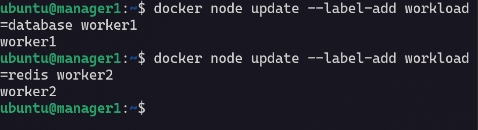
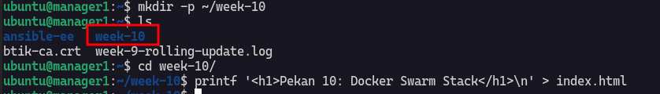
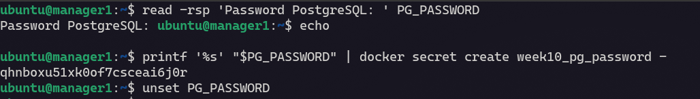
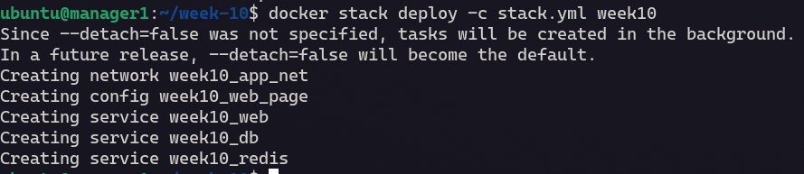
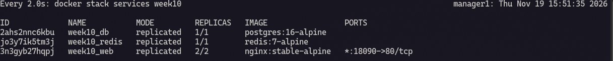
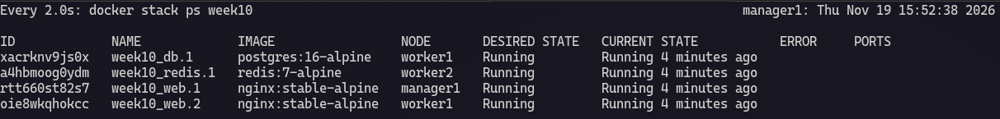
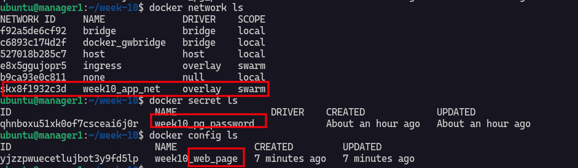
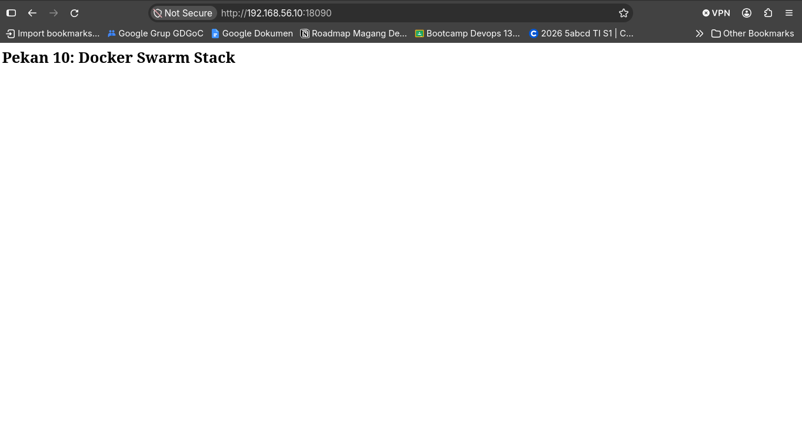

# Stack Deploy dan Overlay Network

Pada pekan ini, saya menjalankan tiga service dalam satu Docker Swarm stack: Nginx, PostgreSQL, dan Redis. Saya juga menggunakan *overlay network* untuk jaringan antarnode, Docker secret untuk password database, Docker config untuk halaman web, serta label node untuk mengatur penempatan service.

Seluruh perintah pengelolaan stack dijalankan dari `manager1`, yaitu manager pada cluster Swarm yang dibuat pada pekan sebelumnya.

## Memberi label pada worker

Saya memberi label `workload=database` pada `worker1` dan `workload=redis` pada `worker2`:

```bash
docker node update --label-add workload=database worker1
docker node update --label-add workload=redis worker2
```



Untuk memastikan label sudah tersimpan, saya memeriksa spesifikasi kedua node:

```bash
docker node inspect worker1 --format '{{json .Spec.Labels}}'
docker node inspect worker2 --format '{{json .Spec.Labels}}'
```


Label tersebut akan dipakai oleh *placement constraint*. Nantinya, PostgreSQL hanya dapat dijadwalkan pada node berlabel `workload=database`, sedangkan Redis pada node berlabel `workload=redis`.

## Menyiapkan halaman web dan secret

Saya membuat direktori kerja `week-10` dan halaman HTML sederhana untuk menguji service Nginx:

```bash
mkdir -p ~/week-10
cd ~/week-10

printf '<h1>Pekan 10: Docker Swarm Stack</h1>\n' > index.html
```



File `index.html` akan diberikan kepada service Nginx melalui **Docker config**. Dengan cara ini, isi halaman tidak perlu disalin secara manual ke setiap worker.

Selanjutnya, saya membuat **Docker secret** untuk password PostgreSQL:

```bash
read -rsp 'Password PostgreSQL: ' PG_PASSWORD
echo
printf '%s' "$PG_PASSWORD" | docker secret create week10_pg_password -
unset PG_PASSWORD
```



Opsi `-s` pada `read` membuat password tidak terlihat saat diketik. Tanda `-` pada `docker secret create` berarti isi secret dibaca dari *standard input*. Setelah secret dibuat, variabel `PG_PASSWORD` dihapus dari sesi shell dengan `unset`.

## Membuat file `stack.yml`

Berikut isi file `~/week-10/stack.yml`:

```yaml title="stack.yml"
version: "3.8"

services:
  web:
    image: nginx:stable-alpine
    ports:
      - "18090:80"
    configs:
      - source: web_page
        target: /usr/share/nginx/html/index.html
    networks:
      - app_net
    deploy:
      replicas: 2

  db:
    image: postgres:16-alpine
    environment:
      POSTGRES_USER: labdb
      POSTGRES_DB: labdb
      POSTGRES_PASSWORD_FILE: /run/secrets/pg_password
    secrets:
      - pg_password
    volumes:
      - pg_data:/var/lib/postgresql/data
    networks:
      - app_net
    deploy:
      replicas: 1
      placement:
        constraints:
          - node.labels.workload == database

  redis:
    image: redis:7-alpine
    networks:
      - app_net
    deploy:
      replicas: 1
      placement:
        constraints:
          - node.labels.workload == redis

networks:
  app_net:
    driver: overlay

volumes:
  pg_data:

configs:
  web_page:
    file: ./index.html

secrets:
  pg_password:
    external: true
    name: week10_pg_password
```

Beberapa bagian penting dari file tersebut:

| Konfigurasi | Fungsi |
|---|---|
| `replicas: 2` pada `web` | Menjalankan dua task Nginx. |
| `app_net` dengan driver `overlay` | Menyediakan jaringan untuk service yang dapat berjalan di node berbeda. |
| `configs.web_page` | Memasang `index.html` ke dalam container Nginx. |
| `POSTGRES_PASSWORD_FILE` | Meminta PostgreSQL membaca password dari file secret. |
| `pg_data` | Menyimpan data PostgreSQL di volume Docker. |
| `placement.constraints` | Membatasi node tempat task database dan Redis dijalankan. |

Nama `pg_password` di bagian service adalah nama secret **di dalam container**, sehingga path-nya menjadi `/run/secrets/pg_password`. Sementara itu, `week10_pg_password` adalah nama secret yang sudah dibuat di Swarm.

## Deploy dan verifikasi stack

Dari direktori `~/week-10`, saya menjalankan:

```bash
docker stack deploy -c stack.yml week10
```

Perintah tersebut membuat service dan resource lain yang didefinisikan dalam `stack.yml`. Nama `week10` menjadi nama stack sekaligus awalan nama servicenya, misalnya `week10_web`.



Saya memeriksa jumlah replica yang berjalan:

```bash
docker stack services week10
```

Pada kondisi yang diharapkan, service `web` menunjukkan `2/2`, sedangkan `db` dan `redis` masing-masing `1/1`.



Kemudian saya melihat task beserta node tempatnya dijalankan:

```bash
docker stack ps week10
```

Melalui kolom `NODE`, saya dapat memeriksa apakah PostgreSQL berjalan di `worker1` dan Redis di `worker2`, sesuai label dan *placement constraint* yang telah ditetapkan.



Saya juga memeriksa resource Swarm yang digunakan oleh stack:

```bash
docker network ls
docker secret ls
docker config ls
```

Perintah tersebut masing-masing menampilkan daftar network, secret, dan config. Untuk stack ini, nama network dan config biasanya mendapat awalan `week10_`, sedangkan secret tetap bernama `week10_pg_password` karena dideklarasikan sebagai resource eksternal.



Terakhir, saya membuka halaman web melalui alamat manager:

```text
http://192.168.56.10:18090
```

Jika halaman menampilkan teks **“Pekan 10: Docker Swarm Stack”**, berarti Nginx berhasil menyajikan file `index.html` yang dipasang melalui Docker config.



:::note
Untuk melihat stack bisa menggunakan command `docker stack ls` atau `docker stack ps nama_stack`. Ketika ingin menghapus stack cukup ketik `docker stack rm nama_stack`.
:::

## Kesimpulan

Melalui satu file `stack.yml`, saya dapat mendeklarasikan dan menjalankan beberapa service di cluster Docker Swarm. Overlay network menyediakan jaringan antarnode, sedangkan label node dan placement constraint menentukan lokasi task. Docker config digunakan untuk halaman web dan Docker secret digunakan untuk password PostgreSQL.

Pada lab ini, Nginx masih menyajikan halaman statis; halaman tersebut **belum melakukan query ke PostgreSQL atau Redis**. Volume `pg_data` juga menggunakan penyimpanan lokal pada node tempat database berjalan. Karena itu, constraint PostgreSQL perlu dipertahankan agar task tidak berpindah ke node lain dengan volume lokal yang berbeda.