# Upload Bersama dan Uji Performa NFS

Pada [lab Pekan 11](/docs/internship-btik/pekan-11), saya sudah menyiapkan NFS server di VM `infra` (`192.168.56.13`). Kali ini saya menggunakan penyimpanan tersebut untuk aplikasi upload yang berjalan sebagai tiga replika di Docker Swarm. Saya juga menguji kecepatan baca dan tulis NFS menggunakan `fio`.

## Membuat aplikasi upload

Di VM `manager1`, siapkan direktori kerja dan buat `index.php`:

```bash
mkdir -p ~/week-11-devops
cd ~/week-11-devops
vim index.php
```

Isi `index.php`:

```php title="index.php"
<?php
$message = '';

if ($_SERVER['REQUEST_METHOD'] === 'POST' && isset($_FILES['upload'])) {
    $file = $_FILES['upload'];

    if ($file['error'] !== UPLOAD_ERR_OK) {
        $message = 'Upload gagal. Kode error: ' . $file['error'];
    } else {
        $name = preg_replace('/[^a-zA-Z0-9._-]/', '_', basename($file['name']));
        $name = bin2hex(random_bytes(4)) . '-' . $name;

        if (move_uploaded_file($file['tmp_name'], '/data/' . $name)) {
            $message = 'Berhasil disimpan: ' . $name;
        } else {
            $message = 'Gagal menulis file ke volume NFS.';
        }
    }
}

$files = array_diff(scandir('/data'), ['.', '..']);
?>
<!doctype html>
<html lang="id">
<head>
    <meta charset="utf-8">
    <title>Upload NFS</title>
</head>
<body>
    <h1>Upload file ke NFS</h1>
    <p>Hostname container: <?= htmlspecialchars(gethostname()) ?></p>
    <p><?= htmlspecialchars($message) ?></p>

    <form method="post" enctype="multipart/form-data">
        <input type="file" name="upload" required>
        <button type="submit">Upload</button>
    </form>

    <h2>File di NFS</h2>
    <ul>
        <?php foreach ($files as $file): ?>
            <li><?= htmlspecialchars($file) ?></li>
        <?php endforeach; ?>
    </ul>
</body>
</html>
```

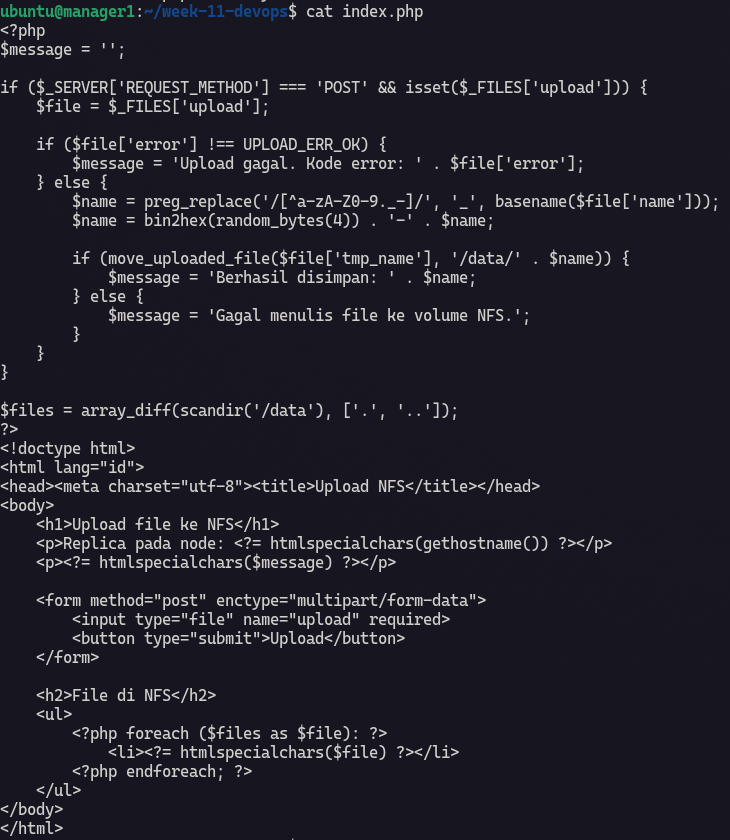

Aplikasi menerima file dari formulir, memberi awalan acak pada nama file agar tidak mudah bertabrakan, lalu menyimpannya ke `/data`. Direktori `/data` nantinya dihubungkan ke NFS. Daftar file dibaca kembali dari direktori yang sama. Ini aplikasi sederhana untuk kebutuhan lab, bukan rancangan aplikasi upload produksi.

Teks *Hostname container* membantu menunjukkan container yang melayani halaman. Nilainya **bukan** nama VM tempat container berjalan.

## Membuat Dockerfile

Buat `Dockerfile` di direktori yang sama:

```dockerfile title="Dockerfile"
FROM php:8.3-cli-alpine

COPY index.php /app/index.php
USER 1000:1000

CMD ["php", "-d", "upload_max_filesize=10M", "-d", "post_max_size=11M", "-S", "0.0.0.0:8080", "-t", "/app"]
```

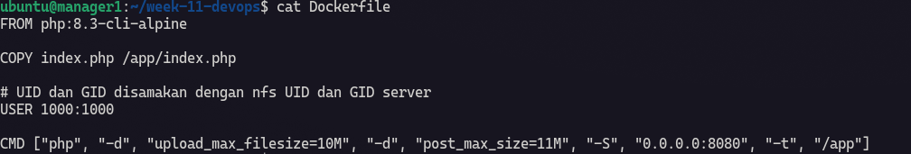

Image ini menjalankan aplikasi dengan PHP built-in server pada port `8080`. Proses berjalan sebagai UID dan GID `1000:1000`, sesuai kepemilikan direktori yang telah saya atur pada NFS server. Kesesuaian UID/GID diperlukan agar proses di dalam container dapat menulis ke direktori NFS.

## Build dan push image

Masih di VM `manager1`, login ke private registry, lalu build image:

```bash
docker login registry.btik.lab:5000
docker build -t registry.btik.lab:5000/lab/upload-nfs:w11 .
```

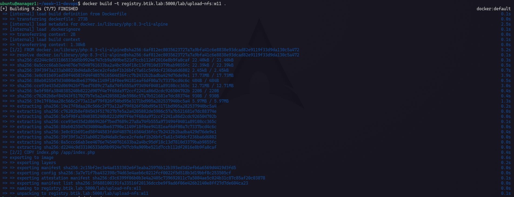

Tag `w11` menunjukkan image yang digunakan untuk lab Pekan 11. Setelah build selesai, kirim image ke registry pada VM `infra`:

```bash
docker push registry.btik.lab:5000/lab/upload-nfs:w11
```

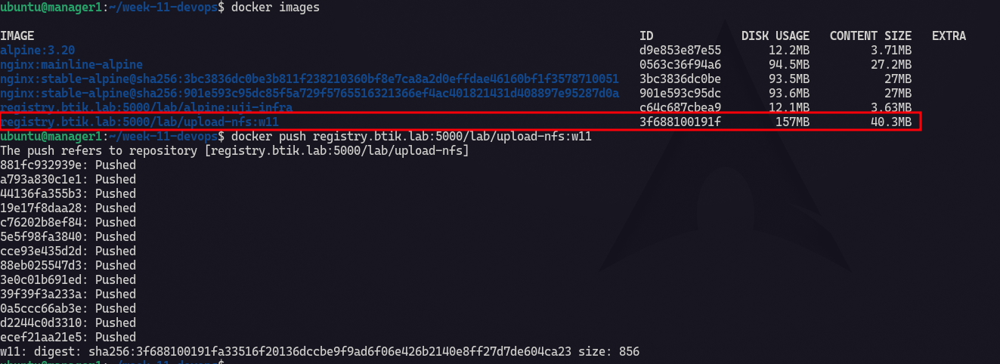

Node Swarm akan mengambil image ini ketika menjalankan task. Karena registry menggunakan autentikasi, kredensial registry juga perlu diteruskan saat deploy.

## Membuat dan menjalankan stack

Buat file berikut di `~/week-11-devops/stack.yml`:

```yaml title="stack.yml"
version: "3.8"

services:
  upload:
    image: registry.btik.lab:5000/lab/upload-nfs:w11
    ports:
      - "18082:8080"
    volumes:
      - shared_data:/data
    deploy:
      replicas: 3

volumes:
  shared_data:
    driver: local
    driver_opts:
      type: nfs
      o: "addr=192.168.56.13,nfsvers=4,rw"
      device: ":/srv/shared-data"
```

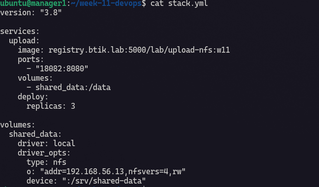

Service `upload` meminta tiga replika. Port `18082` digunakan untuk mengakses aplikasi dari luar Swarm, sedangkan aplikasi di dalam container mendengarkan port `8080`. Volume `shared_data` memasang export NFS dari VM `infra` ke `/data` pada setiap container.

:::caution
Opsi NFS harus ditulis `nfsvers=4`, bukan `nfs_server=4`. Saat saya salah menulis opsi tersebut, task berstatus `Rejected` dengan pesan `invalid argument` ketika Docker mencoba memasang volume.

Jika volume Docker sudah telanjur dibuat menggunakan opsi yang salah, memperbaiki `stack.yml` saja mungkin belum mengubah opsi pada volume lama. Periksa dengan `docker volume inspect week11-devops_shared_data` di node terkait sebelum menentukan langkah perbaikannya.
:::

Deploy stack dari VM `manager1`:

```bash
docker stack deploy --with-registry-auth -c stack.yml week11-devops
```

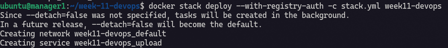

Opsi `--with-registry-auth` meneruskan informasi login registry agar node Swarm dapat mengambil image aplikasi.

Periksa statusnya:

```bash
docker stack services week11-devops
docker service ps week11-devops_upload
```

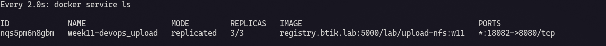

Targetnya adalah `3/3` pada kolom `REPLICAS`. Perintah `docker service ps` juga menunjukkan node tempat masing-masing task berjalan. **Tiga replika tidak otomatis berarti satu replika berada di setiap node**; lokasi aktualnya harus dilihat dari hasil perintah tersebut.

## Upload dan memeriksa data bersama

Buka `http://192.168.56.10:18082` dari browser, pilih sebuah file, lalu klik **Upload**.

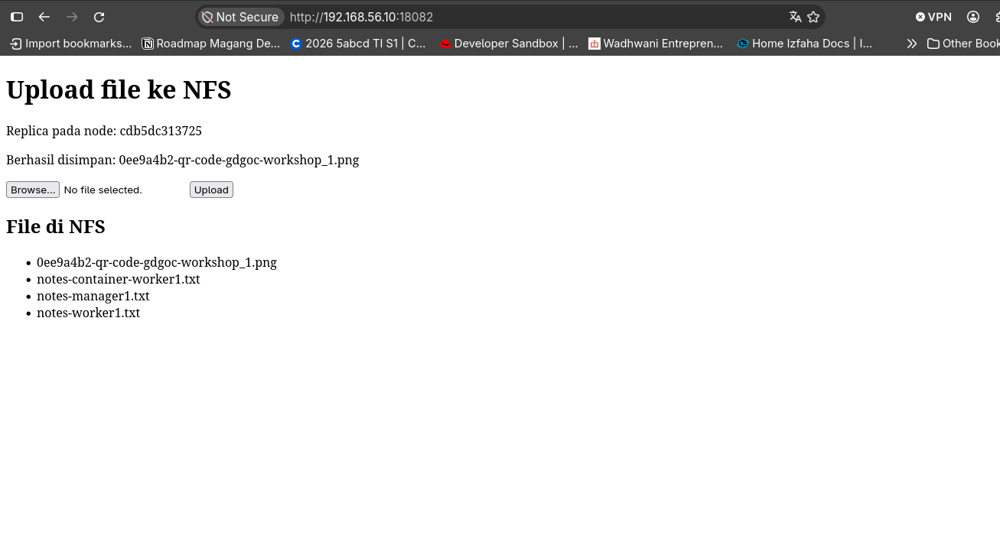

Setelah upload berhasil, periksa file pada NFS server di VM `infra`:

```bash
ls -lh /srv/shared-data
```

Untuk membuktikan bahwa replika lain membaca file yang sama, lihat dulu penempatan task melalui `docker service ps week11-devops_upload`. Masuk ke node yang menjalankan task, cari container aplikasinya, lalu lihat isi `/data`:

```bash
docker ps --filter label=com.docker.swarm.service.name=week11-devops_upload
docker exec 0c38734bb447 ls -lh /data
```

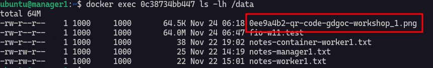

Pada gambar diatas yg menjalankan ke 3 replica adalah node `manager1`. Jika file upload yang sama terlihat dari container-container tersebut, berarti replika menggunakan data bersama dari export NFS. Mengakses halaman berkali-kali lewat browser saja belum memastikan request mengenai setiap replika, karena Swarm dapat mengarahkan request ke container yang berbeda.

## Mengukur baca dan tulis NFS dengan fio

Pengujian berikut dijalankan di VM `manager1`, dengan asumsi export NFS sudah terpasang di `/srv/shared-data`. Pastikan terlebih dahulu:

```bash
findmnt --mountpoint /srv/shared-data
```

Saya menggunakan file uji `fio-w11.test` berukuran 64 MiB, ukuran blok 1 MiB, dan satu proses. File ini terpisah dari file upload aplikasi.

### Uji tulis

```bash
fio --name=nfs-write \
  --filename=/srv/shared-data/fio-w11.test \
  --size=64M \
  --bs=1M \
  --rw=write \
  --ioengine=sync \
  --end_fsync=1 \
  --output="$HOME/w11-fio-test.txt"

cat "$HOME/w11-fio-test.txt"
```

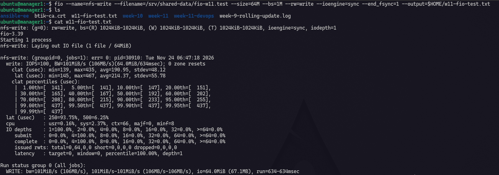

Pada percobaan saya, `fio` melaporkan `err=0`, `BW=101MiB/s`, `IOPS=100`, dan waktu pengujian sekitar `634 ms`. Artinya, pengujian berhasil dan laju transfer yang **terukur pada percobaan ini** sekitar 101 MiB/s. `--end_fsync=1` meminta sinkronisasi file setelah penulisan selesai.

### Uji baca

Gunakan file yang dibuat pada uji tulis:

```bash
fio --name=nfs-read \
  --filename=/srv/shared-data/fio-w11.test \
  --size=64M \
  --bs=1M \
  --rw=read \
  --ioengine=sync \
  --direct=1 \
  --output="$HOME/w11-fio-test-read.txt"

cat "$HOME/w11-fio-test-read.txt"
```

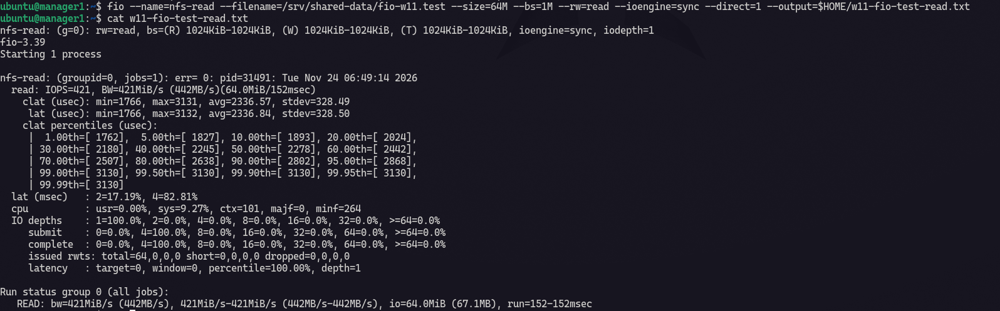

Pada percobaan saya, `fio` melaporkan `err=0`, `BW=421MiB/s`, `IOPS=421`, dan waktu pengujian sekitar `152 ms`. Opsi `--direct=1` meminta I/O langsung di sisi klien, tetapi hasil baca tetap dapat dipengaruhi cache di sisi NFS server. Karena file ujinya hanya 64 MiB dan baru saja ditulis, angka **421 MiB/s tidak dapat dianggap sebagai kecepatan disk fisik NFS server**.

| Pengujian | Data | Bandwidth terukur | IOPS | Durasi |
| --- | ---: | ---: | ---: | ---: |
| Tulis | 64 MiB | 101 MiB/s | 100 | 634 ms |
| Baca | 64 MiB | 421 MiB/s | 421 | 152 ms |

Angka di tabel adalah hasil satu kali pengujian pada kondisi lab ini, bukan jaminan performa NFS secara umum. Untuk evaluasi yang lebih mewakili beban aplikasi, ukuran data, pola akses, jumlah proses, dan pengulangan pengujian perlu disesuaikan dengan penggunaan sebenarnya.

Setelah selesai, hapus **hanya file uji fio**:

```bash
rm /srv/shared-data/fio-w11.test
```

## Kesimpulan

Tiga replika aplikasi dapat menggunakan direktori NFS yang sama untuk menyimpan dan membaca file upload. NFS membantu menjaga file tetap tersedia bagi task yang berjalan pada node berbeda, selama NFS server dan jaringannya dapat diakses. Pengujian `fio` memberi gambaran awal performa baca-tulis, tetapi hasil singkat dari file 64 MiB belum cukup untuk menilai performa penyimpanan pada beban produksi.