# NFS untuk Data Bersama di Docker Swarm

Pada lab ini, VM `infra` (`192.168.56.13`) berperan sebagai NFS server. Direktori yang dibagikan akan diakses oleh node Docker Swarm, lalu dipasang sebagai volume pada sebuah service.

Tujuan pengujiannya adalah memastikan file yang dibuat oleh container tetap tersedia ketika Swarm menghentikan task di `worker1` dan menjalankan task pengganti di `worker2`.

## Menyiapkan NFS server di VM `infra`

Saya memasang paket NFS server:

```bash
sudo apt-get update
sudo apt-get install -y nfs-kernel-server
```

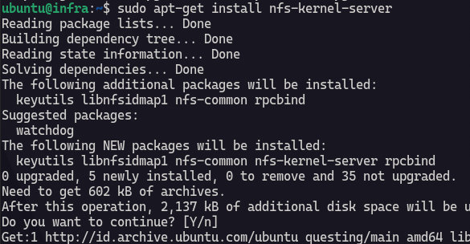

Selanjutnya, saya membuat direktori yang akan dibagikan:

```bash
sudo mkdir -p /srv/shared-data
```

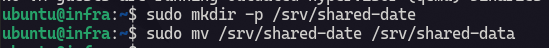

Saya menetapkan UID dan GID pemilik direktori menjadi `1000:1000`, sesuai identitas proses yang akan digunakan container pada pengujian ini:

```bash
sudo chown 1000:1000 /srv/shared-data
```


Kemudian saya mengatur permission direktori:

```bash
sudo chmod 2770 /srv/shared-data
```

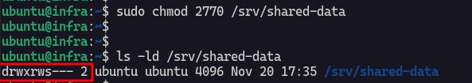

Nilai `770` memberikan akses penuh kepada pemilik dan grup, tetapi tidak kepada user lain. Angka `2` di depannya mengaktifkan bit *setgid*, sehingga file atau direktori baru mewarisi grup dari direktori induknya.

### Mengekspor direktori NFS

Saya mengizinkan node pada subnet lab `192.168.56.0/24` mengakses direktori tersebut:

```bash
echo '/srv/shared-data 192.168.56.0/24(rw,sync,no_subtree_check,root_squash)' | sudo tee /etc/exports.d/week11.exports

sudo exportfs -rav
sudo exportfs -v
```

File `/etc/exports.d/week11.exports` digunakan agar konfigurasi lab ini terpisah dari export NFS lain yang mungkin sudah ada. Perintah `exportfs -rav` menerapkan konfigurasi, sedangkan `exportfs -v` menampilkan export yang aktif.

Opsi `rw` mengizinkan baca dan tulis, `sync` meminta server menyelesaikan penulisan sebelum mengonfirmasi operasi, dan `root_squash` mencegah user root pada client memperoleh hak root pada direktori server.

## Memasang NFS pada node Swarm

Langkah berikut dilakukan pada **`manager1`, `worker1`, dan `worker2`**. Saya memasang paket NFS client dan membuat direktori mount:

```bash
sudo apt-get install -y nfs-common
sudo mkdir -p /srv/shared-data
```

Contoh instalasi pada `manager1`:

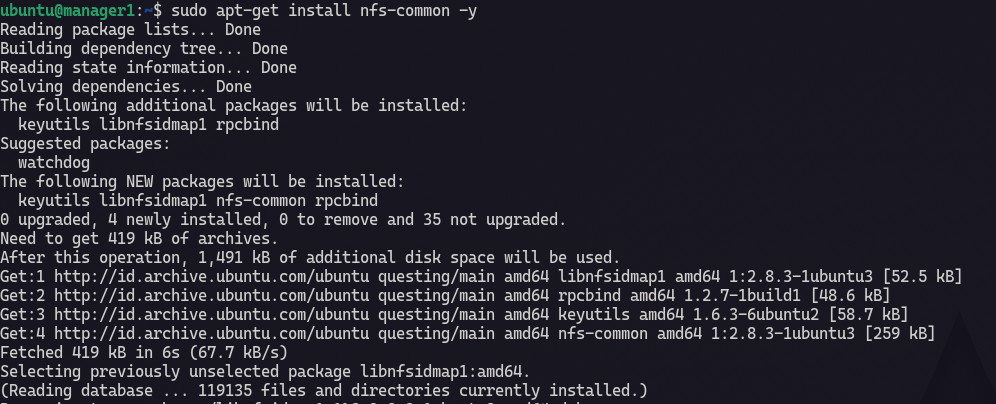


Saya memasang export dari VM `infra` ke direktori tersebut:

```bash
sudo mount -t nfs4 192.168.56.13:/srv/shared-data /srv/shared-data
```


Untuk memastikan mount berhasil dan melihat pemilik direktori dalam bentuk angka, saya menjalankan:

```bash
findmnt --mountpoint /srv/shared-data
ls -ldn /srv/shared-data
```

Output `findmnt` seharusnya menunjukkan sumber `192.168.56.13:/srv/shared-data` dengan tipe filesystem `nfs4`. Sementara itu, `ls -ldn` memperlihatkan UID dan GID direktori.

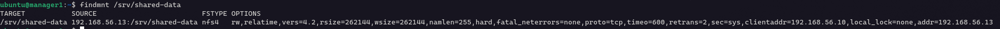

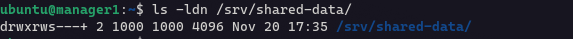

### Menguji file bersama

Dari `manager1`, saya membuat file pada direktori NFS:

```bash
echo 'Catatan dari VM manager1' > /srv/shared-data/notes-manager1.txt
```

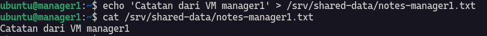

Saya juga membuat `notes-worker1.txt` dari `worker1`. Ketika saya menjalankan perintah berikut di VM `infra`, kedua file terlihat pada direktori yang sama:

```bash
ls -lh /srv/shared-data
```

Hasil ini menunjukkan bahwa `manager1` dan `worker1` mengakses data yang disimpan pada NFS server, bukan salinan direktori lokal yang terpisah.

:::caution
Mount yang dibuat dengan perintah `mount` secara manual tidak otomatis terpasang kembali setelah VM reboot. Jika ingin mount host tetap tersedia setelah reboot, tambahkan baris berikut ke `/etc/fstab` pada masing-masing node:

```text
192.168.56.13:/srv/shared-data /srv/shared-data nfs4 defaults,_netdev 0 0
```

Setelah menyimpan file, uji konfigurasinya dengan `sudo mount -a` dan periksa menggunakan `findmnt --mountpoint /srv/shared-data`. Pastikan tidak membuat entri duplikat untuk mount point yang sama.
:::

## Membuat stack dengan volume NFS

Di `manager1`, saya membuat `stack.yml` berikut:

```yaml title="stack.yml"
version: "3.8"

services:
  nfs:
    image: busybox:1.36
    user: "1000:1000"
    command: ["sh", "-c", "while true; do sleep 3600; done"]
    volumes:
      - shared_data:/data
    deploy:
      replicas: 1
      placement:
        constraints:
          - node.role == worker

volumes:
  shared_data:
    driver: local
    driver_opts:
      type: nfs
      o: "addr=192.168.56.13,nfsvers=4,rw"
      device: ":/srv/shared-data"
```

Service ini menjalankan satu task BusyBox pada node dengan role `worker`. Container berjalan sebagai UID/GID `1000:1000` dan melihat direktori NFS pada path `/data`.

Pada bagian `shared_data`, driver Docker bernama `local` digunakan **dengan opsi NFS**. Karena itu, ketika task dijalankan pada node berbeda, Docker dapat memasang export NFS yang sama pada node tempat task tersebut berjalan. Mount host `/srv/shared-data` dari langkah sebelumnya berguna untuk pengujian manual; volume Docker pada stack ini memiliki konfigurasi mount NFS sendiri.

Saya menjalankan stack dan memeriksa penempatan task:

```bash
docker stack deploy -c stack.yml week11
docker stack ps week11
```

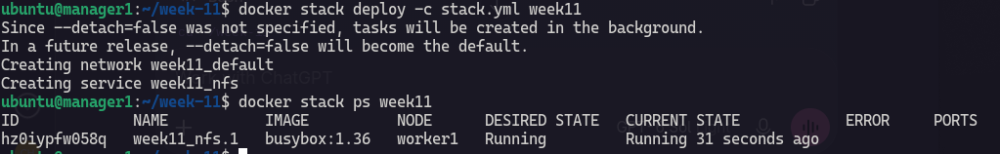

## Menguji data saat task berpindah node

Dari output `docker stack ps week11`, saya melihat bahwa task awal berjalan di `worker1`. Oleh karena itu, saya masuk ke VM `worker1` untuk mencari container milik service:

```bash
docker ps --filter label=com.docker.swarm.service.name=week11_nfs
```

Setelah mendapatkan ID container, saya membuat file melalui path `/data` di dalam container:

```bash
docker exec 4986602dfe88 sh -c 'echo "Data percobaan dari container worker1" > /data/notes-container-worker1.txt'
```

Ganti `<ID_CONTAINER>` dengan ID yang ditampilkan oleh `docker ps`. ID container dapat berubah setiap kali Swarm membuat task baru.

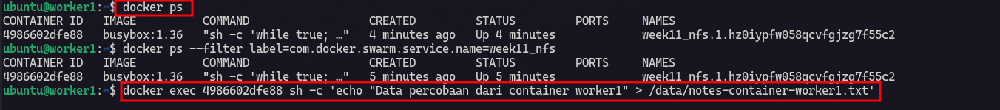

Untuk memastikan file disimpan pada NFS server, saya memeriksanya dari VM `infra`:

```bash
ls -lh /srv/shared-data
cat /srv/shared-data/notes-container-worker1.txt
```

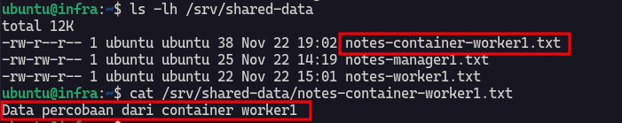

### Drain `worker1`

Sebelum drain, saya memastikan `worker2` berstatus `Ready` dan `Active`:

```bash
docker node ls
```

Dari `manager1`, saya kemudian mengubah availability `worker1` menjadi `Drain`:

```bash
docker node update --availability drain worker1
docker stack ps --no-trunc week11
```

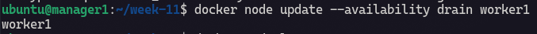

:::note
Service ini memiliki constraint `node.role == worker`. Artinya, task hanya boleh berjalan di `worker1` atau `worker2`, bukan di `manager1`. Jika `worker1` di-drain sementara `worker2` juga tidak `Ready` dan `Active`, task pengganti akan tetap `Pending` karena tidak ada node yang memenuhi syarat.

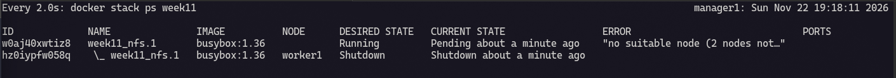
:::

Setelah `worker2` tersedia, Swarm menjalankan task pengganti di node tersebut:

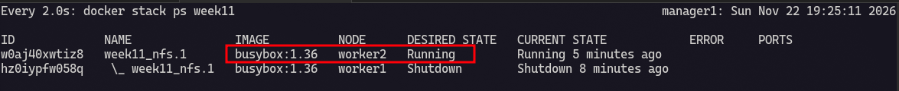

Saya masuk ke `worker2`, mencari ID container baru, lalu membaca file yang sebelumnya dibuat dari container di `worker1`:

```bash
docker ps --filter label=com.docker.swarm.service.name=week11_nfs

docker exec 51030f87be21 ls /data
docker exec 51030f87be21 cat /data/notes-container-worker1.txt
```

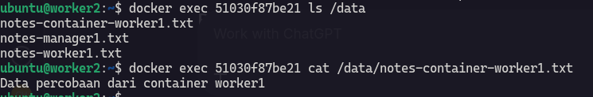

File masih dapat dibaca setelah task berpindah node. Container di `worker2` memasang direktori NFS yang sama dengan container sebelumnya di `worker1`; datanya tetap berada pada VM `infra`.

Setelah pengujian selesai, saya mengaktifkan kembali `worker1` dari `manager1`:

```bash
docker node update --availability active worker1
```

## Kesimpulan

Pengujian ini memperlihatkan perbedaan antara **task container** dan **lokasi data**. Swarm menghentikan task di `worker1` lalu membuat task baru di `worker2`, sedangkan file tetap tersimpan di NFS server `infra`. Dengan demikian, task pengganti dapat membaca file yang dibuat sebelum perpindahan node.

NFS pada skenario ini sesuai untuk berbagi file seperti upload atau aset statis. Pengujian ini belum menunjukkan bahwa NFS cocok sebagai penyimpanan data PostgreSQL yang aktif, dan VM `infra` masih menjadi titik ketergantungan bagi seluruh client NFS.