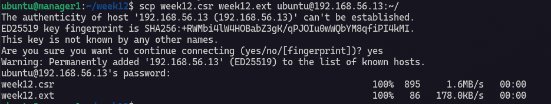
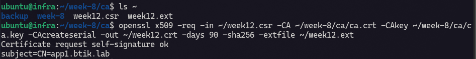
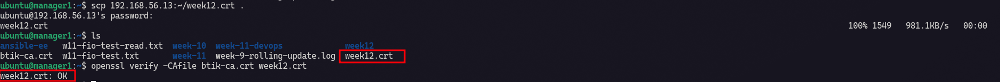
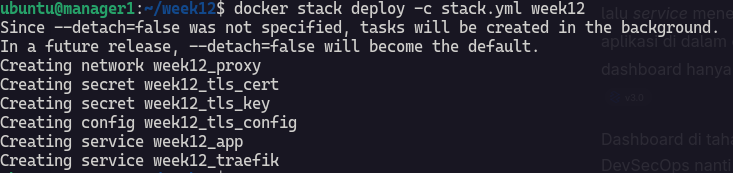
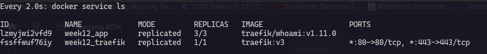
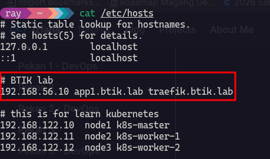
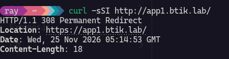
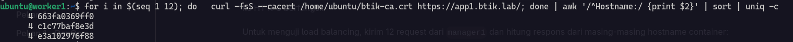
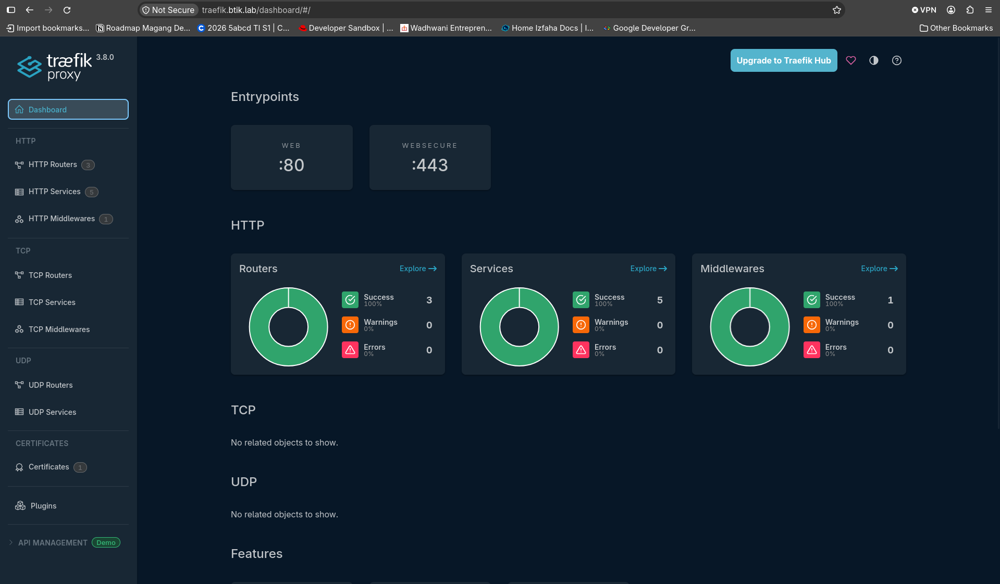

# Traefik Reverse Proxy di Docker Swarm

Pada lab Pekan 12, saya menggunakan Traefik sebagai pintu masuk ke aplikasi di Docker Swarm. Traefik mengalihkan request HTTP ke HTTPS, lalu membaca nama domain untuk menentukan tujuan request. Domain `app1.btik.lab` diarahkan ke aplikasi `whoami`, sedangkan `traefik.btik.lab` digunakan untuk mengakses dashboard.

Untuk HTTPS, saya menggunakan kembali CA internal yang sudah dibuat pada Pekan 8.

## Menandatangani sertifikat Traefik dengan CA internal

Di VM `manager1`, saya sudah menyiapkan tiga file di `~/week12`: `week12.csr` sebagai permintaan sertifikat, `week12.ext` sebagai konfigurasi ekstensi sertifikat, dan `week12.key` sebagai private key Traefik.

Saya mengirim **CSR dan file ekstensi** ke VM `infra` (`192.168.56.13`), tempat CA internal disimpan:

```bash
scp ~/week12/week12.csr ~/week12/week12.ext ubuntu@192.168.56.13:~/
```



Di VM `infra`, saya menandatangani CSR menggunakan sertifikat dan private key CA Pekan 8:

```bash
openssl x509 -req \
  -in ~/week12.csr \
  -CA ~/week-8/ca/ca.crt \
  -CAkey ~/week-8/ca/ca.key \
  -CAcreateserial \
  -out ~/week12.crt \
  -days 90 \
  -sha256 \
  -extfile ~/week12.ext
```



File `week12.ext` memuat `app1.btik.lab` dan `traefik.btik.lab` sebagai **Subject Alternative Name (SAN)**. Dengan begitu, satu sertifikat server bisa digunakan untuk kedua domain. Private key CA tetap di `infra`, sedangkan `week12.key` tetap di `manager1`.

Kembali ke `manager1`, saya mengambil sertifikat yang sudah ditandatangani dan memverifikasinya dengan `btik-ca.crt`:

```bash
scp ubuntu@192.168.56.13:~/week12.crt /home/ubuntu/week12.crt

openssl verify \
  -CAfile /home/ubuntu/btik-ca.crt \
  /home/ubuntu/week12.crt

openssl x509 -in /home/ubuntu/week12.crt -noout -ext subjectAltName
```



Hasil `week12.crt: OK` menunjukkan bahwa sertifikat server dapat diverifikasi dengan CA internal. Perintah kedua digunakan untuk memastikan kedua domain tercantum di SAN.

## Menyiapkan stack Traefik di `manager1`

Saya menyimpan `tls.yml` dan `stack.yml` di `~/week12`. File `tls.yml` memberi tahu Traefik lokasi sertifikat dan private key **di dalam container**:

```yaml title="tls.yml"
tls:
  certificates:
    - certFile: /run/secrets/week12.crt
      keyFile: /run/secrets/week12.key
```

Berikut konfigurasi stack yang digunakan:

```yaml title="stack.yml"
version: "3.8"

services:
  traefik:
    image: traefik:v3
    command:
      - "--providers.swarm.endpoint=unix:///var/run/docker.sock"
      - "--providers.swarm.exposedbydefault=false"
      - "--providers.file.filename=/tls.yml"
      - "--entrypoints.web.address=:80"
      - "--entrypoints.web.http.redirections.entrypoint.to=websecure"
      - "--entrypoints.web.http.redirections.entrypoint.scheme=https"
      - "--entrypoints.websecure.address=:443"
      - "--api.dashboard=true"
    ports:
      - "80:80"
      - "443:443"
    networks:
      - proxy
    volumes:
      - /var/run/docker.sock:/var/run/docker.sock:ro
    configs:
      - source: tls_config
        target: /tls.yml
    secrets:
      - source: tls_cert
        target: week12.crt
      - source: tls_key
        target: week12.key
    deploy:
      placement:
        constraints:
          - node.role == manager
      labels:
        - "traefik.enable=true"
        - "traefik.http.routers.w12-dashboard.rule=Host(`traefik.btik.lab`)"
        - "traefik.http.routers.w12-dashboard.entrypoints=websecure"
        - "traefik.http.routers.w12-dashboard.service=api@internal"
        - "traefik.http.routers.w12-dashboard.tls=true"
        - "traefik.http.services.w12-dashboard-dummy.loadbalancer.server.port=9999"

  app:
    image: traefik/whoami:v1.11.0
    networks:
      - proxy
    deploy:
      replicas: 3
      labels:
        - "traefik.enable=true"
        - "traefik.http.routers.w12-app.rule=Host(`app1.btik.lab`)"
        - "traefik.http.routers.w12-app.entrypoints=websecure"
        - "traefik.http.routers.w12-app.tls=true"
        - "traefik.http.services.w12-app.loadbalancer.server.port=80"

networks:
  proxy:
    driver: overlay

configs:
  tls_config:
    file: ./tls.yml

secrets:
  tls_cert:
    file: /home/ubuntu/week12.crt
  tls_key:
    file: /home/ubuntu/week12/week12.key
```

Port `80` menerima request HTTP dan mengalihkannya ke port `443` untuk HTTPS. Setelah request masuk, label `Host()` menentukan router yang dipakai. Router aplikasi meneruskan request ke port `80` milik `whoami` melalui jaringan overlay `proxy`. Router dashboard menggunakan `api@internal`; port `9999` hanya digunakan sebagai label pendamping untuk provider Swarm.

Perhatikan perbedaan lokasinya: `file: ./tls.yml` menunjuk ke file di VM, sedangkan `target: /tls.yml` adalah lokasi file yang dibaca Traefik di dalam container.

## Deploy dan periksa status service

Saya menjalankan deploy dari VM `manager1`:

```bash
cd ~/week12
docker stack deploy -c stack.yml week12
```



Setelah deploy, saya memeriksa jumlah replika:

```bash
docker stack services week12
```



Targetnya adalah `week12_traefik` **`1/1`** dan `week12_app` **`3/3`**. Jika jumlah replika belum sesuai, cek status task dan log service:

```bash
docker service ps --no-trunc week12_traefik
docker service logs --since 10m --tail 50 week12_traefik
```

## Menguji redirect, load balancing, dan dashboard

Di mesin yang digunakan untuk pengujian, arahkan kedua domain ke `manager1` lewat `/etc/hosts`:

```text
192.168.56.10 app1.btik.lab traefik.btik.lab
```



Untuk menguji redirect, saya mengirim request ke port HTTP:

```bash
curl -sSI http://app1.btik.lab/
```



Respons `308 Permanent Redirect` dengan header `Location: https://app1.btik.lab/` menunjukkan bahwa pengalihan ke HTTPS berfungsi.

Untuk menguji load balancing, kirim 12 request dari `manager1` dan hitung respons dari masing-masing hostname container:

```bash
for i in $(seq 1 12); do
  curl -fsS --cacert /home/ubuntu/btik-ca.crt https://app1.btik.lab/
done | awk '/^Hostname:/ {print $2}' | sort | uniq -c
```



Jika muncul tiga hostname berbeda, berarti ketiga replika ikut melayani request. Angka di sebelah kiri menunjukkan berapa kali masing-masing container merespons selama pengujian.

Untuk dashboard, saya menggunakan path `/dashboard/` dengan garis miring di akhir:

```bash
curl -sS --cacert /home/ubuntu/btik-ca.crt \
  -o /dev/null -w 'HTTP %{http_code}\n' \
  https://traefik.btik.lab/dashboard/
```



Dashboard pada tahap ini digunakan di jaringan lab karena belum dilindungi autentikasi.

## Kendala yang ditemui

| Gejala | Penyebab dan perbaikan |
| --- | --- |
| Traefik bertahan di `0/1` dengan log `field not found, node: enpoint` | Ada salah ketik pada flag Swarm. Saya mengganti `enpoint` menjadi `endpoint`, lalu deploy ulang. |
| File provider gagal dan `curl` melaporkan `self-signed certificate` | Traefik tidak menemukan direktori yang dipakai untuk membaca konfigurasi TLS. Saya menyamakan target config dan flag file provider ke `/tls.yml`. |
| Router aplikasi menolak `Host(app1.btik.lab)` | Nama domain belum diapit backtick. Saya memperbaiki aturan menjadi ``Host(`app1.btik.lab`)``. |
| URL `https://traefik.btik.lab/` mengembalikan `404` | Saya mengakses `/dashboard/` dan memastikan router dashboard memakai `websecure`, TLS aktif, serta service `api@internal`. |