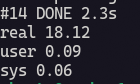
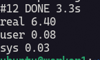
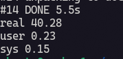
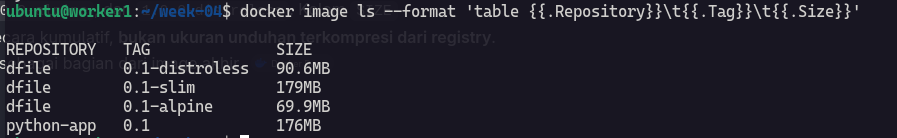

## Menyiapkan Dockerfile 

Menyiapkan Dockerfile untuk setiap image yg nantinya akan di uji ukuran image dan waktu build nya. Saya juga menambahkan healthcheck script untuk memantau kesehatan container juga.

| Name | Image |
| ----- | ----- |
| Dockerfile.alpine ||
| Dockerfile.slim ||
| Dockerfile.distroless ||

Dialam configurasi Dockerfile sudah saya sesuaikan dengan instruksi yg ada.

Ini adalah isi dari Dockerfile.alpine :

```docker title="Dockerfile.alpine" showLineNumber
FROM python:3.13-slim-trixie AS builder

WORKDIR /build
COPY src/ ./src/
RUN python -m zipapp src -c -o app.pyz

FROM python:3.13-alpine

WORKDIR /app

ENV PYTHONUNBUFFERED=1 \
    PYTHONDONTWRITEBYTECODE=1

COPY --from=builder /build/app.pyz ./app.pyz
COPY healthcheck.py ./healthcheck.py

USER 65532:65532
EXPOSE 8080

HEALTHCHECK --interval=10s --timeout=3s --start-period=5s --retries=3 \
    CMD ["python3", "/app/healthcheck.py"]

ENTRYPOINT ["python3"]
CMD ["/app/app.pyz"]
```

Ini adalah isi dari Dockerfile.slim :

```docker title="Dockerfile.slim" showLineNumber
FROM python:3.13-slim-trixie AS builder

WORKDIR /build
COPY src/ ./src/
RUN python -m zipapp src -c -o app.pyz

FROM python:3.13-slim-trixie

WORKDIR /app

ENV PYTHONUNBUFFERED=1 \
    PYTHONDONTWRITEBYTECODE=1

COPY --from=builder /build/app.pyz ./app.pyz
COPY healthcheck.py ./healthcheck.py

USER 65532:65532
EXPOSE 8080

HEALTHCHECK --interval=10s --timeout=3s --start-period=5s --retries=3 \
    CMD ["python3", "/app/healthcheck.py"]

ENTRYPOINT ["python3"]
CMD ["/app/app.pyz"]
```

Ini adalah isi dari Dockerfile.distroless :

```docker title="Dockerfile.distroless" showLineNumber
FROM python:3.13-slim-trixie AS builder

WORKDIR /build
COPY src/ ./src/
RUN python -m zipapp src -c -o app.pyz

FROM gcr.io/distroless/python3-debian13:nonroot

WORKDIR /app

ENV PYTHONUNBUFFERED=1 \
    PYTHONDONTWRITEBYTECODE=1

COPY --from=builder /build/app.pyz ./app.pyz
COPY healthcheck.py ./healthcheck.py

EXPOSE 8080

HEALTHCHECK --interval=10s --timeout=3s --start-period=5s --retries=3 \
    CMD ["/usr/bin/python", "/app/healthcheck.py"]

CMD ["/app/app.pyz"]
```

Sekarang saya akan mencoba untuk membandingkan ke 3 Dockerfile tersebut untuk waktu build dan ukuran image nya. Saya akan mejalankan 3 terminal :

**Kecepatan waktu build :**

- Dockerfile.alpine :

```bash
time -p docker build --no-cache --progress=plain -f Dockerfile.alpine -t dfile:0.1-alpine .
```

Ini adalah waktu build dari base image alpine dapat di 2.3 detik.



- Dockerfile.slim :

```bash
time -p docker build --no-cache --progress=plain -f Dockerfile.slim -t dfile:0.1-slim .
```

Ini adalah waktu build dari base image slim dapat di 3.3 detik.



- Dockerfile.distroless :

```bash
time -p docker build --no-cache --progress=plain -f Dockerfile.distroless -t dfile:0.1-distroless .
```

Ini adalah waktu build dari base image distroless dapat di 5.5 detik.



:::note
Di sini saya memiliki rasa penasaran terhadap output dari `real`, `user` dan `sys`. Setelah saya telusuri ternyata :
- `real` adalah durasi waktu dari mulai sampai selesai build, termasuk waktu tunggu disk, jaringan dan proses yg lain.
- `user` adalah waktu CPU yg dipakai untuk menjalankan code.
- `sys` adalah waktu yg dipakai oleh kernel untuk menangani pekerjaan program.
:::

**Ukuran Image :**

Dengan menjalankan command ini semua ukuran image app python nya akan tampil :

```bash
docker image ls --format 'table {{.Repository}}\t{{.Tag}}\t{{.Size}}'
```



Dari sini timbul pertanyaan kira kira apa yg mempengaruhi besar kecil nya image docker? setelah saya ulik ternyata yg mempengaruhi bersar kecilnya image itu dari instruksi, base image, sama file yg di salin ke dalam container nantinya. Kurang lebih sekian dokumentasi dari saya mohon maaf kalo ada kesalahan :p.