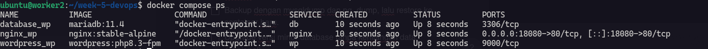
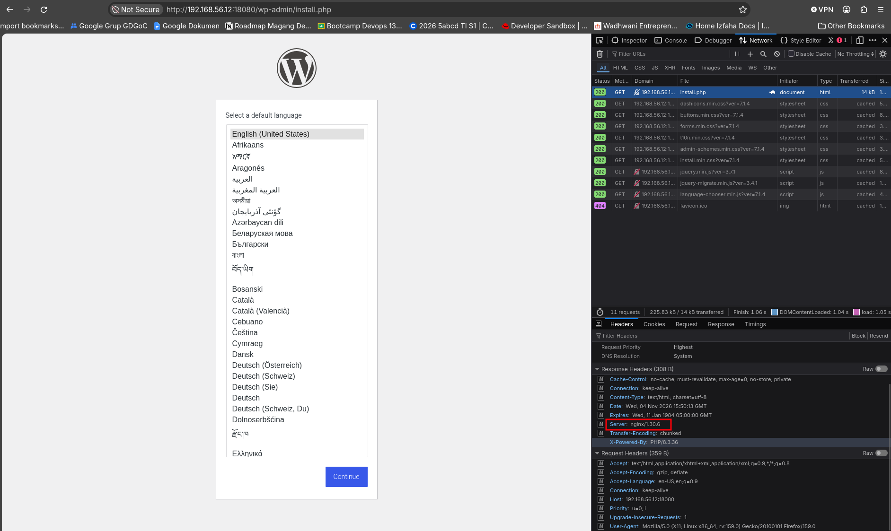
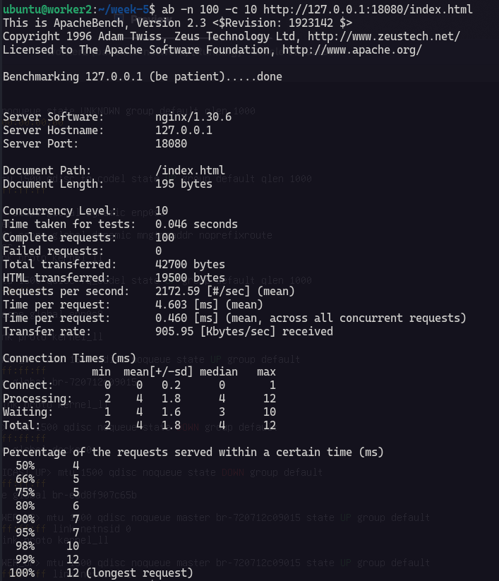
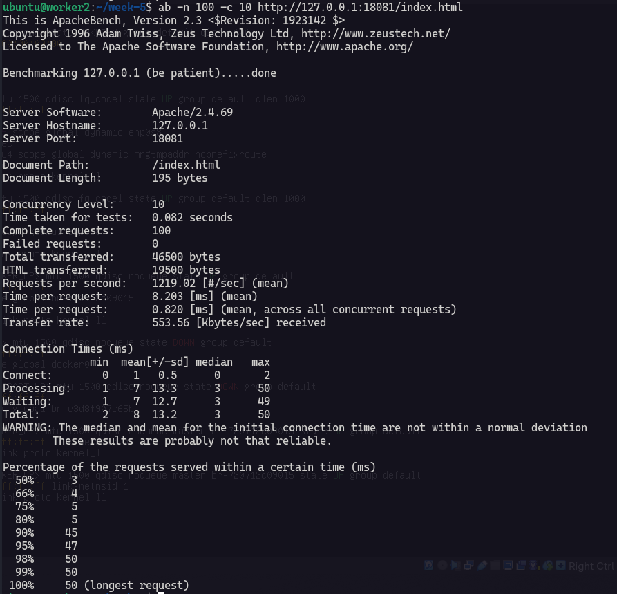

# Deploy aplikasi PHP (Laravel, CodeIgniter, atau WordPress) dengan Nginx dan PHP-FPM via Compose.

Untuk persiapan, saya membuat `.env`, `compose.yml` dan `nginx/default.conf`.

untuk `compose.yml` berisi 3 service yaitu, wordpress, mariadb dan nginx. Untuk resource saya limitas mengikuti best practice yg ada dan ada 2 volume `db_data` untuk service mariadb dan volume `wp_data` untuk data wordpress. 

```yml
services:
  db:
    image: mariadb:11.4
    container_name: database_wp
    deploy:
      resources:
        limits:
          cpus: 0.5
          memory: 1g
    environment:
      MARIADB_DATABASE: ${DB_NAME}
      MARIADB_USER: ${DB_USER}
      MARIADB_PASSWORD: ${DB_PASSWORD}
      MARIADB_ROOT_PASSWORD: ${DB_ROOT_PASSWORD}
    volumes:
      - db_data:/var/lib/mysql
    restart: unless-stopped

  wp:
    image: wordpress:php8.3-fpm
    container_name: wordpress_wp
    deploy:
      resources:
        limits:
          cpus: 1.0
          memory: 1g
    environment:
      WORDPRESS_DB_HOST: db:3306
      WORDPRESS_DB_NAME: ${DB_NAME}
      WORDPRESS_DB_USER: ${DB_USER}
      WORDPRESS_DB_PASSWORD: ${DB_PASSWORD}
    volumes:
      - wp_data:/var/www/html

  nginx:
    image: nginx:stable-alpine
    container_name: nginx_wp
    restart: unless-stopped
    deploy:
      resources:
        limits:
          cpus: 1.0
          memory: 1g
    ports:
      - "18080:80"
    volumes:
      - wp_data:/var/www/html:ro
      - ./nginx/default.conf:/etc/nginx/conf.d/default.conf:ro

volumes:
  db_data:
  wp_data:
```

Sekarang beralih ke konfigurasi nginx. Untuk `server_name` saya menggunakan localhost dan menggunakan php-fpm `wp:9000` memakai port `9000` karena make php-fpm.

```nginx
server {
    listen 80;
    server_name localhost;

    root /var/www/html;
    index index.php;

    client_max_body_size 16m;

    location / {
        try_files $uri $uri/ /index.php?$args;
    }

    location ~* ^/wp-content/uploads/.*\.php$ {
        deny all;
    }

    location ~ \.php$ {
        try_files $uri =404;

        include fastcgi_params;
        fastcgi_param SCRIPT_FILENAME $document_root$fastcgi_script_name;

        fastcgi_pass wp:9000;
    }

    location ~ /\. {
        deny all;
    }
}
```

selanjut nya saya akan mencoba untuk menjalankan docker compose :

```bash
docker compose up -d
```


dan berhasil untuk mendeploy wordpress dan sudah melewati nginx.



## Uji beban Nginx dan Apache dengan ab atau wrk, bandingkan hasilnya. (opsional)

Sekarang saya akan uji memakai `ab`. untuk menginstall nya bisa menggunakan package bernama `apache2-utils`, tinggal :

```
sudo apt install apache2-utils
```

lalu langsung tes :

**Test brencmark Nginx**

```bash
ab -n 100 -c 10 http://127.0.0.1:18080/index.html
```



**Test brencmark Apache2**

```bash
ab -n 100 -c 10 http://127.0.0.1:18081/index.html
```



Ini adalah table metrik dari hasil brenchmarking dari `ab`. Perlu di ingat `ab` atau ApacheBench itu belum mengukur performa keseluruhan web app, cuman mengetest satu endpoin saja. Lebih tepatnya `ab` dalam praktik ini hanya mengukur performa nginx dan apache dalam melayani file statis HTML aja. 

| Metrik | Nginx `18080` | Apache `18081` |
|---|---:|---:|
| `Time taken for tests` | 0,046 s | 0,082 s |
| `Requests per second` | 2.172,59 | 1.219,02 |
| `Time per request` | 4,603 ms | 8,203 ms |
| `Failed requests` | 0 | 0 |
| 95% request selesai dalam | 7 ms | 47 ms |