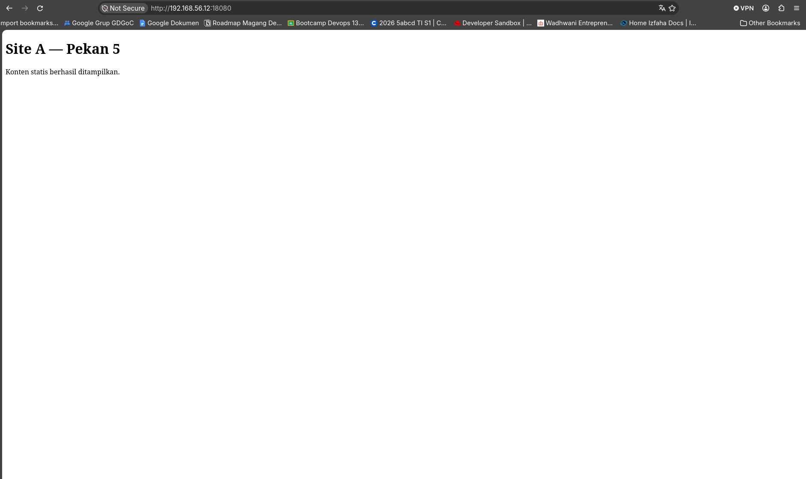
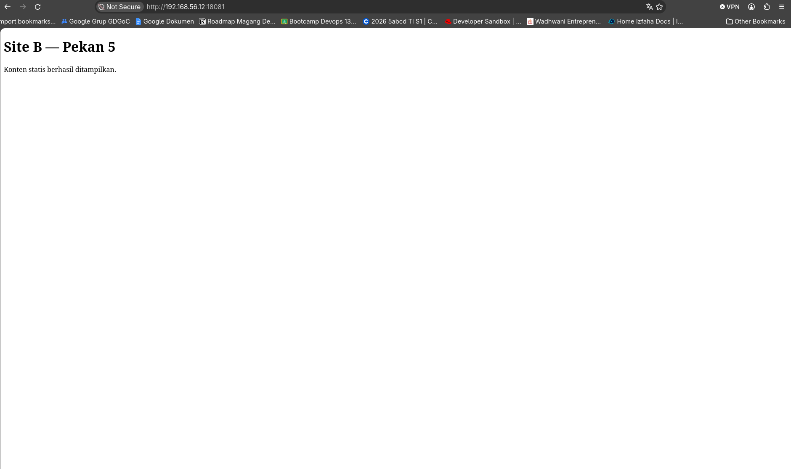

## Overview

Untuk persiapan pekan 5 ini saya membuat nya di vm laptop `worker2` dengan ip `192.168.56.12`.
Pada latihan kali ini berfokus ke bagaimana cara kerja web server seperti `nginx` dan `apache` bekerja.
Untuk struktur folder nya seperti dibawah ini. 

## Nginx

Konfigurasi Nginx : `$HOME/week-5/nginx/default.conf`

Maksut dari konfigurasi `nginx.conf` dibawah ini yaitu, nginx akan me-listen port `80` / `http` protocol dengan domain `localhost` (karena local), root folder (atau working direktori) ada di `/var/www/html/site-a` di dalamnya ada html file juga yg berfungsi untuk menjadi test page.

```title=nginx.conf
server {
    listen 80;
    server_name localhost;

    root /var/www/html/site-a;
    index index.html index.php;

    location / {
        try_files $uri $uri/ =404;
    }

    location ~ \.php$ {
        try_files $uri =404;

        include fastcgi_params;
        fastcgi_param SCRIPT_FILENAME $document_root$fastcgi_script_name;

        fastcgi_pass php-fpm:9000;
    }
}

server {
    listen 80;
    server_name localhost;

    root /var/www/html/site-b;
    index index.html index.php;

    location / {
        # memastikan file tersedia sebelum di proses
        try_files $uri $uri/ =404;
    }
}
```



## Apache

Konfigurasi Nginx : `$HOME/week-5/apache/vhosts.conf`

```title=vhosts.conf
ServerName localhost

<VirtualHost *:80>
    ServerName localhost
    DocumentRoot /var/www/html/site-a

    <Directory /var/www/html/site-a>
        Require all granted
        AllowOverride None
        DirectoryIndex index.html index.php
    </Directory>
</VirtualHost>

<VirtualHost *:80>
    ServerName localhost
    DocumentRoot /var/www/html/site-b

    <Directory /var/www/html/site-b>
        Require all granted
        AllowOverride None
        DirectoryIndex index.html
    </Directory>
</VirtualHost>
```



Sites Nginx : `$HOME/week-5/nginx/sites/site-a/index.html`
PHP info : `$HOME/week-5/nginx/sites/site-a/info.php `

Konfigurasi Apache : `$HOME/week-5/apache/vhosts.conf`
Sites Apache : `$HOME/week-5/apache/sites/site-b/index.html`

Dilihat dari browser sudah kelihatan semua dari web server nginx dan apache menandakan bahwa konfigurasi kita sudah berhasil. Untuk konfigurasi nginx dan apache saya agak kagok karena belum terlalu tau alur apache nya kalo nginx sudah beberapa kali implementasiin.
