## Overview 

Untuk project ini saya akan menjalankan di vm laptop `worker2` di direkrori `$HOME/week-6-devops`. Pada kasus ini saya akan belajar tentang cara scheduling backup pada suatu database application. Untuk backup server di vm laptop `infra`.

| VM | IP |
| ----- | ----- |
| `worker2` | 192.168.56.12 |
| `worker2` | 192.168.56.13 |

## Persiapan VM `worker2`

### index.php file

Saya akan membuat codingan php sederhana di `index.php` dan juga membuat `Dockerfile` nya juga. Ini juga terkoneksi dengan database mariadb yg nantinya akan digunakan untuk bahan backup ke server `infra`.

```php title=app/index.php
<?php
declare(strict_types=1);

$pesan = '';
$catatan = [];

try {
    $pdo = new PDO(
        sprintf(
            'mysql:host=%s;dbname=%s;charset=utf8mb4',
            getenv('DB_HOST'),
            getenv('DB_NAME')
        ),
        getenv('DB_USER'),
        getenv('DB_PASSWORD'),
        [PDO::ATTR_ERRMODE => PDO::ERRMODE_EXCEPTION]
    );

    $pdo->exec(
        'CREATE TABLE IF NOT EXISTS catatan (
            id INT AUTO_INCREMENT PRIMARY KEY,
            isi VARCHAR(255) NOT NULL,
            dibuat_pada TIMESTAMP DEFAULT CURRENT_TIMESTAMP
        )'
    );

    if ($_SERVER['REQUEST_METHOD'] === 'POST') {
        $isi = trim((string) ($_POST['isi'] ?? ''));

        if ($isi !== '' && mb_strlen($isi) <= 255) {
            $stmt = $pdo->prepare('INSERT INTO catatan (isi) VALUES (?)');
            $stmt->execute([$isi]);
            header('Location: /');
            exit;
        }

        $pesan = 'Isi catatan wajib diisi dan maksimal 255 karakter.';
    }

    $catatan = $pdo
        ->query('SELECT id, isi, dibuat_pada FROM catatan ORDER BY id DESC')
        ->fetchAll(PDO::FETCH_ASSOC);
} catch (Throwable $e) {
    http_response_code(500);
    $pesan = 'Koneksi atau query database gagal. Periksa log aplikasi.';
    error_log($e);
}

function aman(string $nilai): string
{
    return htmlspecialchars($nilai, ENT_QUOTES | ENT_SUBSTITUTE, 'UTF-8');
}
?>
<!doctype html>
<html lang="id">
<head>
    <meta charset="utf-8">
    <meta name="viewport" content="width=device-width, initial-scale=1">
    <title>Catatan Pekan 6</title>
</head>
<body>
    <h1>Catatan Pekan 6</h1>

    <?php if ($pesan !== ''): ?>
        <p><?= aman($pesan) ?></p>
    <?php endif; ?>

    <form method="post">
        <label for="isi">Catatan baru</label>
        <input id="isi" name="isi" maxlength="255" required>
        <button type="submit">Simpan</button>
    </form>

    <ul>
        <?php foreach ($catatan as $item): ?>
            <li>
                <?= aman((string) $item['isi']) ?>
                — <?= aman((string) $item['dibuat_pada']) ?>
            </li>
        <?php endforeach; ?>
    </ul>
</body>
</html>
```

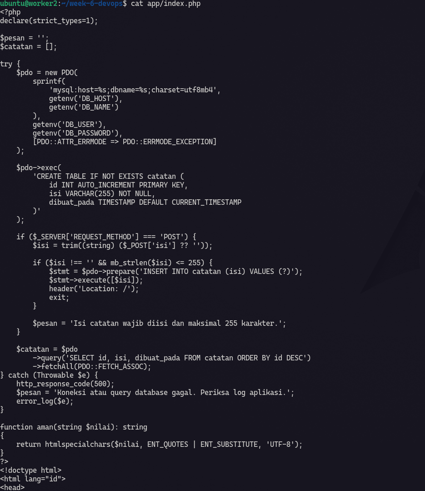

### Dockerfile

Di dalam `Dockerfile` ini hanya meng copy index.php ke dalam folder container `/var/www/html/index.php`.

```yml title=Dockerfile
FROM php:8.3-apache

RUN docker-php-ext-install pdo_mysql

COPY index.php /var/www/html/index.php

```

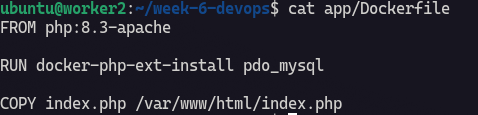

### docker compose

Setelah itu saya akan mempersiapkan 3 services di `compose.yml`, apa aja yg perlu di siapkan ? yaitu service untuk app, database dan adminer untuk UI friendly.

```yml title=compose.yml
services:
  mariadb:
    image: mariadb:11.4.13
    restart: unless-stopped
    environment:
      MARIADB_DATABASE: ${MARIADB_DATABASE}
      MARIADB_USER: ${MARIADB_USER}
      MARIADB_PASSWORD: ${MARIADB_PASSWORD}
      MARIADB_ROOT_PASSWORD: ${MARIADB_ROOT_PASSWORD}
    volumes:
      - mariadb_data_devops:/var/lib/mysql
    healthcheck:
      test: ["CMD", "healthcheck.sh", "--connect", "--innodb_initialized"]
      interval: 10s
      timeout: 5s
      retries: 10
    stop_grace_period: 1m

  app:
    build: ./app
    restart: unless-stopped
    environment:
      DB_HOST: mariadb
      DB_NAME: ${MARIADB_DATABASE}
      DB_USER: ${MARIADB_USER}
      DB_PASSWORD: ${MARIADB_PASSWORD}
    ports:
      - "18082:80"
    depends_on:
      mariadb:
        condition: service_healthy

  adminer:
    image: adminer:standalone
    restart: unless-stopped
    environment:
      ADMINER_DEFAULT_SERVER: mariadb
    ports:
      - "127.0.0.1:18083:8080"
    depends_on:
      mariadb:
        condition: service_healthy

volumes:
  mariadb_data_devops:
```

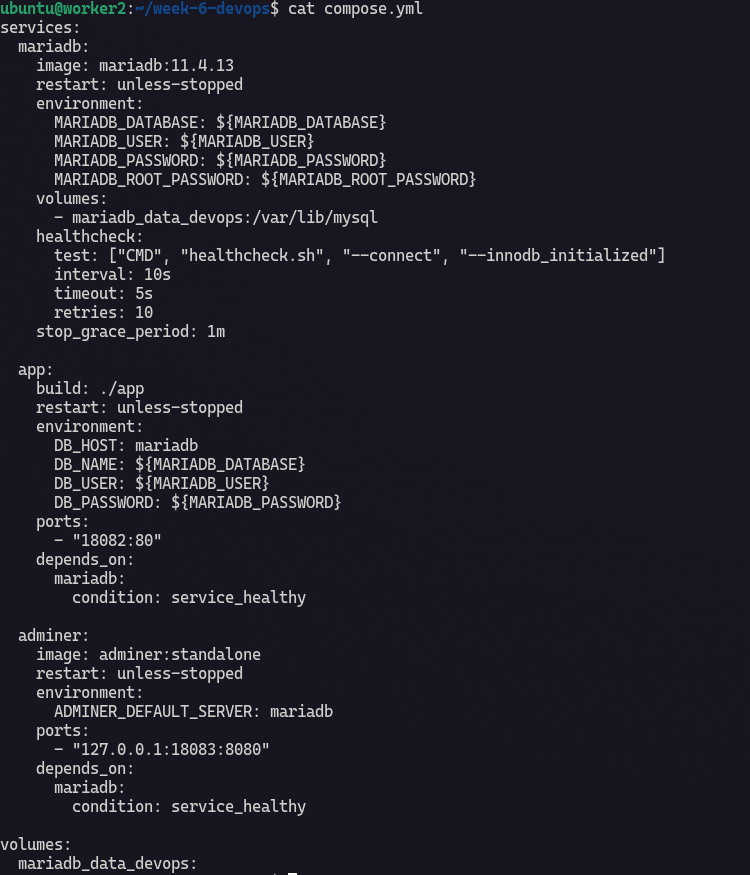

Pada compose, untuk database mariadb tidak akan expose port dan untuk app akan expose port karena ini akan ditampilkan ke browser akan tetapi untuk UI adminer akan di batasi hanya bisa di lihat secara local saya dengan `127.0.0.1`. Sekarang saya akan mencoba menjalankan compose nya dulu.

```bash
docker compose up
```

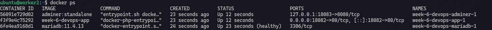

Membuka UI index.php di browser 192.168.56.12.

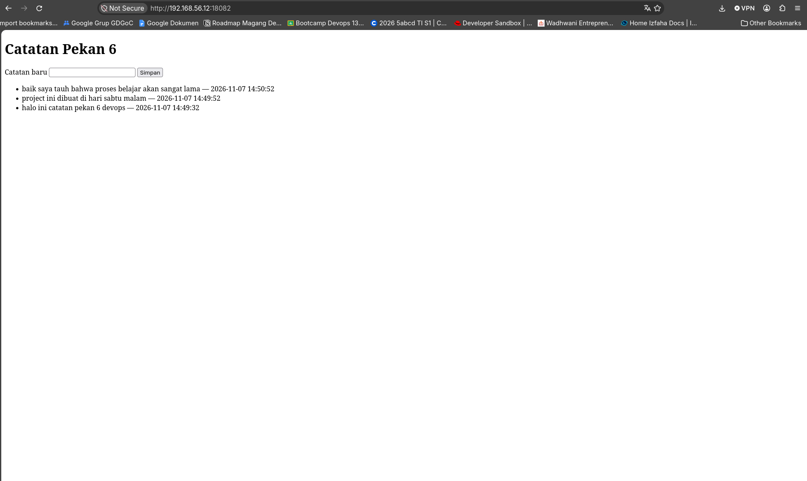

UI adminer via `ssh -L 18083:localhost:18083 ubuntu@192.168.56.12`.

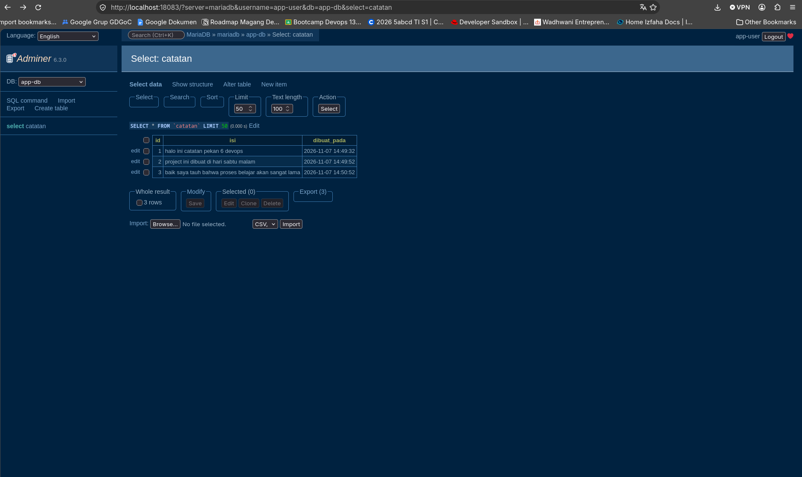

### Generate ssh key

Baik semua persiapan di vm `worker2` sudah beres, selanjutnya saya akan menyiapkan vm `infra`. Tapi sebelum itu saya perlu membuat script backup ssh key untuk di pasangkan ke vm `infra`. 

Saya sudah membuat ssh key untuk backup ke vm `infra` dengan no pasphrase, saya kurang tau apakah ini best practice untuk backup atau tidak. 

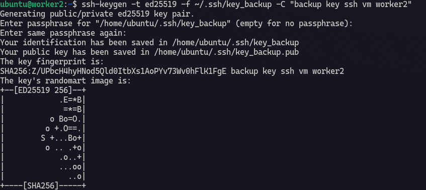

Kirim ssh key ke vm `infra` :

```bash
ssh-copy-id -i ~/.ssh/key_backup.pub ubuntu@192.168.56.13
```

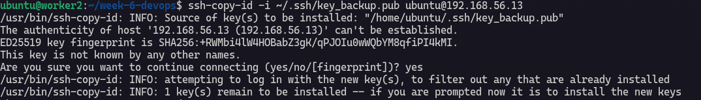

sekarang saya akan uji koneksi dengan command :

```bash
ssh -i ~/.ssh/week6_backup ubuntu@192.168.56.13 'test -w /srv/backups/week6-devops && echo "Folder backup siap"'
```

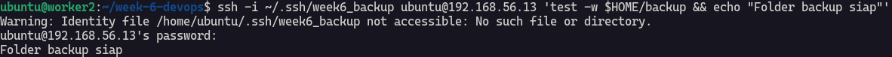

Alhamdulillah berhasil.

### Pembuatan Backup Script

Saya membuat script di dalam folder script dengan nama `backup.sh`.

```bash title=backup.sh
#!/usr/bin/env bash
set -Eeuo pipefail
umask 077

PROJECT_DIR="$HOME/week-6-devops"
REMOTE_USER="ubuntu"
REMOTE_HOST="192.168.56.13"
REMOTE_DIR="$HOME/backup"
SSH_KEY="$HOME/.ssh/key_backup"

BACKUP_NAME="week6-app-$(date +%Y%m%d-%H%M%S).sql.gz"
LOCAL_FILE="$(mktemp "$PROJECT_DIR/.backup-XXXXXX.sql.gz")"
trap 'rm -f "$LOCAL_FILE"' EXIT

cd "$PROJECT_DIR"

docker compose exec -T mariadb sh -c \
  'exec mariadb-dump \
    --single-transaction \
    --quick \
    -u "$MARIADB_USER" \
    -p"$MARIADB_PASSWORD" \
    "$MARIADB_DATABASE"' \
  | gzip > "$LOCAL_FILE"

test -s "$LOCAL_FILE"
gzip -t "$LOCAL_FILE"

scp -i "$SSH_KEY" "$LOCAL_FILE" \
  "$REMOTE_USER@$REMOTE_HOST:$REMOTE_DIR/$BACKUP_NAME.part"

ssh -i "$SSH_KEY" "$REMOTE_USER@$REMOTE_HOST" \
  "mv '$REMOTE_DIR/$BACKUP_NAME.part' '$REMOTE_DIR/$BACKUP_NAME'"

LOCAL_HASH="$(sha256sum "$LOCAL_FILE" | awk '{print $1}')"
REMOTE_HASH="$(
  ssh -i "$SSH_KEY" "$REMOTE_USER@$REMOTE_HOST" \
    "sha256sum '$REMOTE_DIR/$BACKUP_NAME'" | awk '{print $1}'
)"

test "$LOCAL_HASH" = "$REMOTE_HASH"

echo "Backup berhasil: $REMOTE_USER@$REMOTE_HOST:$REMOTE_DIR/$BACKUP_NAME"
```

## Persiapan VM `infra`

### Cek backup

Proses backup normal nya membutuhkan waktu banyak jika data sangat besar tapi di sini database saya masih sedikit jadi prosesnya lebih cepat. Saya akan menjalankan backup script dari vm `worker2`.

```bash
./script/backup.sh
```

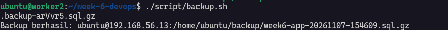

Akhirnya backup script kita berhasil.

### Cronjob scheduling

Atur crontab `crontab -e`, jika baru pertama kali menjalankan command ini maka akan di minta memilih default text editor. Pilih aja sesuai preferensi sendiri. Masukan code ini ke konfigurasi contab :

```
0 2 * * * /home/ubuntu/week-6-devops/script/backup.sh >> /home/ubuntu/week-6-devops/backup.log 2>&1
```

Setelah itu cek dulu dengan command `crontab -l`. Command ini akan memberitahukan kita list crontab yg ada.

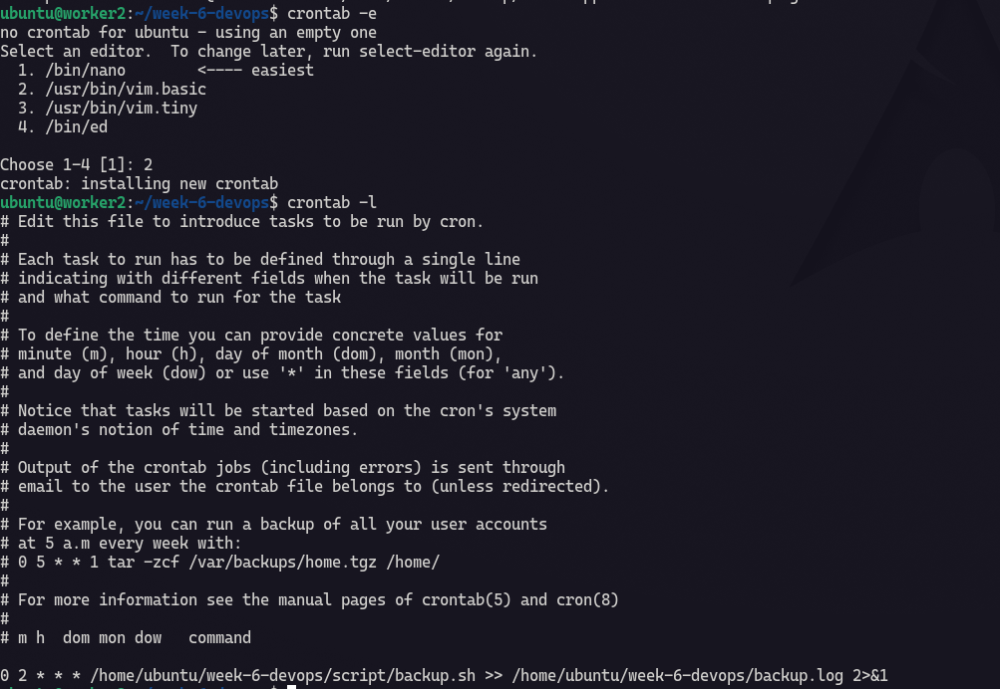

### Buat Compose untuk Restore

Sekarang saya akan membuat compose baru lalu saya akan merestore database backup nya. Saya akan menjalankan compose backup dan mengambil backup database dari vm `infra`.

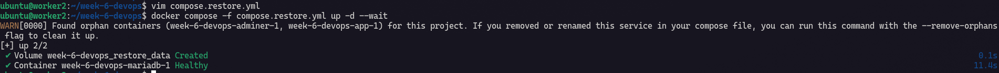

```
scp -i ~/.ssh/key_backup ubuntu@192.168.56.13:/home/ubuntu/backup/week6-app-20261107-154609.sql.gz ./backups
```

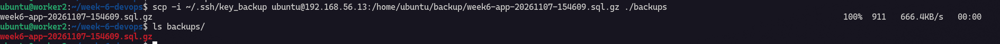

Semua proses backup sudah berhasil sekarang saya akan me-restore ke container yg baru.

```bash
gzip -dc ./restore-test.sql.gz | docker compose -f compose.restore.yaml exec -T mariadb sh -c 'exec mariadb -u "$MARIADB_USER" -p"$MARIADB_PASSWORD" "$MARIADB_DATABASE"'
```

Lalu bandingkan dengan database yg sekarang.

```bash
docker compose exec mariadb sh -c \
  'mariadb -u "$MARIADB_USER" -p"$MARIADB_PASSWORD" "$MARIADB_DATABASE" -e "SELECT COUNT(*) AS jumlah FROM catatan; SELECT * FROM catatan;"'

docker compose -f compose.restore.yaml exec mariadb sh -c \
  'mariadb -u "$MARIADB_USER" -p"$MARIADB_PASSWORD" "$MARIADB_DATABASE" -e "SELECT COUNT(*) AS jumlah FROM catatan; SELECT * FROM catatan;"'
```

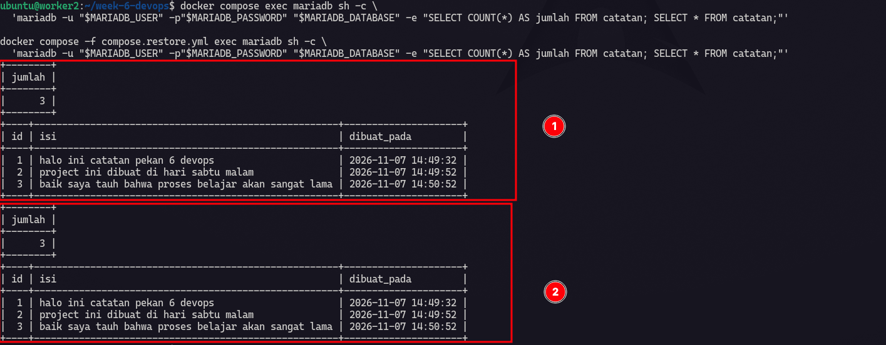

Nomor 1 : Database asli.
Nomor 2 : Database yg sudah berhasil di restore.

DONE.

## New Knowlege

Pada pekan ini saya menjalankan aplikasi PHP, MariaDB, dan Adminer menggunakan Docker Compose. Saya juga membuat alur backup terjadwal dari worker2 ke VM infra dan menguji pemulihan data pada container database yang terpisah. Dari praktik ini, saya memahami bahwa backup baru bisa diandalkan jika file berhasil dibuat, sampai ke tujuan, dan dapat di-restore.

Beberapa hal baru yang saya pelajari:

1. File backup boleh dikompresi, tetapi tidak wajib di-ZIP. Pada lab ini, hasil mariadb-dump dikompresi menjadi .sql.gz untuk mengurangi ukuran file dan data yang dikirim. Pilihan format bergantung pada alat backup dan kebutuhan restore. Untuk database besar, logical dump juga bisa memerlukan waktu restore yang lama.

2. Backup terjadwal memerlukan proses yang dapat dijalankan otomatis. Saya membuat backup.sh agar langkah dump, kompresi, pemeriksaan file, pengiriman, dan verifikasi dijalankan secara konsisten oleh cron. Script bukan syarat untuk setiap sistem; perusahaan juga dapat memakai aplikasi atau layanan backup khusus.

3. Koneksi ke server tujuan perlu diuji sebelum penjadwalan. Saya memastikan worker2 bisa masuk melalui SSH dan user tujuan mempunyai izin menulis pada direktori backup. Setelah backup berjalan, keberhasilannya tetap perlu dicek dari log dan file yang diterima.

4. Restore harus diuji, bukan hanya diasumsikan berhasil. Pada lab ini, backup dipulihkan ke container baru, lalu jumlah dan isi tabel catatan dibandingkan dengan data asli pada waktu backup dibuat. Untuk database besar, tim biasanya membandingkan jumlah baris dan ringkasan penting per tabel, rentang ID atau tanggal, serta menjalankan query dan fungsi aplikasi yang kritis. Pemeriksaan integritas file membantu, tetapi hash file yang sama hanya membuktikan file tidak berubah saat dikirim, bukan bahwa seluruh datanya berhasil dipulihkan. Untuk PostgreSQL base backup, tersedia pg_verifybackup; alat ini berlaku untuk jenis backup tersebut, bukan untuk semua file dump SQL. 

5. Transfer otomatis lebih cocok memakai SSH key khusus. Dengan key, cron dapat mengirim backup tanpa memasukkan password secara interaktif. Pada VM infra, user khusus backup tidak perlu akses sudo jika hanya menerima file di direktori yang dimilikinya. Akun Linux itu juga tidak harus diberi password untuk alur login berbasis key; yang penting public key terpasang dan aksesnya dibatasi sesuai kebutuhan. SSH mendukung pembatasan kemampuan sebuah key melalui konfigurasi authorized_keys