# Restore Data to MariaDB and PostgreSQL

Untuk Lab pekan 6 saya menggunakan vm `worker2` di laptop saya. saya akan belajar tentang bagaimana cara menjalankan mariadb dan postgres di docker compose dengan presisten volume.

## Docker Compose 

Saya akan membuat `docker-compose.yml` berisi 2 service yaitu, mariadb dan postgres. Sebelum itu saya akan menata working direktori nya.

```
mkdir {mariadb-init,postgres-init,backup}
```

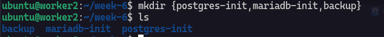

Folder tersebut akan di isi query .sql untuk di inject ke dalam container tiap database nya. Jangan lupa untuk membuat `.env`.

```yml
services:
  mariadb:
    image: mariadb:11.4
    container_name: mariadb
    ports:
      - "3306:3306"
    environment:
      MARIADB_DATABASE: ${MARIADB_DATABASE}
      MARIADB_USER: ${MARIADB_USER}
      MARIADB_PASSWORD: ${MARIADB_PASSWORD}
      MARIADB_ROOT_PASSWORD: ${MARIADB_ROOT_PASSWORD}
    volumes:
      - mariadb_data:/var/lib/mysql
      - ./mariadb-init:/docker-entrypoint-initdb.d:ro
    healthcheck:
      test: ["CMD", "healthcheck.sh", "--connect", "--innodb_initialized"]
      interval: 10s
      timeout: 5s
      retries: 10
      start_period: 30s
    restart: unless-stopped

  postgres:
    image: postgres:17
    container_name: postgres
    ports:
      - "5432:5432"
    environment:
      POSTGRES_DB: ${POSTGRES_DB}
      POSTGRES_USER: ${POSTGRES_USER}
      POSTGRES_PASSWORD: ${POSTGRES_PASSWORD}
    volumes:
      - postgres_data:/var/lib/postgresql/data
      - ./postgres-init:/docker-entrypoint-initdb.d:ro
    healthcheck:
      test: ["CMD-SHELL", "pg_isready -U \"$${POSTGRES_USER}\" -d \"$${POSTGRES_DB}\""]
      interval: 10s
      timeout: 5s
      retries: 10
      start_period: 30s
    restart: unless-stopped

volumes:
  mariadb_data:
  postgres_data:
```

Di sini saya akan post port supaya tidak kepanjangan nulis command sql nya.

## Buat Isi dari init

Selua perintah sql ini akan di bind mount ke dalam container tiap database nya, di bind mount melalui docker compose.

**Mariadb Init**


```sql
USE lab_mariadb;

CREATE TABLE IF NOT EXISTS catatan (
    id INT PRIMARY KEY AUTO_INCREMENT,
    isi VARCHAR(100) NOT NULL
);

INSERT INTO catatan (isi)
VALUES ('Data awal dari init script MariaDB');
```

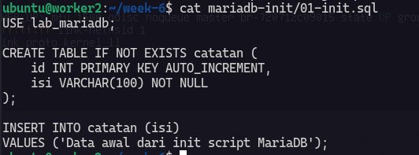

**Postgres Init**

```sql
CREATE TABLE IF NOT EXISTS catatan (
    id INTEGER GENERATED ALWAYS AS IDENTITY PRIMARY KEY,
    isi VARCHAR(100) NOT NULL
);

INSERT INTO catatan (isi)
VALUES ('Data awal dari init script PostgreSQL');
```

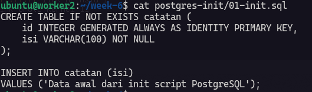

Sekarang ke dua conatainer database sudah hidup.

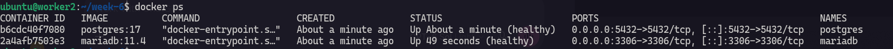

Sekarang kita cek table database nya :

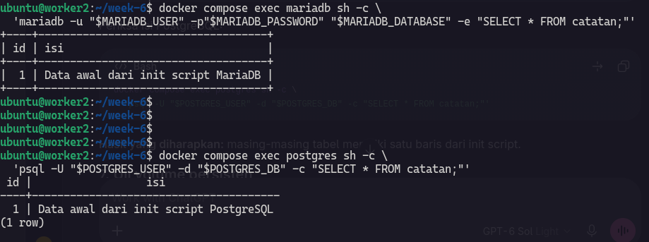

## Backups 2 database

Untuk cara backup, saya menggunakan command ini :

**MariaDB**

```sql
docker compose exec -T mariadb sh -c 'exec mariadb-dump -u "$MARIADB_USER" -p"$MARIADB_PASSWORD" "$MARIADB_DATABASE"' > backups/mariadb.sql
```

**PostgreSQL**

```sql
docker compose exec -T postgres sh -c 'exec pg_dump -U "$POSTGRES_USER" -d "$POSTGRES_DB" --no-owner --no-acl' > backups/postgres.sql
```

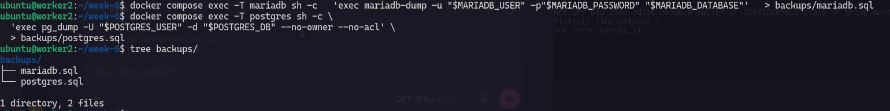

Ini adalah hasil dari backup ke 2 database tadi, selanjutnya saya akan belajar merestore ke container baru.

## Restore ke Container Baru

Untuk uji coba restore saya akan membuat docker compose baru.

```yml
services:
  mariadb:
    image: mariadb:11.4
    container_name: mariadb_restore
    environment:
      MARIADB_DATABASE: ${MARIADB_DATABASE}
      MARIADB_USER: ${MARIADB_USER}
      MARIADB_PASSWORD: ${MARIADB_PASSWORD}
      MARIADB_ROOT_PASSWORD: ${MARIADB_ROOT_PASSWORD}
    volumes:
      - mariadb_restored_data:/var/lib/mysql
    healthcheck:
      test: ["CMD", "healthcheck.sh", "--connect", "--innodb_initialized"]
      interval: 10s
      timeout: 5s
      retries: 10
      start_period: 30s

  postgres:
    image: postgres:17
    container_name: posgres_restore
    environment:
      POSTGRES_DB: ${POSTGRES_DB}
      POSTGRES_USER: ${POSTGRES_USER}
      POSTGRES_PASSWORD: ${POSTGRES_PASSWORD}
    volumes:
      - postgres_restored_data:/var/lib/postgresql/data
    healthcheck:
      test: ["CMD-SHELL", "pg_isready -U \"$${POSTGRES_USER}\" -d \"$${POSTGRES_DB}\""]
      interval: 10s
      timeout: 5s
      retries: 10
      start_period: 30s

volumes:
  mariadb_restored_data:
  postgres_restored_data:
```

Sekarang saya akan masukan backupnya dengan command ini :

**Mariadb**

```bash
docker compose -f docker-compose.restore.yml exec -T mariadb sh -c 'exec mariadb -u $MARIADB_USER -p$MARIADB_PASSWORD $MARIADB_DATABASE' < backups/mariadb.sql
```


Cek backup database :

```bash
docker compose -f docker-compose.restore.yml exec -T mariadb sh -c 'mariadb -u $MARIADB_USER -p$MARIADB_PASSWORD $MARIADB_DATABASE -e "SELECT * FROM catatan;"'
```

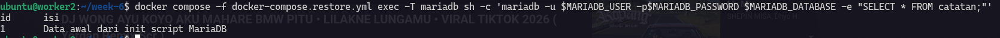

**PostgreSQL**

```bash
# resore command for postgresql
docker compose -f docker-compose.restore.yml exec -T postgres sh -c 'exec psql -v ON_ERROR_STOP=1 -U "$POSTGRES_USER" -d "$POSTGRES_DB"' < backups/postgres.sql

# check restore command
docker compose -f docker-compose.restore.yml exec postgres sh -c 'psql -U "$POSTGRES_USER" -d "$POSTGRES_DB" -c "SELECT * FROM catatan;"'
```

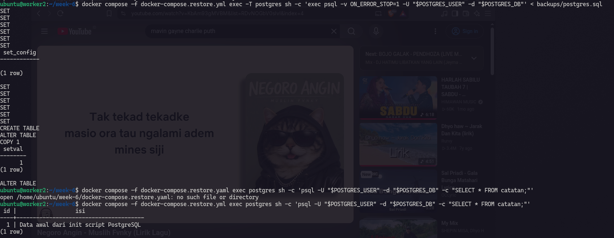

## Upgrade versi minor database tanpa kehilangan data. (opsional)

Sebelum update version database, saya akan mengechek table dan versi yg sekarang :

```bash
# check mariadb version
docker exec mariadb mariadb --version
# check mariadb version
docker exec postgres postgres --version
```

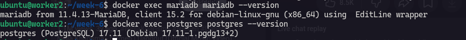

```bash
# check table mariadb
docker compose exec mariadb sh -c \
  'mariadb -u "$MARIADB_USER" -p"$MARIADB_PASSWORD" "$MARIADB_DATABASE" -e "SELECT COUNT(*) AS jumlah FROM catatan;"'

# check table postgresql
docker compose exec postgres sh -c \
  'psql -U "$POSTGRES_USER" -d "$POSTGRES_DB" -c "SELECT COUNT(*) AS jumlah FROM catatan;"'
```

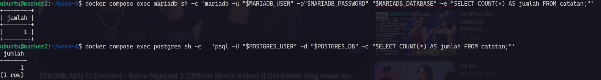

Sekarang saya akan update dulu :

```docker
services:
  mariadb:
    image: mariadb:11.4.13

  postgres:
    image: postgres:17.11
```

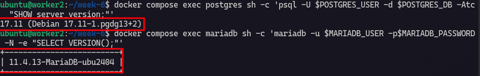

## Summary

Sebelum melakukan upgrade, saya memeriksa versi MariaDB dan PostgreSQL yang sedang berjalan, serta memastikan tabel catatan dapat diakses. Saya mencatat jumlah baris dan isi tabel sebagai pembanding setelah upgrade.

Selanjutnya, saya membuat backup dari kedua database dan menguji hasilnya dengan melakukan restore ke container baru. Langkah ini dilakukan untuk memastikan file backup benar-benar dapat digunakan jika proses upgrade mengalami masalah. Saya juga memastikan volume persisten yang menyimpan data tetap terpasang pada lokasi yang sama.

Setelah itu, saya menentukan versi tujuan dalam seri yang sama, yaitu `MariaDB 11.4.13` dan `PostgreSQL 17.11`, serta memeriksa catatan rilisnya. Upgrade dilakukan satu database pada satu waktu agar hasilnya lebih mudah diperiksa. Setelah masing-masing container berjalan kembali, saya akan membandingkan versi, status container, log, dan isi tabel catatan dengan kondisi sebelum upgrade.

