# Redis Caching Benchmark and Sentinel Failover

## Ukur response time aplikasi sebelum dan sesudah caching

### Pengujian Tanpa Cache

Pada pengujian tanpa cache, nilai `Time per request (mean)` adalah **71,297 ms**. Artinya, rata-rata satu request membutuhkan sekitar 71 ms untuk mendapatkan respons.


```bash
ab -n 200 -c 10 `http://127.0.0.1:18080/bench.php?mode=uncached` | mkdir -p ~/week-7/bench-result | tee ~/week-7/bench-result/tanpa-cahce.txt
```

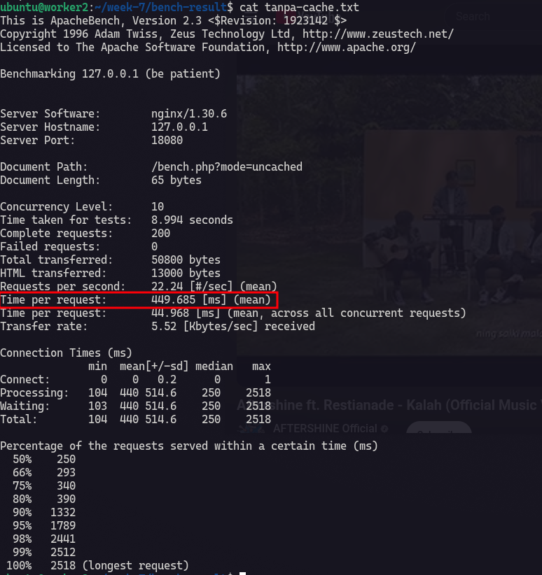

### Pengujian Dengan Cache

Pada pengujian dengan Redis cache, nilai `Time per request (mean)` adalah **18,020 ms**. Artinya, rata-rata satu request membutuhkan sekitar 18 ms untuk mendapatkan respons.

dengan cahce = 18.020 [ms] (mean)
```bash
ab -n 200 -c 10 `http://127.0.0.1:18080/bench.php?mode=cached` | tee ~/week-7/bench-result/pakai-cahce.txt
```

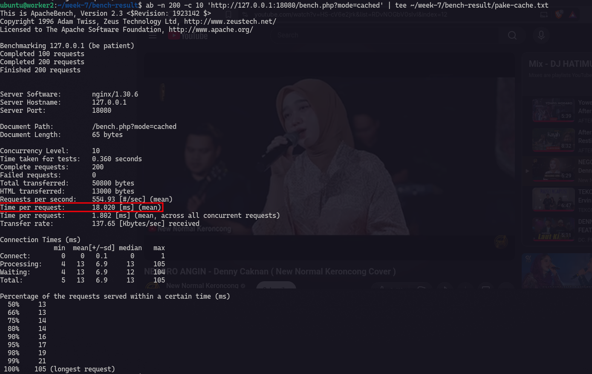

### Perbandingan

| Kondisi | Rata-rata waktu respons |
|---|---:|
| Tanpa cache | 71,297 ms |
| Dengan Redis cache | 18,020 ms |

Selisih waktu respons rata-rata adalah **53,277 ms**, atau sekitar **74,7% lebih rendah** saat menggunakan cache. Hasil ini menunjukkan bahwa untuk endpoint yang diuji, mengambil data yang sudah tersedia di Redis lebih cepat daripada menjalankan ulang prosesnya pada setiap request.

Pengujian ini menggunakan endpoint latihan dengan simulasi proses yang memerlukan waktu. Karena itu, angka tersebut menggambarkan hasil pada lingkungan lab ini, bukan perkiraan peningkatan performa untuk semua aplikasi.

## Susun Redis replica dan Sentinel dasar dengan Compose, uji failover. (opsional)

Disini saya agak bingung soal Sentinel dan Failover, pas saya cari tau ternyata, Sentinel adalah pemantau Redis yang mengatur pergantian master secara otomatis dan Failover adalah proses pergantian tersebut ketika master bermasalah.

Cara kerja Failover :

Pertama jika sentinel mendeteksi tidak adanya respons dari master maka sentinel akan saling mengkonfirmasi ketika master bermasalah. Lalu sentinel akan memilih salah satu replika untuk dijadikan master baru dan replika lainya akan diarahkan untuk menyalin data dari master baru. Ketika master lama kembali dan dikonfirmasi oleh sentinel, master lama akan di jadikan replika dari master yg baru.

### Pembuatan Compose

Dalam file compose ini terdapat master redis dan 2 slave dan juga 3 sentinel. Untuk container master redis saya buat jadi static ip supaya sentinel dapat mendeteksi by ip bukan by container service.

```yaml
x-sentinel: &sentinel
  image: redis:7-alpine
  networks:
    - redis-ha
  entrypoint:
    - /bin/sh
    - -ec
    - |
      cat > /tmp/sentinel.conf <<'EOF'
      port 26379
      protected-mode no
      sentinel monitor mymaster 172.30.77.10 6379 2
      sentinel down-after-milliseconds mymaster 5000
      sentinel failover-timeout mymaster 30000
      sentinel parallel-syncs mymaster 1
      EOF
      exec redis-server /tmp/sentinel.conf --sentinel
  command: []

services:
  redis-master:
    image: redis:7-alpine
    command: ["redis-server", "--protected-mode", "no", "--appendonly", "yes"]
    networks:
      redis-ha:
        ipv4_address: 172.30.77.10

  redis-replica-1:
    image: redis:7-alpine
    command:
      - redis-server
      - --protected-mode
      - "no"
      - --appendonly
      - "yes"
      - --replicaof
      - redis-master
      - "6379"
    depends_on:
      - redis-master
    networks:
      - redis-ha

  redis-replica-2:
    image: redis:7-alpine
    command:
      - redis-server
      - --protected-mode
      - "no"
      - --appendonly
      - "yes"
      - --replicaof
      - redis-master
      - "6379"
    depends_on:
      - redis-master
    networks:
      - redis-ha

  sentinel-1:
    <<: *sentinel

  sentinel-2:
    <<: *sentinel

  sentinel-3:
    <<: *sentinel

networks:
  redis-ha:
    internal: true
    ipam:
      config:
        - subnet: 172.30.77.0/24
```

#### Cek Redis dan Sentinel Container 

Redis Master :

```bash
docker exec ha-redis-master-1 redis-cli INFO replication
```

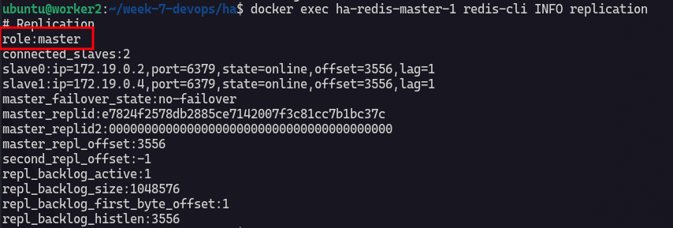

Redis Replica 1 :

```bash
docker exec ha-redis-replica-1-1 redis-cli INFO replication
```

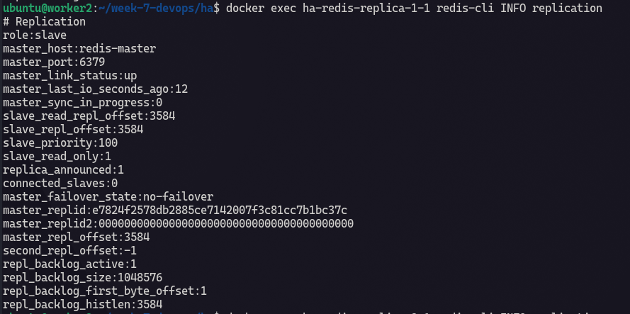

Redis Replica 2 :

```bash
docker exec ha-redis-replica-2-1 redis-cli INFO replication
```

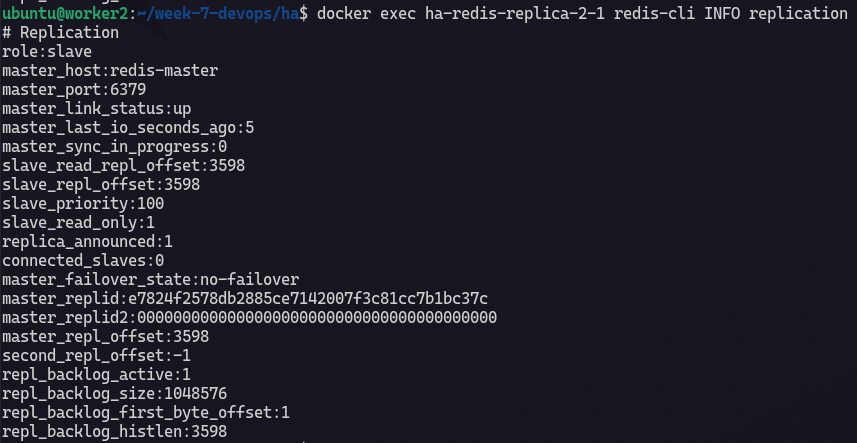

Cek Sentinel :

```bash
docker exec ha-sentinel-1-1 redis-cli -p 26379 SENTINEL CKQUORUM mymaster
docker exec ha-sentinel-1-1 redis-cli -p 26379 SENTINEL get-master-addr-by-name mymaster
```

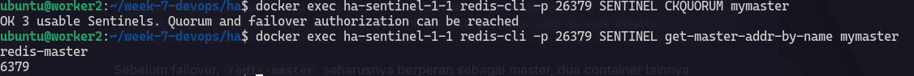

### Uji Failover

Sekarang saatnya uji failover. Disini saya akan menulis data untuk dijadikan percobaan.

```bash
docker exec ha-redis-master-1 redis-cli SET latihan:failover "data-sebelum-failover"
```

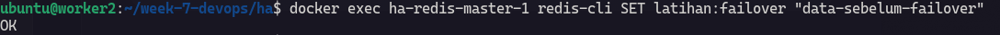

Sekarang saya cek apakah sentinel mendeteksi container master redis dan 2 replica nya.

```bash
docker logs -f ha-sentinel-1-1
```

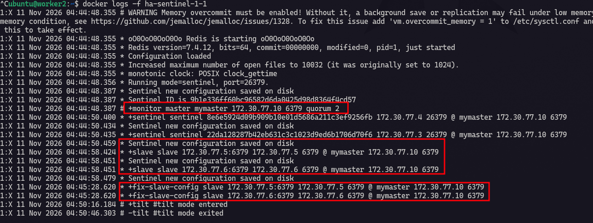

Sekrang saya coba hentikan master container, apakah sentinel akan menentukan master baru. saya perlu menunggu proses penentuan master baru. Nanti akan ada replika yg role nya berubah menjadi `master`. 

```bash
docker stop f36782788e56
```

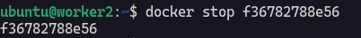

Lalu sentinel akan menjacari kandidat master dan ketemu, master baru diberikan kepana container slave 2.

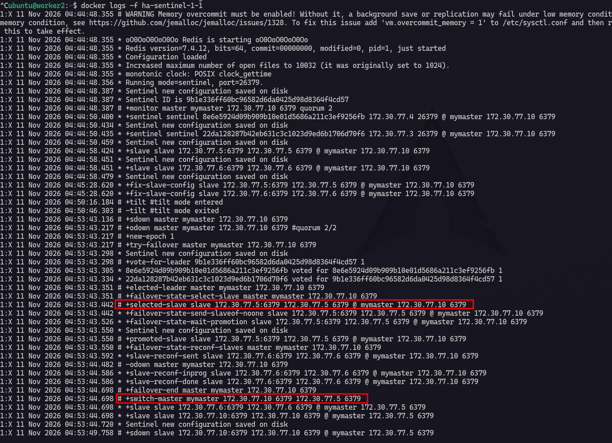

Untuk container slave 2 menjadi master karena master sebelumnya down dan untuk slave 1 menjadi slave dari master (slave 2).

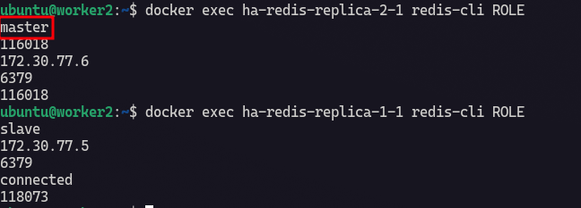