# Redis sebagai Cache dan Session Store

## Apa itu Redis?

Redis adalah tempat penyimpanan yg berada pada memory atau RAM. Aplikasi juga bisa membaca data dari redis melalui mekanisme caching. Fungsi lain juga sebagai cache, session, queue dan lainnya.

Redis umumnya dipakai di aplikasi yg sudah memiliki data yg banyak atau besar sehingga setiap pencarian data tidak perlu ke database langsung. Cache redis memiliki alur kerja, aplikasi akan mencari data di redis jika cache hit (ada) aplikasi akan memakai aplikasi tersebut jika cache miss (tidak ada) maka aplikasi mengambil data dari database lalu menyimpannya sementara di redis.

Redis juga memiliki struktur data yaitu, `String`, `Hash`, `List` dan `Set`, dengan memiliki kecocokan nilai di masing-masing struktur data nya.

Ini adalah beberapa term yg ada di Redis :

| Term | Meaning |
| ----- | ----- |
| Data Structure | Bentuk nilai yang disimpan Redis |
| TTL (Time To Live) | Batas waktu hidup suatu key |
| RDB | Menyimpan snapshot data ke disk secara berkala |
| AOF | Mencatat operasi penulisan agar data dapat dibangun kembali saat Redis hidup lagi |
| maxmemory | Batas memory yang dipakai Redis untuk kebijakan penyimpanan key |
| eviction policy | Aturan memilih key yang dikeluarkan ketika batas memory tercapai |

## Persiapan Lab

### Pembuatan Compose

Pada pembuatan compose ini terdapat 4 service yaitu, nginx, app, redis-cache dan redis-session serta health check untuk redis nya guna memastikan service berjalan dengan baik lalu baru menjalankan container yg lainnya.

```yaml title="compose.yml"
services:
  nginx:
    image: nginx:stable-alpine
    container_name: nginx-w7
    ports:
      - "18080:80"
    volumes:
      - ./php/index.php:/var/www/html/index.php:ro
      - ./nginx/default.conf:/etc/nginx/conf.d/default.conf:ro
    depends_on:
      - php
    restart: unless-stopped

  php:
    build: ./php
    container_name: app-w7
    volumes:
      - ./php/index.php:/var/www/html/index.php:ro
    depends_on:
      redis-cache:
        condition: service_healthy
      redis-session:
        condition: service_healthy
    restart: unless-stopped

  redis-cache:
    image: redis:7-alpine
    container_name: redis-cache-w7
    command:
      - redis-server
      - --save
      - "60"
      - "1"
      - --appendonly
      - "no"
      - --maxmemory
      - "64mb"
      - --maxmemory-policy
      - allkeys-lru
    volumes:
      - cache_data:/data
    healthcheck:
      test: ["CMD", "redis-cli", "ping"]
      interval: 10s
      timeout: 3s
      retries: 5
    restart: unless-stopped
  
  redis-session:
    image: redis:7-alpine
    container_name: redis-session-w7
    command:
      - redis-server
      - --save
      - ""
      - --appendonly
      - "yes"
      - --appendfsync
      - everysec
      - --maxmemory
      - "64mb"
      - --maxmemory-policy
      - noeviction
    volumes:
      - session_data:/data
    healthcheck:
      test: ["CMD", "redis-cli", "ping"]
      interval: 10s
      timeout: 3s
      retries: 5
    restart: unless-stopped


volumes:
  cache_data:
  session_data:
```

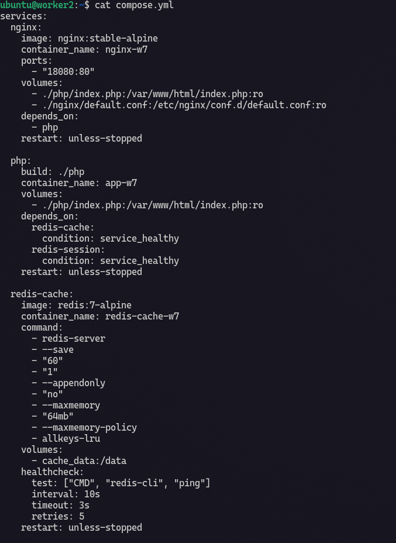

### Pembuatan Index dan Dockerfile

```php title="php/index.php"
<?php
declare(strict_types=1);

ini_set('session.save_handler', 'redis');
ini_set('session.save_path', 'tcp://redis-session:6379');
ini_set('session.gc_maxlifetime', '1800');

session_start();

$_SESSION['kunjungan'] = ($_SESSION['kunjungan'] ?? 0) + 1;
$kunjungan = (int) $_SESSION['kunjungan'];

$redis = new Redis();
$redis->connect('redis-cache', 6379, 2.0);

$key = 'week7:contoh-cache';
$hasilCache = $redis->get($key);

if ($hasilCache === false) {
    $sumber = 'MISS: data baru dibuat';
    $hasilCache = date('Y-m-d H:i:s');
    $redis->setEx($key, 30, $hasilCache);
} else {
    $sumber = 'HIT: data diambil dari Redis';
}

$ttl = $redis->ttl($key);

function aman(string $nilai): string
{
    return htmlspecialchars($nilai, ENT_QUOTES | ENT_SUBSTITUTE, 'UTF-8');
}
?>
<!doctype html>
<html lang="id">
<head>
    <meta charset="utf-8">
    <meta name="viewport" content="width=device-width, initial-scale=1">
    <title>Pekan 7 - Redis</title>
</head>
<body>
    <h1>Praktik Redis: Cache dan Session</h1>

    <p><strong>Status cache:</strong> <?= aman($sumber) ?></p>
    <p><strong>Waktu data dibuat:</strong> <?= aman((string) $hasilCache) ?></p>
    <p><strong>Sisa TTL cache:</strong> <?= $ttl ?> detik</p>
    <p><strong>Jumlah kunjungan dalam session:</strong> <?= $kunjungan ?></p>

    <p>Refresh halaman beberapa kali, lalu tunggu lebih dari 30 detik.</p>
</body>
</html>
```
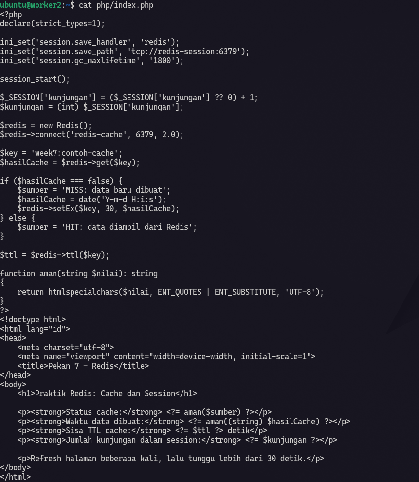

```yml title="php/Dockerfile"
FROM php:8.3-fpm

RUN pecl install redis \
    && docker-php-ext-enable redis
```

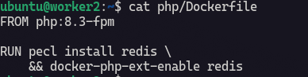

Selanjutnya saya akan menjalankan compose yg sudah dibuat :

```bash
docker compose up -d --build
```

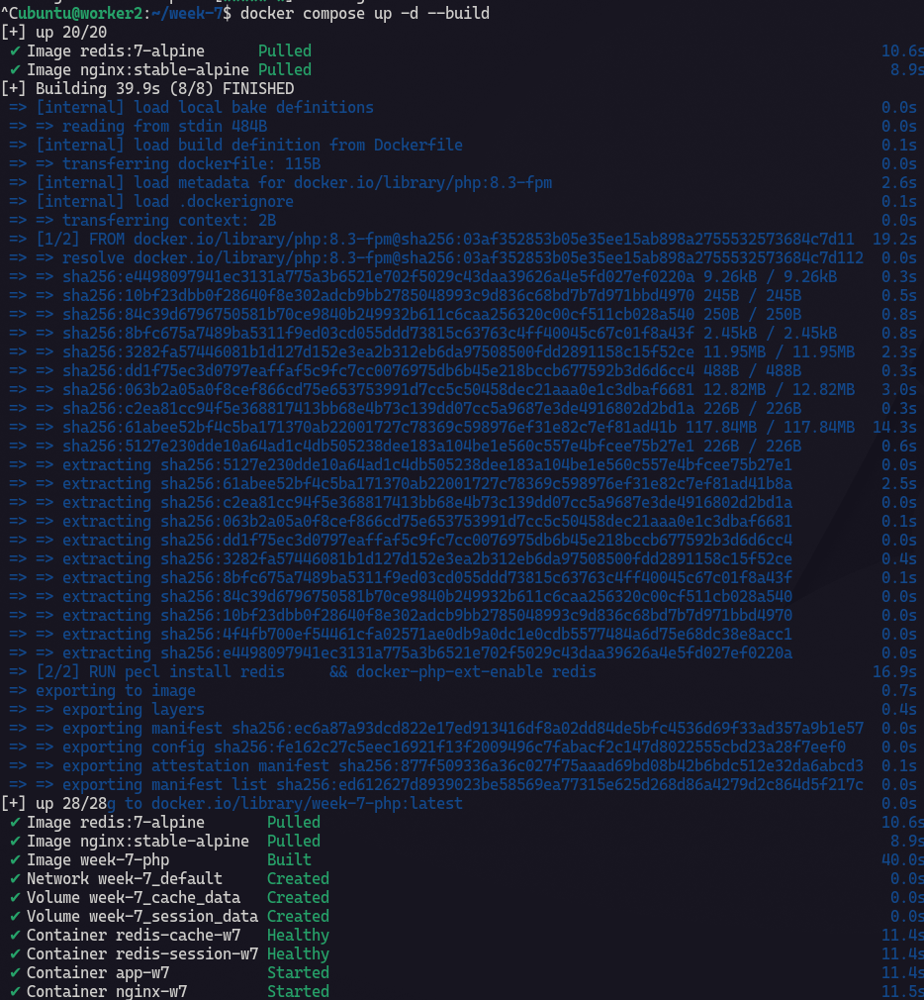

Index di `http://192.168.56.12:18080` sudah jalan :

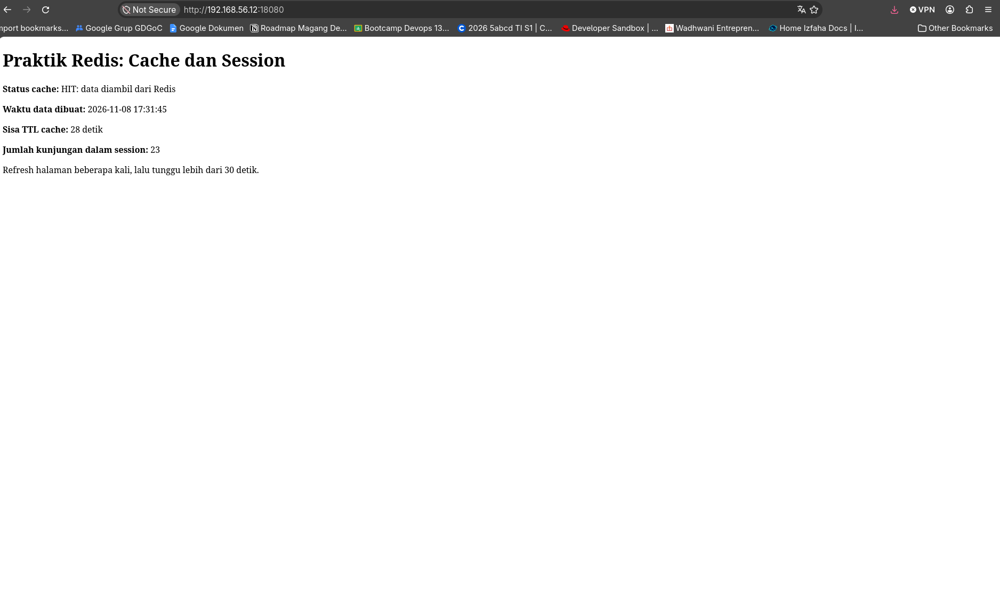

## Belajar struktur data dan TTL

Selanjutnya saya akan mengoprek sedikit tentang data structure dan time to live di redis. Saya akan menjalankan command redis via docker tanpa masuk interface tty nya :

Command ini akan menyimpan string berisi "Halo Redis" dan setelah eksekusi redis akan menampilkan output OK.

```bash
docker exec redis-session-w7 redis-cli SET latihan:string "Halo Redis"
```

Untuk menampilkan string, bisa menggunakan `GET` setelah command `redis-cli`.

```bash
docker exec redis-session-w7 redis-cli GET latihan:string
```

Selanjutnya saya akan menambahkan item `backup` `restore` `monitoring` ke depan list dengan `LPUSH`. 

```bash
docker exec redis-session-w7 redis-cli LPUSH latihan:tugas backup restore monitoring
```

Cara membaca outputnya dengan `LRANGE`.

```bash
docker exec redis-session-w7 redis-cli LRANGE latihan:tugas 0 -1
```

Command ini untuk menambahkan anggota unik ke set :

```bash
docker exec redis-session-w7 redis-cli SADD latihan:tools docker redis nginx
```

Dan ini untuk membaca anggota set.

```bash
docker exec redis-session-w7 redis-cli SMEMBERS latihan:tools
```

**TTL**

Ini untuk memberikan Time To Live atau batas data disimpan di redis. Sekarang saatnya membuat data sementara di redis disimpan di key `latihan:sementara` 5 detik saja.

```bash
docker exec redis-cache-w7 redis-cli SET latihan:sementara "hapus otomatis" EX 5
docker exec redis-cache-w7 redis-cli TTL latihan:sementara
```

selanjutnya kita tunggu 5 detik

```bash
docker exec redis-cache-w7 redis-cli GET latihan:sementara
docker exec redis-cache-w7 redis-cli TTL latihan:sementara
```

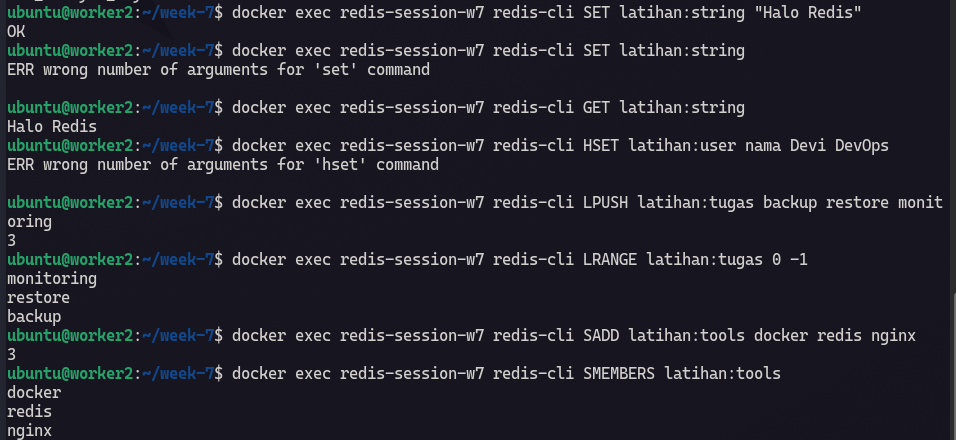

:::note
GET mengambil data sementara `"hapus otomatis"` dalam kasus ini sudah kosong berarti data sudah tidak ada. Command TTL untuk menanyakan sisa waktu hidup data didalam key.

:::

## Memeriksa RDB, AOF, dan eviction policy

```bash
docker exec redis-cache-w7 redis-cli CONFIG GET save
docker exec redis-cache-w7 redis-cli CONFIG GET appendonly
docker exec redis-cache-w7 redis-cli CONFIG GET maxmemory
docker exec redis-cache-w7 redis-cli CONFIG GET maxmemory-policy
```

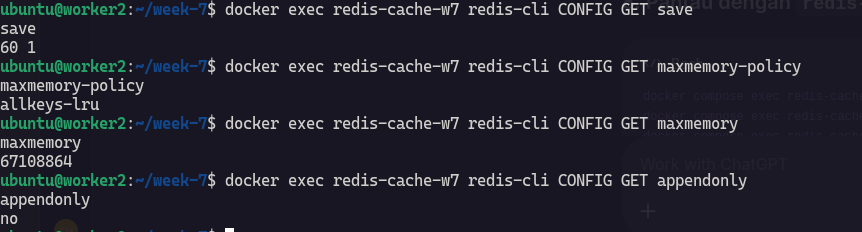

```bash
docker exec redis-session-w7 redis-cli CONFIG GET save
docker exec redis-session-w7 redis-cli CONFIG GET appendonly
docker exec redis-session-w7 redis-cli CONFIG GET maxmemory
docker exec redis-session-w7 redis-cli CONFIG GET maxmemory-policy
```

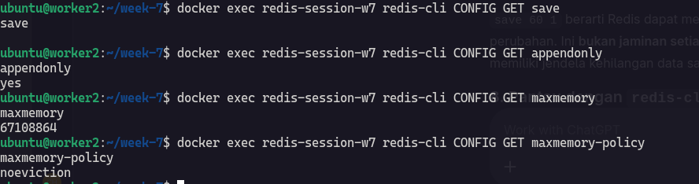

## Memantau dengan `redis-cli INFO`

Saya perlu memantau dengan command `redis-cli INFO` untuk memastikan bahwa Redis bekerja dengan baik dan benar. Pada pengoprekan kali ini ada beberapa hal yg perlu di perhatikan ketika mengecheck informasi :

1. `INFO memory` : yang perlu diperhatikan `used_memory_human`, `maxmemory`, `maxmemory_policy`. Ke 3 hal ini digunakan untuk mengetaui pemakaian memori dan apakah redis mendekati treshold yg ditentukan.

2. `INFO stats` : `keyspace_hits`, `keyspace_misses`, `evicted_keys`, untuk melihat cache yang dipakai dan apakah key mulai dikeluarkan karena memori penuh.

3. `INFO persistance` : Status penyimpanan RDB atau AOF, memastikan mekanisme persistence berjalan tanpa error.

Ini adalah isi dari Redis INFO :

**Container Redis Cache**

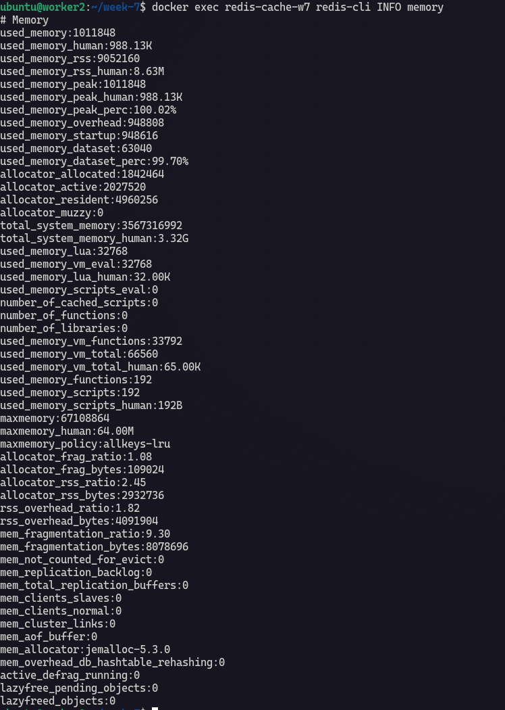

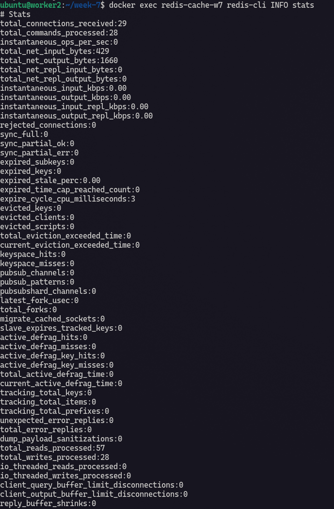

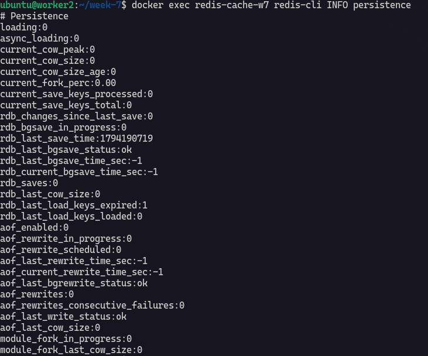

**Container Redis Session**

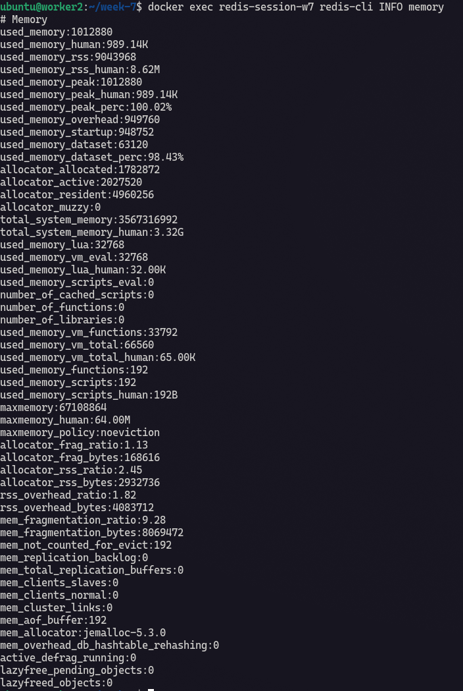

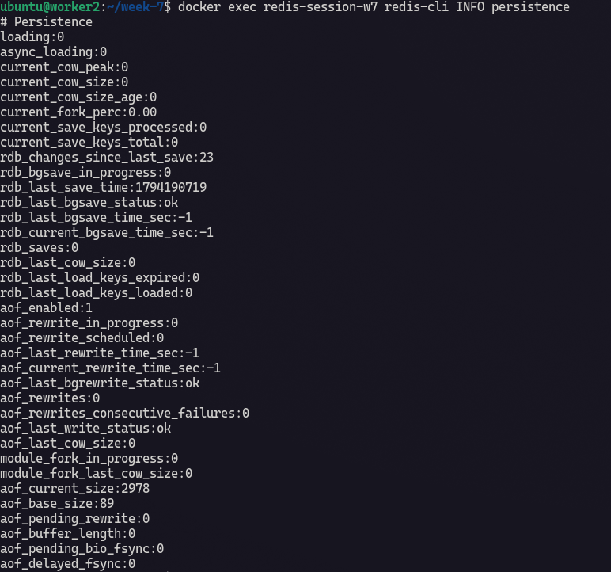
