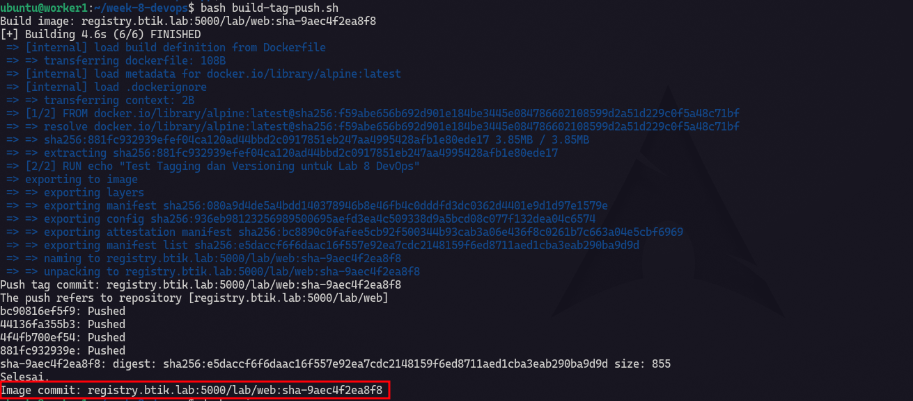
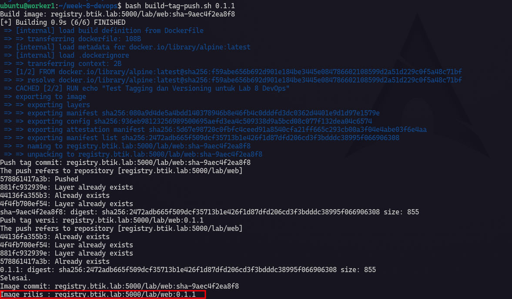
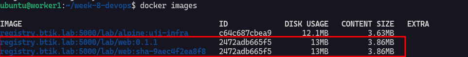
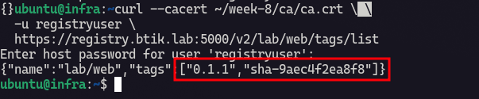

# Build, Tag, Push, dan Retensi Image Registry

Untuk lab pekan 8 DevOps saya menggunakan vm `worker1`.

## Buat script build–tag–push

Ini adalah script untuk build tag push otomatis tapi dalamnya terdapat rules yaitu pertama script akan mengechek apakah ada Dockerfile didalam app directory, jika tidak maka script akan berhenti tetapi jika ada maka akan lanjut ke tahap pengecheckan commit jika perubahan sudah tercommit maka akan di tagging sesuai keiginan user, apakah mau pake digest `sha-<commit>` atau memakai version number.

```bash title="build-tag-push.sh"
#!/usr/bin/env bash
set -Eeuo pipefail

REGISTRY="registry.btik.lab:5000"
REPOSITORY="lab/web"
APP_DIR="${APP_DIR:-$HOME/week-8-devops/app}"
IMAGE="$REGISTRY/$REPOSITORY"

if [[ ! -f "$APP_DIR/Dockerfile" ]]; then
  printf 'Dockerfile tidak ditemukan: %s/Dockerfile\n' "$APP_DIR" >&2
  exit 1
fi

if ! command -v git >/dev/null; then
  echo "git belum terpasang." >&2
  exit 1
fi

if ! git -C "$APP_DIR" rev-parse --is-inside-work-tree >/dev/null 2>&1; then
  echo "Direktori aplikasi harus berada di dalam repository Git." >&2
  exit 1
fi

if [[ -n "$(git -C "$APP_DIR" status --porcelain)" ]]; then
  echo "Working tree belum bersih. Commit perubahan sebelum membuat image rilis." >&2
  exit 1
fi

SHA="$(git -C "$APP_DIR" rev-parse --short=12 HEAD)"
SHA_TAG="sha-$SHA"
VERSION="${1:-}"

if [[ -n "$VERSION" && ! "$VERSION" =~ ^[0-9]+\.[0-9]+\.[0-9]+$ ]]; then
  echo "Versi harus berbentuk MAJOR.MINOR.PATCH, contoh: 1.2.0" >&2
  exit 1
fi

echo "Build image: $IMAGE:$SHA_TAG"
docker build \
  --label "org.opencontainers.image.revision=$(git -C "$APP_DIR" rev-parse HEAD)" \
  -t "$IMAGE:$SHA_TAG" \
  "$APP_DIR"

echo "Push tag commit: $IMAGE:$SHA_TAG"
docker push "$IMAGE:$SHA_TAG"

if [[ -n "$VERSION" ]]; then
  docker tag "$IMAGE:$SHA_TAG" "$IMAGE:$VERSION"
  echo "Push tag versi: $IMAGE:$VERSION"
  docker push "$IMAGE:$VERSION"
fi

echo "Selesai."
echo "Image commit: $IMAGE:$SHA_TAG"
[[ -z "$VERSION" ]] || echo "Image rilis : $IMAGE:$VERSION"
```

## Buat Dockerfile

```yaml title="Dockerfile"
FROM alpine

RUN echo "Test Tagging dan Versioning untuk Lab 8 DevOps"
```

Pastikan sudah di commit, karena aturan dari script adalah file Dockerfile harus di commit dahulu baru bisa di build => tagging baru akan di push ke `registry.btik.lab:5000`.

## Test di vm `worker1`

Saya memakai tag `sha-<commit>` untuk menelusuri kode sumber image dan tag versi seperti `0.1.1` untuk menandai rilis. Tag yang sedang digunakan dan beberapa rilis yang diperlukan untuk rollback dipertahankan. Tag percobaan ditinjau secara berkala. Sebelum menghapus image lama, saya memeriksa apakah beberapa tag menunjuk ke manifest digest yang sama. Penghapusan manifest dilakukan berdasarkan digest, kemudian garbage collection dijalankan saat registry tidak menerima push. Pada tahap lab ini, penghapusan dilakukan secara manual agar tidak menghapus image yang masih dipakai node lain.

Ini adalah tagging menggunakan digest sha commit docker.

```bash
bash build-tag-push.sh
```



Dan ini menggunakan version `0.1.1`.

```bash
bash build-tag-push.sh 0.1.1
```





Cek di `registry.btik.lab:5000` vm `infra`.



