# Private Docker Registry

Pada Pekan 8, saya menjalankan private Docker Registry di VM `infra` dengan alamat IP `192.168.56.13`. Registry diakses melalui `registry.btik.lab:5000`. Empat VM dalam lab, yaitu `manager1`, `worker1`, `worker2`, dan `infra`, akan menggunakan registry ini untuk menyimpan dan mengambil image.

Registry menggunakan TLS agar koneksi terenkripsi dan autentikasi htpasswd agar aksesnya memerlukan akun.

## Menyiapkan nama registry di semua VM

Pada setiap VM, saya menambahkan nama `registry.btik.lab` ke `/etc/hosts`:

```bash
sudo nano /etc/hosts
```

Tambahkan baris berikut:

```text
192.168.56.13 registry.btik.lab
```

Dengan baris tersebut, VM dapat menerjemahkan `registry.btik.lab` menjadi IP VM `infra` tanpa memerlukan DNS server tersendiri.

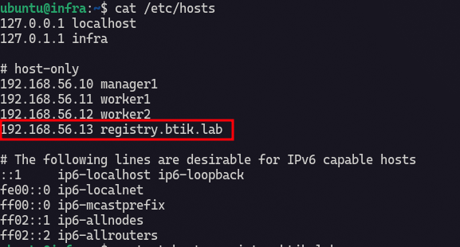

Saya memeriksa hasilnya di setiap VM:

```bash
getent hosts registry.btik.lab
```

`getent hosts` menanyakan hasil resolusi nama pada sistem. Output yang diharapkan menunjukkan IP `192.168.56.13`.

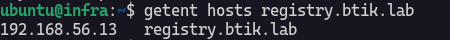

## Membuat CA internal dan sertifikat registry

Seluruh perintah pada bagian ini dijalankan di VM `infra`. Saya menyiapkan direktori kerja:

```bash
mkdir -p ~/week-8/{ca,certs,auth,data}
cd ~/week-8
```

Opsi `-p` membuat seluruh direktori yang diperlukan sekaligus dan tidak menganggap direktori yang sudah ada sebagai kesalahan. Fungsi masing-masing direktori adalah:

| Direktori | Fungsi |
|---|---|
| `ca/` | Menyimpan sertifikat dan private key CA internal. |
| `certs/` | Menyimpan sertifikat dan private key milik registry. |
| `auth/` | Menyimpan file akun htpasswd. |
| `data/` | Menyimpan data image yang diterima registry. |

### Membuat CA internal

```bash
openssl genrsa -out ca/ca.key 4096

openssl req -x509 -new -sha256 \
  -key ca/ca.key \
  -days 3650 \
  -out ca/ca.crt \
  -subj "/CN=BTIK Lab Internal CA"
```

Perintah pertama membuat private key CA berukuran 4096 bit. Perintah kedua membuat sertifikat CA yang ditandatangani oleh CA itu sendiri, berlaku selama 3650 hari. Dalam lab ini, CA internal digunakan untuk menandatangani sertifikat server registry.

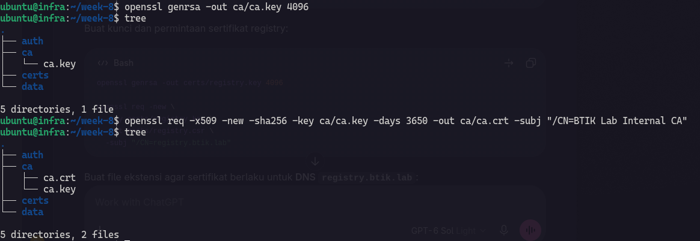

### Membuat private key dan CSR registry

```bash
openssl genrsa -out certs/registry.key 4096

openssl req -new \
  -key certs/registry.key \
  -out certs/registry.csr \
  -subj "/CN=registry.btik.lab"
```

`registry.key` adalah private key yang akan digunakan registry untuk TLS. File `registry.csr` adalah *Certificate Signing Request*, yaitu permintaan sertifikat yang nantinya ditandatangani oleh CA internal. Nilai `CN` berisi nama registry yang digunakan dalam lab.

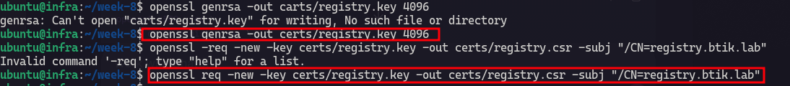

### Menambahkan identitas DNS pada sertifikat

```bash
cat > certs/registry.ext <<'EOF'
subjectAltName = DNS:registry.btik.lab
basicConstraints = CA:FALSE
keyUsage = digitalSignature, keyEncipherment
extendedKeyUsage = serverAuth
EOF
```

Perintah `cat` di atas menulis isi ke file `registry.ext`. Bagian `subjectAltName` menyatakan bahwa sertifikat berlaku untuk nama `registry.btik.lab`. `CA:FALSE` menyatakan sertifikat ini milik server, bukan sertifikat CA. `serverAuth` menyatakan sertifikat digunakan untuk autentikasi server TLS.

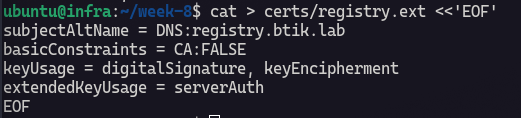

### Menandatangani dan memeriksa sertifikat

```bash
openssl x509 -req \
  -in certs/registry.csr \
  -CA ca/ca.crt \
  -CAkey ca/ca.key \
  -CAcreateserial \
  -out certs/registry.crt \
  -days 365 \
  -sha256 \
  -extfile certs/registry.ext

chmod 600 ca/ca.key certs/registry.key
```

Perintah `openssl x509 -req` menghasilkan `registry.crt` dengan menandatangani CSR memakai CA internal. Sertifikat server ini berlaku selama 365 hari. Perintah `chmod 600` membatasi pembacaan kedua private key agar hanya pemilik file yang dapat mengaksesnya.

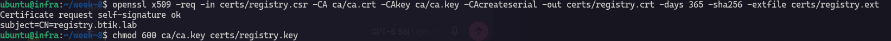

Saya memvalidasi hasilnya:

```bash
openssl verify -CAfile ca/ca.crt certs/registry.crt

openssl x509 -in certs/registry.crt -noout -ext subjectAltName
```

Perintah pertama memeriksa apakah `registry.crt` dapat diverifikasi menggunakan `ca.crt`. Hasil yang diharapkan adalah `certs/registry.crt: OK`. Perintah kedua menampilkan identitas DNS pada sertifikat; hasilnya harus memuat `DNS:registry.btik.lab`.

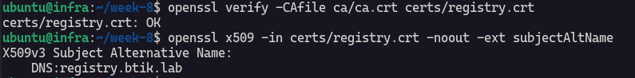

:::caution
`ca.key` dan `registry.key` adalah private key. Keduanya tetap disimpan di VM `infra`. Sertifikat yang dibagikan ke node lain hanya `ca.crt`.
:::

## Membuat akun registry dengan htpasswd

Di VM `infra`, saya memasang utilitas `htpasswd`:

```bash
sudo apt update
sudo apt install -y apache2-utils
```

`apt update` memperbarui daftar paket, sedangkan paket `apache2-utils` menyediakan perintah `htpasswd`.

Saya membuat file akun pertama:

```bash
htpasswd -Bc ~/week-8/auth/htpasswd registryuser
```

Opsi `-B` menyimpan password dalam bentuk hash bcrypt. Opsi `-c` membuat file htpasswd baru, sehingga **hanya digunakan saat membuat akun pertama**. Perintah ini meminta password secara interaktif.

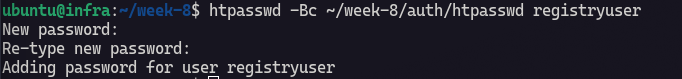

Untuk menambah akun berikutnya, saya menggunakan `-B` tanpa `-c`:

```bash
htpasswd -B ~/week-8/auth/htpasswd manager1
htpasswd -B ~/week-8/auth/htpasswd worker1
htpasswd -B ~/week-8/auth/htpasswd worker2
```

Saya melihat daftar nama akun tanpa menampilkan hash password:

```bash
cut -d: -f1 ~/week-8/auth/htpasswd
```

Akun registry berbeda dari akun login Linux. Nama akun `manager1` hanyalah akun autentikasi registry; akun tersebut tidak dibuat otomatis hanya karena ada VM bernama `manager1`.

## Menjalankan registry dengan Docker Compose

File `~/week-8/compose.yaml` berisi:

```yaml
services:
  registry:
    image: registry:2
    container_name: registry-btik
    restart: unless-stopped
    ports:
      - "5000:5000"
    environment:
      REGISTRY_HTTP_ADDR: "0.0.0.0:5000"
      REGISTRY_HTTP_TLS_CERTIFICATE: /certs/registry.crt
      REGISTRY_HTTP_TLS_KEY: /certs/registry.key
      REGISTRY_AUTH: htpasswd
      REGISTRY_AUTH_HTPASSWD_REALM: "BTIK Registry"
      REGISTRY_AUTH_HTPASSWD_PATH: /auth/htpasswd
      REGISTRY_STORAGE_DELETE_ENABLED: "true"
    volumes:
      - ./data:/var/lib/registry
      - ./certs:/certs:ro
      - ./auth:/auth:ro
```

Penjelasan bagian penting Compose:

| Konfigurasi | Fungsi |
|---|---|
| `image: registry:2` | Menggunakan image Docker Registry versi 2. |
| `ports: "5000:5000"` | Membuka port 5000 VM `infra` ke port 5000 container. |
| `REGISTRY_HTTP_TLS_*` | Menentukan sertifikat dan private key untuk HTTPS. |
| `REGISTRY_AUTH: htpasswd` | Mengaktifkan autentikasi menggunakan file htpasswd. |
| `REGISTRY_STORAGE_DELETE_ENABLED` | Mengizinkan penghapusan manifest melalui API registry. |
| `./data:/var/lib/registry` | Menyimpan data image di VM `infra`, sehingga tidak bergantung pada filesystem sementara container. |
| `:ro` | Memasang direktori sertifikat dan autentikasi dalam mode baca saja di container. |
| `restart: unless-stopped` | Menjalankan kembali container jika Docker dimulai ulang, kecuali container dihentikan secara sengaja. |

Saya memvalidasi lalu menjalankan Compose:

```bash
cd ~/week-8
docker compose config -q
docker compose up -d
docker ps --filter name=registry-btik
```

`config -q` memeriksa konfigurasi Compose tanpa menampilkan seluruh hasilnya. `up -d` menjalankan registry di latar belakang. `docker ps` memastikan container berstatus berjalan.

### Memeriksa HTTPS dan autentikasi

Saya mengirim request tanpa akun:

```bash
curl --cacert ~/week-8/ca/ca.crt -I https://registry.btik.lab:5000/v2/
```

`--cacert` meminta `curl` mempercayai CA internal yang dibuat sebelumnya. Opsi `-I` menampilkan header respons saja. Respons `401 Unauthorized` di tahap ini diharapkan: koneksi HTTPS berhasil, tetapi registry meminta autentikasi.

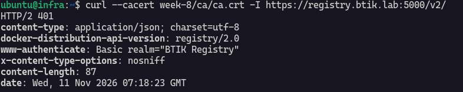

Kemudian saya mengirim request dengan akun registry:

```bash
curl --cacert ~/week-8/ca/ca.crt -u registryuser https://registry.btik.lab:5000/v2/
```

Opsi `-u registryuser` membuat `curl` meminta password akun tersebut. Jika berhasil, endpoint `/v2/` mengembalikan `{}`.

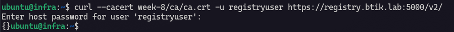

## Mendistribusikan CA ke semua node

Agar Docker pada VM lain mempercayai sertifikat registry, saya menyalin **sertifikat CA publik** dari `infra`:

```bash
# Dijalankan di VM infra
scp ~/week-8/ca/ca.crt ubuntu@192.168.56.10:/tmp/btik-ca.crt
scp ~/week-8/ca/ca.crt ubuntu@192.168.56.11:/tmp/btik-ca.crt
scp ~/week-8/ca/ca.crt ubuntu@192.168.56.12:/tmp/btik-ca.crt
```

`scp` menyalin file melalui SSH. Ketiga alamat tujuan adalah VM `manager1`, `worker1`, dan `worker2`. Yang disalin adalah `ca.crt`, bukan private key CA.

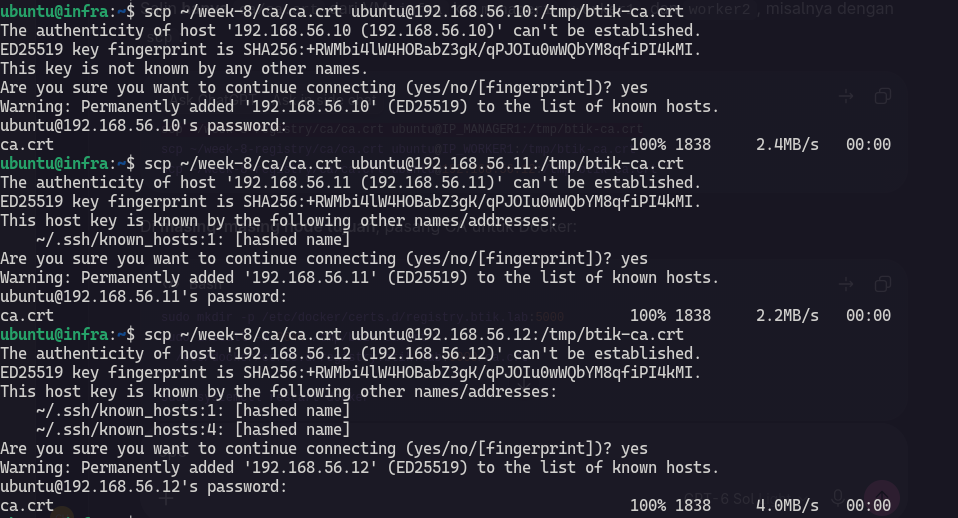

Di masing-masing VM tujuan, saya memasang CA pada direktori kepercayaan Docker:

```bash
sudo mkdir -p /etc/docker/certs.d/registry.btik.lab:5000

sudo install -m 0644 /tmp/btik-ca.crt /etc/docker/certs.d/registry.btik.lab:5000/ca.crt

sudo systemctl restart docker
```

Nama direktori `registry.btik.lab:5000` harus sama persis dengan alamat registry yang dipakai untuk `docker login`, `push`, dan `pull`. `install -m 0644` menyalin file sambil mengatur izinnya. Docker kemudian dimulai ulang agar konfigurasi kepercayaan sertifikat dimuat.

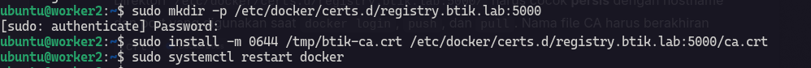

Saya juga memasang CA pada Docker daemon di VM `infra`:

```bash
sudo mkdir -p /etc/docker/certs.d/registry.btik.lab:5000

sudo install -m 0644 ~/week-8/ca/ca.crt /etc/docker/certs.d/registry.btik.lab:5000/ca.crt

sudo systemctl restart docker
```

Memasang CA untuk `curl` melalui `--cacert` tidak otomatis membuat Docker mempercayai registry. Karena itu, CA juga harus tersedia di direktori kepercayaan Docker pada setiap VM.

## Menguji login, push, dan pull

Di VM `infra`, saya login terlebih dahulu:

```bash
docker login -u registryuser registry.btik.lab:5000
```

Docker meminta password akun `registryuser`. Jika berhasil, Docker dapat menggunakan kredensial tersebut saat push dan pull.

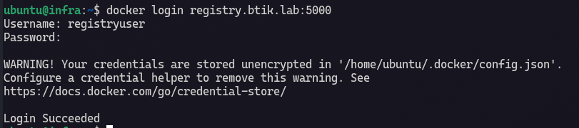

Saya mengambil image Alpine dari Docker Hub:

```bash
docker pull alpine:3.20
```

Perintah ini menyimpan image `alpine:3.20` pada Docker daemon VM `infra`. Image tersebut belum berada di private registry.

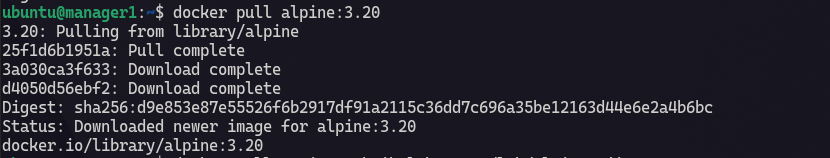

Selanjutnya saya memberikan nama dan tag yang menunjuk ke registry internal:

```bash
docker tag alpine:3.20 registry.btik.lab:5000/lab/alpine:uji-infra
```

`docker tag` membuat referensi nama baru untuk image yang sudah tersedia secara lokal. `registry.btik.lab:5000` menunjukkan alamat registry tujuan, `lab/alpine` adalah nama repository, dan `uji-infra` adalah tag. Perintah ini **belum mengunggah image**.


Saya mengunggahnya dengan:

```bash
docker push registry.btik.lab:5000/lab/alpine:uji-infra
```

`docker push` mengirim image ke registry. Repository `lab/alpine` akan muncul setelah push pertama berhasil; repository tidak perlu dibuat secara manual. Saya memastikan output berakhir dengan digest `sha256:...`.

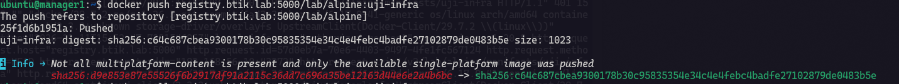

Untuk memeriksa tag yang tersimpan, saya menjalankan perintah berikut di VM `infra`:

```bash
curl --cacert ~/week-8/ca/ca.crt -u registryuser https://registry.btik.lab:5000/v2/lab/alpine/tags/list
```

Hasilnya seharusnya memuat `uji-infra`. Jika muncul `NAME_UNKNOWN`, repository `lab/alpine` belum berhasil dibuat melalui push.

Di VM lain, misalnya `manager1`, saya menguji pull:

```bash
docker login -u manager1 registry.btik.lab:5000

docker pull registry.btik.lab:5000/lab/alpine:uji-infra

docker image inspect registry.btik.lab:5000/lab/alpine:uji-infra
```

Pull membuktikan bahwa `manager1` dapat mengakses image dari registry di VM `infra`. Langkah yang sama dapat dilakukan di `worker1` dan `worker2`.

:::note
Tag harus cocok persis. `uji-manager1` tidak tersedia hanya karena akun `manager1` berhasil login. Tag tersebut baru tersedia setelah sebuah image diberi tag `uji-manager1` dan berhasil di-push.
:::

## Strategi penamaan tag image

Tag membantu saya mengenali versi image yang disimpan di registry. Untuk pengujian koneksi antar-VM, saya menggunakan tag seperti `uji-infra` dan `uji-manager1`. Untuk image aplikasi, bisa menggunakan dua jenis tag:

| Jenis tag | Contoh | Kegunaan |
|---|---|---|
| Versi semantik | `aplikasi/web:1.2.0` | Menandai versi rilis yang mudah dibaca. |
| Git SHA pendek | `aplikasi/web:sha-a1b2c3d` | Menghubungkan image dengan commit kode sumber yang digunakan saat build. |

Nama lengkap image juga memuat alamat registry:

```text
registry.btik.lab:5000/aplikasi/web:1.2.0
registry.btik.lab:5000/aplikasi/web:sha-a1b2c3d
```

Satu image dapat diberi kedua tag tersebut, lalu masing-masing tag di-push. Dengan cara ini, saya dapat melihat versi rilisnya sekaligus menelusuri commit pembuatnya. Tag seperti `latest` tidak saya gunakan sebagai satu-satunya penanda versi karena isi yang dirujuk tag tersebut bisa berubah.

Selain tag, saya mencatat *digest* `sha256:...` dari hasil `docker push`. Digest mengidentifikasi konten image secara lebih pasti ketika saya perlu memastikan image yang digunakan pada deployment.

## Strategi retensi dan garbage collection

Seiring bertambahnya versi aplikasi, registry akan menyimpan lebih banyak manifest dan layer image. Karena itu, saya menetapkan kebijakan retensi sebelum menghapus image lama:

1. Pertahankan tag yang sedang dipakai oleh deployment.
2. Pertahankan tag rilis yang masih diperlukan untuk rollback.
3. Tinjau tag pengujian dan versi lama secara berkala.
4. Hapus manifest yang sudah dipastikan tidak diperlukan.
5. Jalankan *garbage collection* pada waktu pemeliharaan untuk membersihkan blob yang tidak lagi direferensikan.

**Menghapus tag atau manifest dan menjalankan garbage collection adalah dua langkah berbeda.** Garbage collection membersihkan blob yang sudah tidak direferensikan oleh manifest; menjalankannya tanpa menentukan manifest lama yang boleh dihapus tidak otomatis menghapus semua image versi lama.

Pada lab ini, saya belum menjadwalkan penghapusan otomatis. Penghapusan akan diuji lebih dahulu memakai repository khusus percobaan agar image yang digunakan oleh node lain tetap tersedia. Saat garbage collection dijalankan, aktivitas push dihentikan sementara untuk menghindari perubahan data registry selama pembersihan.

:::caution
Sebelum menghapus manifest, periksa seluruh tag yang mengarah kepadanya. Beberapa tag dapat menunjuk ke manifest yang sama, sehingga penghapusan manifest bisa memengaruhi lebih dari satu tag.
:::