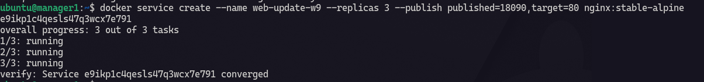
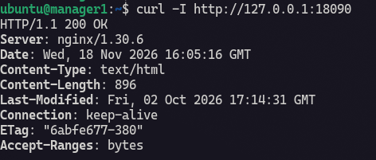
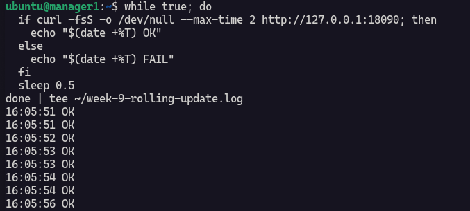
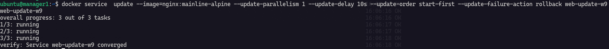
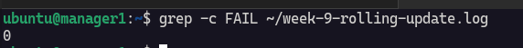

# Rolling Update Docker Swarm

Pada lab ini, saya menguji *rolling update* pada service Docker Swarm. Selama proses update, saya mengirim request HTTP secara terus-menerus untuk melihat apakah service tetap dapat diakses.

## Membuat service di `manager1`

Saya membuat service bernama `web-update-w9` dengan tiga replica. Service ini menggunakan image `nginx:stable-alpine` dan dipublikasikan melalui port `18090`.

```bash
docker service create \
  --name web-update-w9 \
  --replicas 3 \
  --publish published=18090,target=80 \
  nginx:stable-alpine
```



Setelah service dibuat, saya memeriksa status task dan mengirim request HTTP untuk memastikan Nginx dapat diakses:

```bash
docker service ps web-update-w9
curl -I http://127.0.0.1:18090
```

Perintah `docker service ps` menunjukkan task yang dijalankan beserta node tempatnya berjalan. Sementara itu, `curl -I` meminta header respons HTTP dari service.



## Memantau request dengan `curl`

Saya membuka terminal kedua dan menjalankan loop berikut **sebelum memulai update**:

```bash
while true; do
  if curl -fsS -o /dev/null --max-time 2 http://127.0.0.1:18090; then
    echo "$(date +%T) OK"
  else
    echo "$(date +%T) FAIL"
  fi

  sleep 0.5
done | tee ~/week-9-rolling-update.log
```

Loop tersebut mengirim request setiap 0,5 detik. Output `OK` berarti request berhasil, sedangkan `FAIL` berarti request gagal, mengalami *timeout*, atau menerima status HTTP error. Hasil pemantauan juga disimpan dalam file `~/week-9-rolling-update.log`.



## Melakukan rolling update

Sambil membiarkan loop `curl` berjalan di terminal kedua, saya kembali ke terminal pertama untuk memperbarui image service dari `nginx:stable-alpine` menjadi `nginx:mainline-alpine`:

```bash
docker service update \
  --image nginx:mainline-alpine \
  --update-parallelism 1 \
  --update-delay 10s \
  --update-order start-first \
  --update-failure-action rollback \
  web-update-w9
```

Konfigurasi tersebut membuat Swarm memperbarui **satu task setiap tahap**, dengan jeda **10 detik** sebelum melanjutkan ke tahap berikutnya. Opsi `start-first` memulai task pengganti sebelum menghentikan task lama. Jika update task gagal, `--update-failure-action rollback` menginstruksikan Swarm untuk mengembalikan service ke konfigurasi sebelumnya.



Setelah update selesai, saya memeriksa status task:

```bash
docker service ps web-update-w9
```

Kemudian saya menghentikan loop `curl` dengan `Ctrl+C` dan menghitung jumlah request yang tercatat gagal:

```bash
grep -c FAIL ~/week-9-rolling-update.log
```



Hasil penghitungan ini menunjukkan apakah ada request yang gagal **selama periode pengujian**. Jika hasilnya `0`, berarti tidak ada kegagalan request yang teramati pada pengujian tersebut. Konfigurasi rollback sudah dipasang, tetapi mekanismenya belum diuji secara langsung karena update ini tidak sengaja dibuat gagal.