# Docker Swarm Dasar dengan Tiga Node

Di pekan ini saya membangun cluster Docker Swarm dengan satu manager dan dua worker. Saya menggunakan Nginx untuk melihat bagaimana Swarm menjadwalkan workload ke beberapa VM, menjaga jumlah replika, dan menyesuaikan penempatan workload saat salah satu node masuk masa maintenance.

**Swarm mode** adalah fitur orkestrasi yang terintegrasi dengan Docker Engine. Di dalam cluster, **manager** mengelola konfigurasi service dan menjadwalkan task, sedangkan **worker** menjalankan task yang diberikan. Manager dengan availability `Active` juga bisa menjalankan task.

Konfigurasi service bersifat deklaratif. Saat membuat service dengan dua replika, saya menetapkan **desired state** atau kondisi yang ingin dipertahankan. Swarm kemudian berusaha menjaga dua task tetap berjalan. Untuk service Nginx di lab ini, setiap task menjalankan satu container.

## Topologi lab

| Node | Peran | Alamat IP |
| --- | --- | --- |
| `manager1` | Manager | `192.168.56.10` |
| `worker1` | Worker | `192.168.56.11` |
| `worker2` | Worker | `192.168.56.12` |

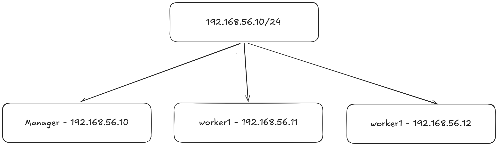

### Port yang digunakan

| Port | Protokol | Fungsi |
| --- | --- | --- |
| `2377` | TCP | Komunikasi pengelolaan cluster menuju manager |
| `7946` | TCP dan UDP | Komunikasi dan penemuan node untuk jaringan overlay |
| `4789` | UDP | Lalu lintas data jaringan overlay, termasuk jaringan `ingress` |
| `18080` | TCP | Port yang saya publish untuk mengakses service Nginx dari klien |

## Inisialisasi Swarm di `manager1`

Saya menjalankan perintah berikut di `manager1` untuk membuat cluster.

```bash
docker swarm init \
  --advertise-addr 192.168.56.10 \
  --data-path-addr 192.168.56.10
```

`--advertise-addr` menetapkan alamat yang diumumkan ke node lain untuk komunikasi Swarm. `--data-path-addr` menetapkan alamat untuk lalu lintas data jaringan overlay. Pada lab ini, kedua parameter menggunakan IP yang sama.

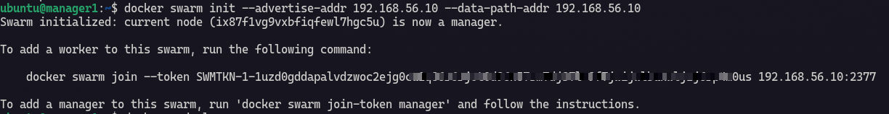

### Bergabung sebagai worker

Output `docker swarm init` menampilkan perintah `docker swarm join` beserta token untuk bergabung sebagai worker. Saya menyalin perintah tersebut dan menjalankannya di `worker1` dan `worker2`. Jika perlu menampilkan ulang perintah join, saya bisa menjalankan `docker swarm join-token worker` dari `manager1`.

Jika dokumentasi ini dipublikasikan, samarkan join token pada tangkapan layar.

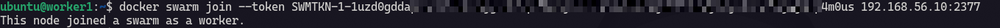

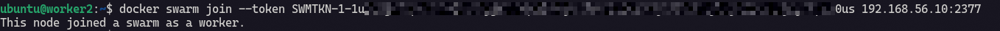

Setelah kedua worker bergabung, saya mengecek keanggotaan cluster dari `manager1`.

```bash
docker node ls
```

Saya mengecek kolom `STATUS` untuk memastikan ketiga node berstatus `Ready`, serta kolom `AVAILABILITY` untuk memastikan ketiganya `Active`. Pada kolom `MANAGER STATUS`, `manager1` seharusnya tampil sebagai `Leader`.

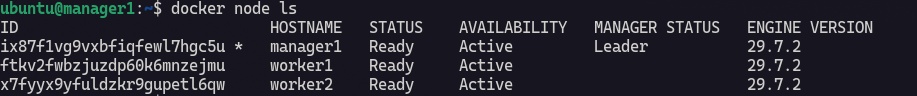

## Membuat service Nginx dalam mode replicated

Dari `manager1`, saya membuat service `web-w9` dengan dua replika. Port `18080` dipublikasikan melalui Swarm dan diarahkan ke port `80` di container Nginx.

```bash
docker service create \
  --name web-w9 \
  --replicas 2 \
  --publish published=18080,target=80 \
  nginx:stable-alpine
```

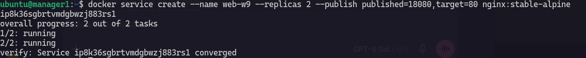

Saya menggunakan dua perintah untuk memeriksa service. `docker service ls` menunjukkan ringkasan jumlah replika, sedangkan `docker service ps` menampilkan penempatan dan status tiap task.

```bash
docker service ls
docker service ps web-w9
```

Jika kedua replika sudah berjalan, kolom `REPLICAS` akan menampilkan `2/2`.

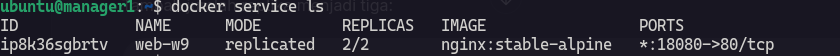

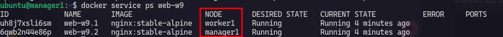

### Menguji ingress routing mesh

Saya mengirim HTTP HEAD request ke port `18080` pada setiap VM dari mesin yang dapat menjangkau jaringan lab.

```bash
curl -I http://192.168.56.10:18080
curl -I http://192.168.56.11:18080
curl -I http://192.168.56.12:18080
```

Service memakai mode publish `ingress` secara default. Melalui **routing mesh**, setiap node dapat menerima koneksi pada port yang dipublikasikan dan meneruskannya ke task Nginx yang aktif. Karena itu, sebuah node tetap bisa merespons `curl` meskipun task Nginx berjalan di node lain. Untuk melihat lokasi task, saya menggunakan `docker service ps web-w9`.

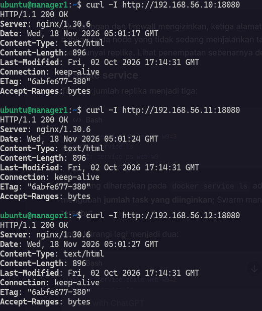

## Melakukan scale up dan scale down

Saya mulai dengan menaikkan jumlah replika `web-w9` dari dua menjadi tiga. Perintah `scale` mengubah desired state service, lalu scheduler menambahkan task untuk memenuhi jumlah yang diminta.

```bash
docker service scale web-w9=3
```

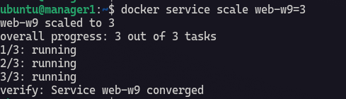

```bash
docker service ps web-w9
docker service ls
```

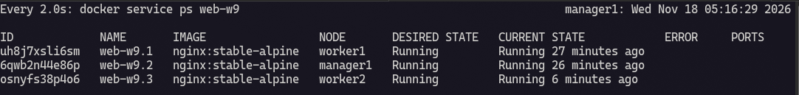

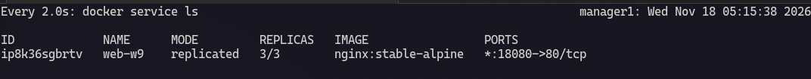

Berikutnya saya menurunkan jumlah replika dari tiga menjadi dua. Saat *scale down*, Swarm menghentikan satu task untuk menyesuaikan jumlah replika dengan konfigurasi baru.

```bash
docker service scale web-w9=2
docker service ls
docker service ps web-w9
```

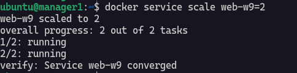

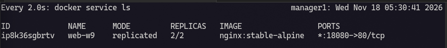

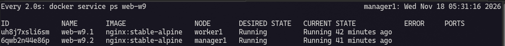

Sebelum lanjut ke percobaan update, saya menaikkan kembali jumlah replika menjadi tiga.

```bash
docker service scale web-w9=3
```

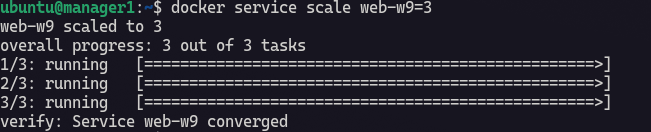

## Melakukan rolling update dan rollback

Saya mengganti image service dari `nginx:stable-alpine` menjadi `nginx:mainline-alpine`. Swarm menerapkan perubahan melalui **rolling update**, yaitu mengganti task secara bertahap berdasarkan kebijakan update service.

```bash
docker service update --image nginx:mainline-alpine web-w9
docker service ps web-w9
```

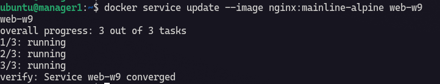

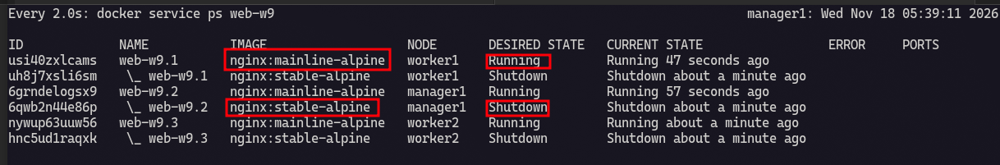

Output `docker service ps` dapat menampilkan task lama dengan status `Shutdown` karena perintah ini juga menampilkan riwayat task. Untuk memeriksa image yang dikonfigurasi pada service, saya menggunakan `inspect`.

```bash
docker service inspect --pretty web-w9
```

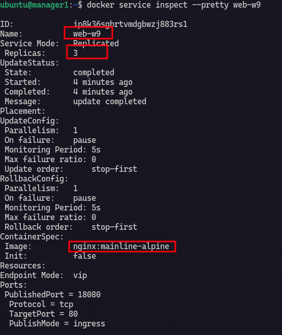

### Mengembalikan konfigurasi service

Saya menjalankan rollback untuk mengembalikan konfigurasi `web-w9` ke kondisi sebelum update terakhir. Dalam percobaan ini, perubahan yang dikembalikan adalah image, sehingga service kembali menggunakan `nginx:stable-alpine`.

```bash
docker service rollback web-w9
docker service ps web-w9
docker service inspect --pretty web-w9
```

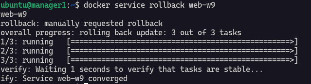

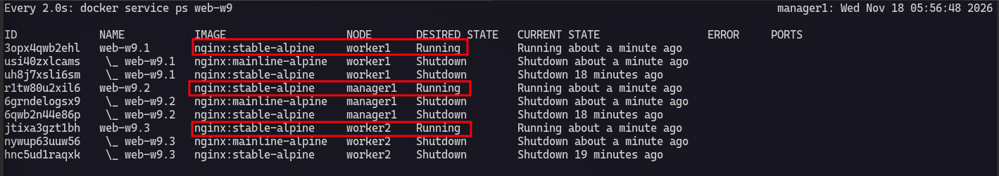

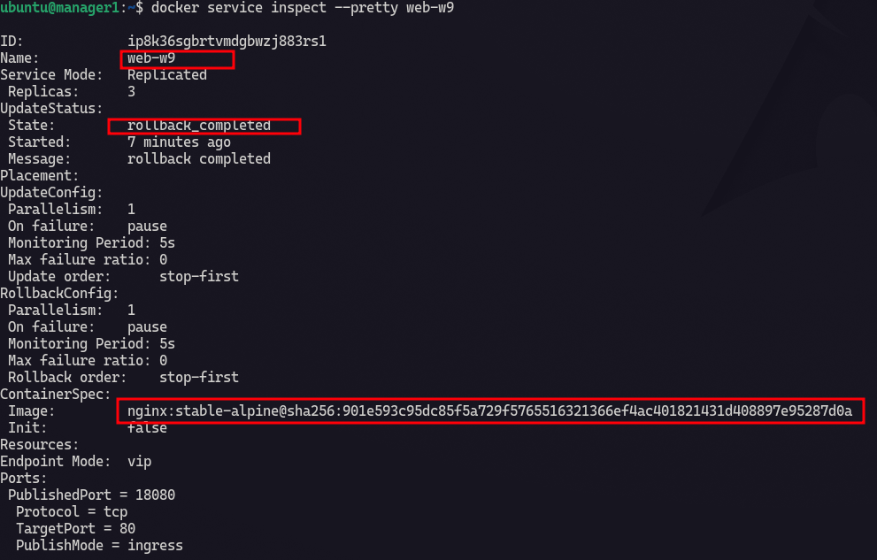

## Membandingkan mode replicated dan global

Saya membuat service Nginx kedua dalam mode `global` untuk membandingkan cara scheduler menentukan jumlah task.

| Mode | Cara Swarm menentukan jumlah task | Service di lab |
| --- | --- | --- |
| `replicated` | Scheduler menjadwalkan task berdasarkan jumlah replika yang ditetapkan untuk service. | `web-w9` |
| `global` | Scheduler menjalankan satu task pada setiap node yang memenuhi syarat penempatan. | `web-global-w9` |

```bash
docker service create \
  --name web-global-w9 \
  --mode global \
  nginx:stable-alpine

docker service ps web-global-w9
docker service inspect --pretty web-global-w9
```

Ketika ketiga node berstatus `Active` dan memenuhi syarat penempatan, `web-global-w9` menjalankan satu task di masing-masing VM. Saya membuat service ini tanpa port yang dipublikasikan karena pengujiannya berfokus pada penempatan task.

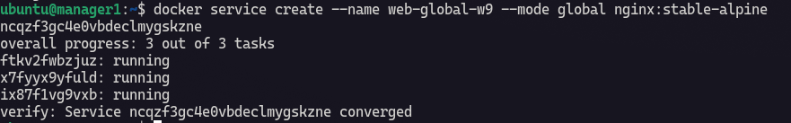

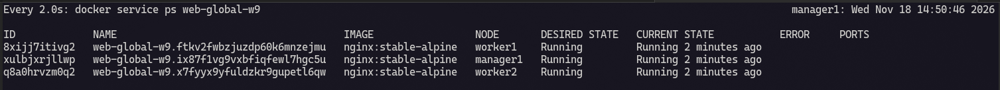

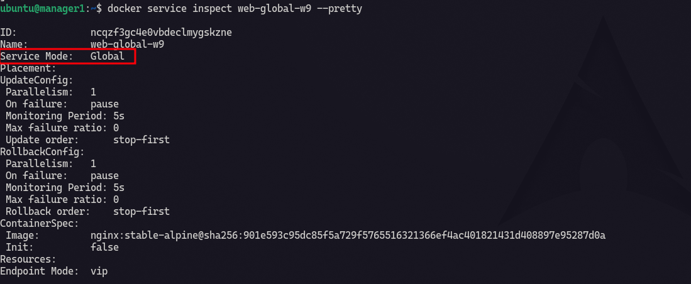

## Melakukan drain pada `worker1` untuk simulasi maintenance

Sebelum mengubah availability `worker1`, saya mengecek penempatan task kedua service sebagai pembanding.

```bash
docker node ls
docker service ps web-w9
docker service ps web-global-w9
```

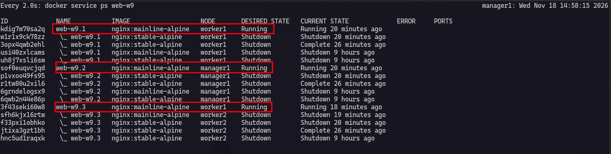

Dari `manager1`, saya mengubah availability `worker1` menjadi `Drain`.

```bash
docker node update --availability drain worker1
```

Saat node masuk status `Drain`, scheduler berhenti menjadwalkan task baru ke node tersebut dan menghentikan task Swarm yang sedang berjalan di sana. Dampaknya pada kedua service berbeda.

- Pada `web-w9`, Swarm mencoba menjalankan task pengganti di node lain yang memenuhi syarat agar jumlah replika kembali sesuai desired state.
- Pada `web-global-w9`, task di `worker1` dihentikan. Node aktif lain tetap menjalankan masing-masing satu task global.

```bash
docker node ls
docker service ps web-w9
docker service ps web-global-w9
```

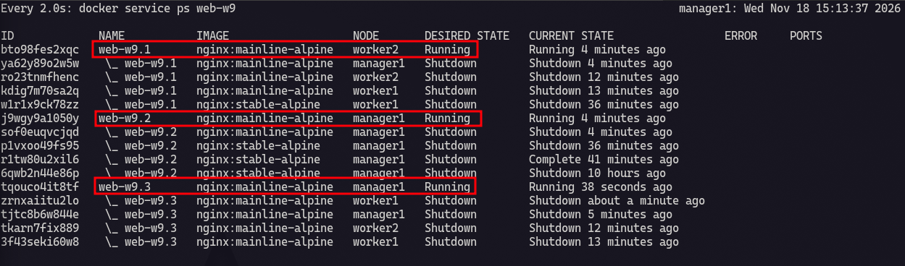

### Mengaktifkan kembali `worker1`

Setelah simulasi maintenance selesai, `worker1` bisa dikembalikan ke status `Active` dari `manager1`.

```bash
docker node update --availability active worker1
docker node ls
docker service ps web-w9
docker service ps web-global-w9
```

Dengan status `Active`, `worker1` kembali bisa menerima task. Service global akan menjadwalkan satu task di `worker1` selama node memenuhi syarat. Untuk service replicated, task yang sudah berjalan di node lain bisa tetap berada di sana. Jadi, `worker1` bisa tampil sebagai `Active` meskipun belum menjalankan task `web-w9`.