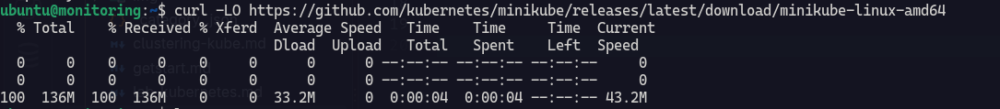
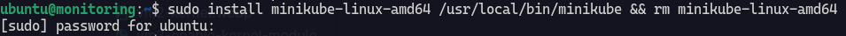
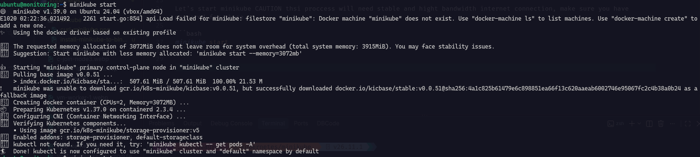
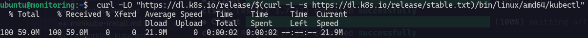
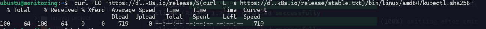
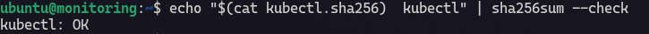
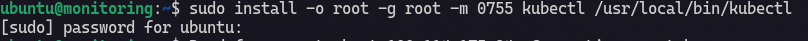

This docs will show how to install minikube and kubectl on Ubuntu.

VM Spesifications :

| RAM | Storage | OS |
|---|---|---|
| 4G | 23G | Ubuntu 24.04 |

## Installing Minikube

This is the official documentation of [minikube](https://minikube.sigs.k8s.io/docs/start/?arch=%2Flinux%2Fx86-64%2Fstable%2Fbinary+download) and I will refer/apply to the docs.

This command is to install minikube on Linux, this is installer type if you laverage different os just choose installer type refer to your OS such as Debian Package or RPM Package. 

```bash
curl -LO https://github.com/kubernetes/minikube/releases/latest/download/minikube-linux-amd64
sudo install minikube-linux-amd64 /usr/local/bin/minikube && rm minikube-linux-amd64
```





Let's start minikube CAUTION thsi proccess will need stable and hight bandwidth internet connection, make sure you have prepared for those.

```bash
minikube start
```



There are so many proccesses when running this command :

1. **Create Local Node**, minikube will create environment for kubernetes's node. If we select `--driver=docker`, minikube will utilize container docker as node. If we select `--driver=vm`, minikube will utilize VM as node.

2. **Running kubernetes inside node**, control plane components such as server API, etcd, scheduler, and control manager are run alongside the node components such as kubelet and container runtime.

3. **Setting Network and System Components**, cluster runs system pod like CoreDNS in order to workload can use network services and kubernetes DNS.

4. **`kubectl` Access Management**, minikube add or choose context minikube in kubeconfig so that kubectl command refers to local cluster.

5. **Cluster Readiness**, after node and service core ready, `minikube start` command will be done. Cluster will be running in backgroud until stopped. 

<div style={{ textAlign: 'center' }}>
  
</div>

## Install kubectl

Referring to [kubectl official docs](https://kubernetes.io/docs/tasks/tools/install-kubectl-linux/), I will follow the docs.

For starting point, let's download the latest release binary :

```bash
curl -LO "https://dl.k8s.io/release/$(curl -L -s https://dl.k8s.io/release/stable.txt)/bin/linux/amd64/kubectl"
```



Now we need to validate the binary by downloading kubectl checksum file :

```bash
curl -LO "https://dl.k8s.io/release/$(curl -L -s https://dl.k8s.io/release/stable.txt)/bin/linux/amd64/kubectl.sha256"
```



Then, validate kubectl binary against the checksum file :

```bash
echo "$(cat kubectl.sha256)  kubectl" | sha256sum --check
```



Install kubectl :

```bash
sudo install -o root -g root -m 0755 kubectl /usr/local/bin/kubectl
```



:::note
If you do not have root access on your system, you can still install kubectl on `~/.local/bin` directory :

```bash
chmod +x kubectl
mkdir -p ~/.local/bin
mv ./kubectl ~/.local/bin/kubectl
# and then append (or prepend) ~/.local/bin to $PATH
```
:::
