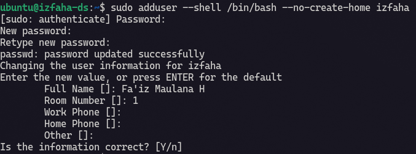
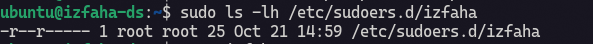

## Create User via `adduser`

Linux provides several commands for creating user accounts, including `adduser` and `useradd`. In this tutorial, I will demonstrate how to create a user with `adduser`.

```bash
sudo adduser --shell /bin/bash --no-create-home izfaha
```

This command will create a user named `izfaha` has access to login shell `/bin/bash` with no home directory.



## Visudo User Permission

To give user's permission in best practice we should create file in `/etc/sudoers.d/{your-username}`. Now let's demo!!!

```bash
sudo vim /etc/sudoers.d/izfaha
```

or recommended to use visudo.

```bash
sudo visudo -f /etc/sudoers.d/izfaha
```

Then insert into file :

This configuration need user's password, **keep in mind** no root's password BUT user's password.

:::note
Change `izfaha` to your desire user.
:::

```
izfaha ALL=(ALL:ALL) ALL
```

or without user's password but this configuration is dangerous as user can run all administrator command without password.

```
izfaha ALL=(ALL) NOPASSWD: ALL
```

For more safety, we can strictly use :

**Add Command Spesific rules** like allow `docker` and `systemctl` command.

We just list the commands that administrator wants to be meant limiting user execute dangerous command. This configuration still give access to sub command such as `systemctl status/restart/disable/start` to all daemon services.

```
# need user's root password

izfaha ALL=(root) /usr/bin/systemctl, /usr/bin/docker
```

```
# without user's root password

izfaha ALL=(root) NOPASSWD: /usr/bin/systemctl, /usr/bin/docker
```

**Use the `NOEXEC` tag in sudoers**

`NOEXEC` tells system which forbidden command to run but the more important thing is preventing. 

```
izfaha ALL=(root) NOEXEC: /usr/bin/systemctl status *, /usr/bin/systemctl restart nginx
```

Make sure to give read access to user and organization. 

```bash
sudo chmod 0440 /etc/sudoers.d/izfaha
```

