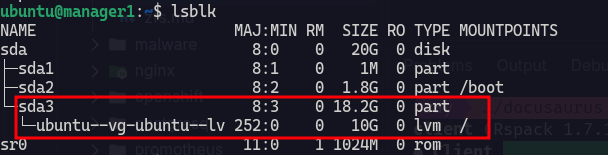
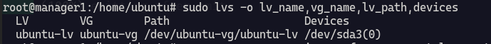
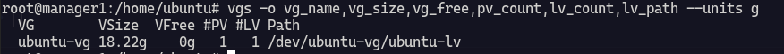
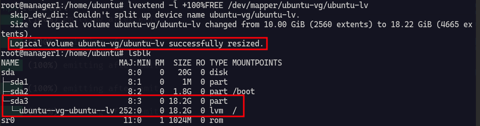

# How to Extend an LVM Root Volume in Ubuntu

In this example, the root filesystem (`/`) is on the logical volume `ubuntu-lv`. The logical volume is about 10 GB, while its physical partition, `/dev/sda3`, is about 18 GB. I want to use the available space to expand `/`.



> The size of `/dev/sda3` does not tell us how much space is available to extend the logical volume. We need to check the free space in its volume group first.

## Check the logical volume and volume group

Run these commands to identify the logical volume, its path, and the free space in the volume group:

```bash
sudo lvs -o lv_name,vg_name,lv_path,lv_size,devices
sudo vgs -o vg_name,vg_size,vg_free,pv_count,lv_count
sudo pvs -o pv_name,vg_name,pv_size,pv_free
```

The `-o` option selects which columns to display:

| Command | Useful columns | Meaning |
|---|---|---|
| `lvs` | `lv_name`, `lv_path`, `lv_size` | Logical volume name, path, and size |
| `vgs` | `vg_name`, `vg_size`, `vg_free` | Volume group name, total size, and unallocated space |
| `pvs` | `pv_name`, `vg_name` | Physical volume and the volume group it belongs to |

To see all available columns, use:

```bash
sudo lvs -o help
sudo vgs -o help
sudo pvs -o help
```

You can add `--units g` to display sizes in GiB.



In my setup, the volume group is `ubuntu-vg`, its physical volume is `/dev/sda3`, and the logical volume path is `/dev/ubuntu-vg/ubuntu-lv`.

## Check the available space

```bash
sudo vgs -o vg_name,vg_size,vg_free --units g
```



Check the **`VG Free`** value. The next command uses all free space *already available in the volume group*. If `VG Free` is `0`, there is no free space for `lvextend` to allocate yet.

Also check the filesystem mounted at `/`:

```bash
findmnt -no SOURCE,FSTYPE,SIZE,AVAIL /
```

## Extend the logical volume and filesystem

If `ubuntu-vg` has free space, extend `ubuntu-lv` and resize its filesystem in one step:

```bash
sudo lvextend -r -l +100%FREE /dev/ubuntu-vg/ubuntu-lv
```

Here:

- `-l +100%FREE` allocates all currently free extents in the volume group.
- `-r` resizes the filesystem along with the logical volume.
- `/dev/ubuntu-vg/ubuntu-lv` is the logical volume to extend.



## Verify the result

```bash
sudo lvs -o lv_name,vg_name,lv_size,lv_path
df -h /
```

`lvs` should show the new logical volume size, and `df -h /` should show the increased filesystem capacity for `/`.