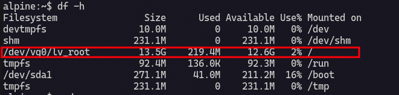
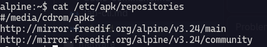
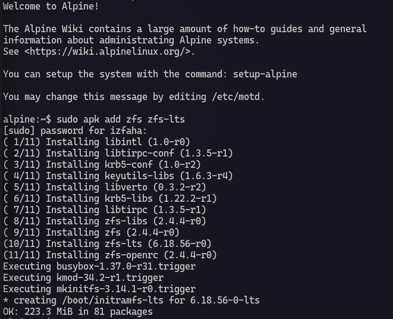

In this night, I try to learn ZFS using method live/rescue means resizing `lv_root` on live. 

| File system (lv name)| Location (lv path) | Description |
| ----- | ----- | ----- |
| lv_root | /dev/vg0/lv_root | this is root partition |
| lv_swap | /dev/vg0/lv_swap | this is swap partition |



:::warning[DISCLAIMER]
I install alpine using LVS filesystem and formated as ext4, in this case `sda2` as `/` and `sda1` as `/boot`.
:::

What I implement is from [zfs documentation](https://openzfs.github.io/openzfs-docs/Getting%20Started/Alpine%20Linux/index.html) If you are experiencing an error while following my instruction just hit zfs docs.

## Installing zfs

In advance, you need to make sure that you have uncomment community repository on `/etc/apk/repository`.



Then install ZFS :

```
apk add zfs zfs-lts
```



Load zfs kernel :

```
modprobe zfs
```

After hitting the command you see no thing means that fine no error occure.

